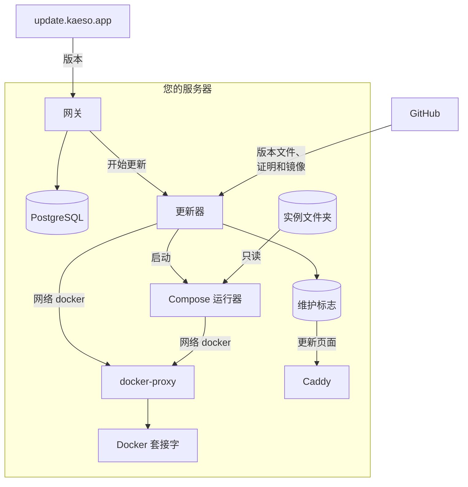

网关发现新版本并请求更新器应用；更新器验证版本并替换容器。[升级](../../self-hosting/upgrades.md)介绍运维人员看到的内容。本页介绍各部分之间的协议及其背后的检查。



## 版本源

`update.kaeso.app` 是在本仓库之外运行的服务，读取 GitHub 上的版本。`v1/releases.json` 以 GitHub 版本 API 的格式列出最新的版本，并始终包含最新的稳定版。该服务把说明截断到 64 KiB，并让整个文件小于 3 MiB，因为网关最多读取 4 MiB。每个版本的 `release.json` 逐字节镜像到 `download/v<version>/` 下，因为网关只从其版本源自身的源获取清单。

每个条目还带有 `art`，即 update.kaeso.app 为该版本一次性选定并永久保留的配图。它由一种风格、一套调色板和一个种子组成，由 UI 库的 `ReleaseArt` 绘制。网关把它为某个版本看到的第一个 `art` 存入 `update_releases.art`，之后从不替换。`me/whats-new` 返回它，版本没有配图时控制台根据版本号绘制一幅。

`v1/releases.json` 的每个响应（包括 `304`）都带有 `Kaeso-Stars` 头，即 logicplanes/kaeso 在 GitHub 上的星标数。网关在内存中保留最近一次成功检查得到的数字，并在 `instance/updates` 中以 `github_stars` 返回。没有该头时（例如来自镜像站点），它为 `null`。**实例** › **更新**从 100 个星标起在**在 GitHub 上加星标**旁显示它。

## 网关

`services/updates.rs` 和 `update_check` 任务负责查找新版本。该任务每分钟询问一次下一次检查是否到期（`update_settings.next_check_at`）。

- **列表。** 一次检查带着 `If-None-Match` 获取 `releases_url?per_page=50`，并沿着下一页链接继续，最多十页，因为版本源不按版本顺序列出版本。列表有变化时，在一个事务中替换 `update_releases`。
- **清单。** 对每个比当前运行版本更新的版本，检查会获取并保存它的 `release.json`，或者保存无法获取的原因。每次检查最多获取十二份，同时获取四份，从最新的开始。清单只从 `https://github.com/logicplanes/kaeso/releases/download/` 获取，使用镜像时则从 `updates.releases_url` 的源获取，而且客户端从不跟随从 HTTPS 到 HTTP 的重定向。
- **时间。** `update_check` 任务每分钟运行一次，下一次检查在 5 分钟后，再加上一分钟内的随机时间，使各个实例不会同时请求。失败后至少隔 15 分钟，如果更新源的 `Retry-After` 或 GitHub 的 `x-ratelimit-reset` 要求更晚则更晚。但间隔从不超过一小时（`MAX_WAIT`），这是 GitHub 每小时速率限制最长会要求的时间。在此之前，`update_settings.blocked_until` 会推迟该任务的检查。实例管理员通过 `instance/updates/check` 发起的检查最多只在上次检查后等待一分钟。这样更新源无法阻止它，反复点击也不会频繁请求更新源。旧版本保存的等待时间同样最多算一小时。发生 panic 的任务算作失败，并在下一轮再次运行。
- **自动更新。** 当 `update_settings.mode` 为 `automatic` 时，同一个任务用 `kaeso_update::schedule` 计算更新窗口。窗口是实例 IANA 时区中的那个整点，通过 `jiff` 及其内置的时区数据计算，因此夏令时会让它移动。在窗口的那一小时内，如果上次成功检查已超过一小时且下一次检查已到期，任务会检查新版本。如果到目标版本的上一个任务以 `rolled_back`、`rollback_failed` 或 `needs_attention` 结束，任务会跳过该版本。否则它像 `apply` 一样启动计划的目标版本，设置 `update_jobs.automatic`，且不关联用户，并在同一个事务中于 `update_settings.auto_window_at` 占用该窗口，因此一个窗口最多启动一次更新。在此之前，该小时内的每次运行都会重试。更改模式或窗口会把 `auto_window_at` 设为当前时间，因此更改永远不会立即启动更新。

`kaeso_update::policy::plan` 决定提供哪个版本：所选通道上比当前运行版本更新的最新版本。版本源标记为预发布的版本一律算作预发布，无论其版本号如何。遇到新的主版本、任何被跨过的版本清单中有 `manual: true`，或者缺少清单时，该更新需要手动操作。目标版本的 `manual_since` 也会计入，因此即使网关从未见过某个被跨过的版本，更新仍会被标记为需要手动操作。该计划还需要目标版本和每个被跨过版本中最高的 `updater_protocol`，因为被跨过版本对 `compose.yaml` 的修改也包含在目标版本中。支持的协议低于此值或低于网关自身协议的更新器为 `outdated`，控制台会显示安装脚本的命令。

`update_jobs` 保存每次更新，一个唯一索引保证同一时间只有一行处于 `running`。`apply` 在调用更新器之前先提交这一行：

- 更新器拒绝（除 `202` 外的任何应答）或无法连接时，这一行立即以 `failed` 结束，原因为 `updater_refused` 或 `updater_unreachable`。
- 请求已发出但没有收到明确的应答时，这一行保持 `running`，由更新器自己的记录决定结果。
- 这一行运行期间，每次读取都会向更新器查询状态，并只记录一次结束，通常由替换后的新网关记录。
- 开始两分钟后更新器仍不知道的任务以 `interrupted` 结束。更新器一小时内都没有应答的任务以 `updater_unreachable` 结束。

## 版本附带的内容

Release 工作流构建 `kaeso-gateway`、`kaeso-console` 和 `kaeso-updater`，并为它们的构建来源生成证明。随后它写出 `release.json`（`scripts/release-manifest.mjs`），由一个只能看到这个文件的作业为它生成证明。同一步骤还写出该版本的 `compose.yaml`：即 `deploy/compose.yaml`，其中每个 Kaeso 镜像都固定到版本及其索引的摘要，例如 `ghcr.io/logicplanes/kaeso-gateway:1.4.2@sha256:…`。`release.json` 写明这个文件的哈希。

只有当 `release.json` 和每个镜像都能用 `gh attestation verify` 针对 `refs/heads/prod` 上的这个工作流以及 `release.json` 指明的提交通过验证时，才会创建版本：

```json
{
  "schema": 1,
  "version": "1.4.2",
  "commit": "5388ad0b98aa3d957fea99e200259842bf746680",
  "manual": false,
  "manual_since": "1.3.0",
  "updater_protocol": 2,
  "images": {
    "gateway": {
      "name": "ghcr.io/logicplanes/kaeso-gateway",
      "digest": "sha256:…"
    },
    "console": {
      "name": "ghcr.io/logicplanes/kaeso-console",
      "digest": "sha256:…"
    },
    "updater": {
      "name": "ghcr.io/logicplanes/kaeso-updater",
      "digest": "sha256:…"
    }
  },
  "compose": { "name": "compose.yaml", "sha256": "…" },
  "migrations": {
    "postgres": "20261017140001_updates",
    "clickhouse": "0002_usage_rollups"
  }
}
```

| 字段 | 含义 |
| --- | --- |
| `commit` | Release 工作流运行所在的提交，也是证明中指明的提交，而不是其上的版本提交（[提交与证明](../releasing.md#提交与证明)） |
| `manual` | 工作流的 **manual** 输入为真，或者按 `yaml` 包解析两个文件后，`docker-proxy` 服务或 `docker` 网络与上一个版本不同时为真 |
| `updater_protocol` | 该版本需要的更新器协议。自更新器能应用 `compose.yaml` 并替换自身起，每个版本都为 2 |
| `manual_since` | 截至本版本最新的 `manual: true` 版本，从上一个版本的 `release.json` 继承 |
| `migrations` | 该版本最新的 PostgreSQL 和 ClickHouse 迁移 |

`kaeso_update::manifest` 解析该文件，拒绝其他 schema，并检查每个名称、摘要、迁移、`manual_since` 和提交。

## 更新器

`crates/kaeso-updater` 是一个运行在 8081 端口的小型服务器。`GET /healthz` 不需要令牌；`GET /v1/status`、`POST /v1/updates`（`{ "id", "version" }`）和 `GET /v1/updates/{id}` 需要带共享令牌的 `Authorization: Bearer`。它一次只执行一个更新，并把状态保存在 `/state/job.json` 中，每次变化后以原子方式写入。一次更新依次执行这些步骤（`engine.rs`）：

1. **验证。** 它先下载并验证 `release.json`，然后根据它检查正在运行的实例（[检查项](#更新器检查的内容)）。它在 `/state` 中保存本地 `compose.yaml` 的副本。如果该文件换上新镜像版本和摘要后与版本中的文件逐字节相同，本次更新就切换容器。否则就应用版本中的文件：它验证当前运行版本的 `release.json`，据此检查该版本的 `compose.yaml`，并要求本地文件与之相同，带不带摘要均可。
2. **下载。** 它按摘要拉取三个镜像，每个镜像的版本标签都必须与该版本一致。它以同样的方式验证当前运行版本的 `release.json` 并比较迁移。两者不同或无法获取该清单时，本次更新视为会迁移数据库。拉取镜像需要多久就可以持续多久，但 Docker 连续 2 分钟没有报告进度时会结束。要应用文件时，它随后写入新的 `compose.yaml` 并运行 `pull` 任务。
3. **切换。** 它写入维护标志。然后先控制台、再网关，停止容器，将其重命名为 `…-previous`，并按旧容器的设置创建新容器（`clone.rs`）。旧镜像带来的一切都会被丢弃，所以新镜像的环境变量、命令和健康检查生效。要应用文件时，则改由 `stop` 任务停止每个网关和控制台容器。
4. **迁移。** 它等待每个健康检查：控制台 2 分钟，网关的迁移 10 分钟，期限到时仍在等待的 Docker 调用也包括在内。崩溃、重启或容器停止会立即失败。要应用文件时，`up` 任务启动新配置并最多等待 10 分钟。
5. **上线。** 如果 `compose.yaml` 仍是它检查过的那份，它就写入新版本号和摘要，然后给镜像打标签，删除旧容器并清除维护标志。保存更新的结束状态后，它启动 `replace` 任务，不等待其完成。

切换之前的失败不会改变任何东西（`failed`）；如果更新已经写入新的 `compose.yaml`，会放回旧文件。切换之后的失败会重新启动旧容器并等待它们（`rolled_back` 或 `rollback_failed`）。如果更新应用了文件，回滚会写回旧文件，并用它运行 `stop` 和 `up`。

如果新网关可能已经迁移了数据库，则不做任何恢复：新的网关和控制台保留，更新以 `needs_attention` 结束。无法删除维护标志或 `…-previous` 容器时也是如此。如果 `compose.yaml` 无法写入或在更新期间被修改，更新仍以 `succeeded` 结束，原因为 `compose_unwritable` 或 `compose_changed`。

其他每个 Docker 调用都有各自的时限：报告版本、列出、检查、启动或重命名为 30 秒，停止为停止宽限期加 15 秒，创建、打标签或删除为 10 分钟。

启动时，更新器最多等待 Docker 两分钟。然后它等待之前遗留的每个 compose 运行器结束，并删除它们。它会完成处于 `online` 的更新，完成新网关变为健康的更新，并回滚其他所有更新。对于应用了文件的更新，如果其 `up` 任务正常结束就完成更新；如果新网关可能已经迁移了数据库，就再次运行 `up`；否则回滚。

### Compose 运行器

Docker Compose 不能在更新器自己的容器中运行：重建更新器会终止它。对于修改了 `compose.yaml` 的版本，以及替换自身时，更新器通过代理创建一个容器，用该版本已验证的更新器镜像运行 `kaeso-updater compose <task>`（`runner.rs`）。该镜像带有一个固定版本的静态 Docker Compose 程序。

- 它以 `0:0` 运行，除 `DAC_READ_SEARCH` 外放弃所有 capability，以便读取安装用户的 `.env` 和 `compose.override.yaml`；它带有 `no-new-privileges`、只读根文件系统、256 MiB 内存和 128 个进程的限制。
- 它以只读方式把 `KAESO_DIR` 挂载到相同路径并在那里工作，这样 `compose.yaml` 中的相对路径会解析为代理检查的宿主机路径。如果没有设置 `KAESO_DIR`，或者它不是更新器自己的 `compose.yaml` 所在的文件夹，更新器就不会启动运行器（`install_unknown`）。
- 它只加入 `docker` 网络，使用代理的 `-allowfrom` 中列出的别名 `updater-runner`，并通过 `tcp://docker-proxy:2375` 访问 Docker。它不指定 API 版本，因此 Compose 会协商出与手动运行 `docker compose` 时相同的版本，写入的镜像标签也会一致。
- `guard.rs` 拒绝为它设置任何其他参数，并用一个标签指明它所属的更新。

更新器轮询运行器直到它退出，保留其日志的最后几行作为失败详情，然后删除它。运行超过时限的运行器会被删除，其任务失败。各任务以明确列出的服务运行 Docker Compose（`compose_cli.rs`）：

| 任务 | 运行 | 服务 |
| --- | --- | --- |
| `pull` | `pull --quiet --policy missing` | 除 `updater`、`updater-init` 和 `docker-proxy` 外的每个服务；它会拒绝未按摘要固定的镜像，因为代理不允许 Compose 查看这类镜像 |
| `stop` | `stop gateway console` | 每个网关副本和控制台 |
| `up` | `up --detach --wait --wait-timeout 600` | 与 `pull` 相同 |
| `replace` | `up --detach --no-deps --wait` | 除网关和控制台外每个使用 Kaeso 镜像的服务，例如更新器和 Caddy |

`replace` 不包含网关和控制台，因为它们已经在运行：切换它们的更新是自己创建的容器，标签中仍是旧的配置哈希，所以之后在实例文件夹中运行 `docker compose up -d` 时会把它们重建一次。

更新器只通过 `http://docker-proxy:2375/` 访问 Docker，`compose.yaml` 中的允许列表列出了它和运行器用到的每个路径，适用于 1.44 及以上的任何 API 版本：

- `HEAD` 可以访问 `/_ping`。
- `GET` 可以访问版本、容器列表、按短 ID 或完整 ID 指定的容器、按完整 ID 指定的容器日志、按 ID 或固定了摘要的名称指定的镜像，以及网络和卷的列表或按名称指定的网络和卷。
- `POST` 可以访问 `images/create`、为按摘要指定的 Kaeso 镜像打标签、`containers/create`、按完整 ID 启动、停止和重命名容器，以及 `networks/create` 和 `volumes/create`。
- `PUT` 可以访问按完整 ID 指定的容器的 `archive`，Compose 用它把 `configs` 复制进容器。
- `DELETE` 按完整 ID 删除容器。

代理还只允许来自 `KAESO_DIR`（即 `.env` 中写明的实例文件夹）的绑定挂载，并拒绝 `VolumesFrom`。未设置 `KAESO_DIR` 时代理不会启动，因为空值会允许所有绑定挂载。

代理只匹配路径而不匹配查询参数，因此无法把 `images/create` 限制为 Kaeso 的镜像。它也无法读取 `containers/create` 请求体的其余部分，例如特权、capabilities、设备或宿主机命名空间。运行器还可以把文件复制进任何容器。查看容器会显示其环境变量，因此更新器可以读取任何容器的密码。因此更新器相当于宿主机的 root 权限，需要主动开启。修改 `compose.yaml` 的版本可以在这些限制内随意配置实例，所以应用文件时信任的是该版本的签名。

`docker-proxy` 无法通过它自己重建，因此当代理的服务或其网络发生变化时，`scripts/release-manifest.mjs` 会把该版本标记为需要手动操作。

`guard.rs` 会在每个请求体发出前检查它。新容器必须沿用被替换容器的名称，以及每个可能放宽容器权限的 `HostConfig` 字段。这些字段涵盖：

- 特权和 capabilities
- 设备、命名空间和网络
- 挂载、`ReadonlyRootfs`、`Tmpfs`、`MaskedPaths` 和 `ReadonlyPaths`
- 发布的端口和名称解析（`ExtraHosts`、`Dns`、`Links`）
- `GroupAdd` 和 `CgroupParent`
- 资源限制（`Memory`、`PidsLimit`、`Ulimits`）
- `Init` 和 `LogConfig`

拉取必须按摘要指定 Kaeso 的镜像，compose 运行器必须恰好使用上述设置。这些检查用于拦截更新器自身的错误，而不是拦截控制了更新器的人。

### 更新器检查的内容

除非以下各项全部成立，否则 `verify.rs` 会拒绝更新：

- 更新器支持该版本的 `updater_protocol`。
- 对于修改了 `compose.yaml` 的版本，本地文件是当前运行版本自带的文件，其哈希值由该版本已验证的 `release.json` 指明，并且 `KAESO_DIR` 是该文件所在的文件夹。
- 它能根据自身容器的标签找到所属 Compose 项目的网关和控制台容器，并且没有以前更新留下的 `…-previous` 容器。
- 当前运行版本（来自网关镜像的 `org.opencontainers.image.version`）比该版本旧，且该版本不是新的主版本。
- `manual` 和 `manual_since` 都没有要求在当前运行版本之后进行手动操作。
- 从 `api.github.com/repos/logicplanes/kaeso/attestations/sha256:…` 获取的每份证明都是 Sigstore bundle，并由 [sigstore-rs](https://github.com/sigstore/sigstore-rs) 根据 `data/trusted_root.json` 中的信任根验证。这涵盖到 Fulcio 的证书链、SCT、DSSE 签名和透明日志条目。
- 证书指明 `https://github.com/logicplanes/kaeso/.github/workflows/release.yml@refs/heads/prod`，由 `https://token.actions.githubusercontent.com` 签发。
- 日志的签名条目时间戳能用 Rekor 密钥验证，这一步由更新器自己完成。没有签名条目时间戳的 bundle（Rekor v2 就是这样写的）会被拒绝，并附上说明这一点的消息。
- 每个 Fulcio 证书颁发机构、CT 日志和 Rekor 密钥只在信任根中的 `validFor` 范围内、以条目的集成时间为准生效。
- in-toto 声明是针对主体名称和摘要的 SLSA provenance v1，来自该工作流和 `release.json` 指明的提交。对镜像而言，主体是按摘要从 `ghcr.io` 获取的镜像索引。

## 边缘

Caddy 从 `maintenance` 卷读取维护标志。标志存在时，每个请求都会立即得到维护应答；否则，网关或控制台返回 `502`、`503` 或 `504` 时才会得到它。

`/kaeso-maintenance.json` 提供该标志，例如 `{"state":"updating","step":"migrating"}`，这样页面能说出当前步骤。该页面内联在 `compose.yaml` 中，其内容安全策略按哈希只允许它自己的样式和脚本。`crates/kaeso-server/tests/edge.rs` 检查 JSON 应答与 `ApiError` 和 `kaeso_codecs::dispatch::encode_error` 生成的内容一致，并检查哈希匹配。

## 测试

| 位置 | 内容 |
| --- | --- |
| `crates/kaeso-update` | 版本标签、通道、包含主版本、手动步骤、预发布和所需协议的计划、清单和协议 |
| `crates/kaeso-server/tests/updates.rs` | 网关对接模拟的 GitHub 和更新器：条件请求、退避及其一小时上限、清单、权限、审计日志、单一更新锁以及每种结束方式 |
| `crates/kaeso-updater/tests/verify.rs` | Kaeso 0.1.0 的真实证明能通过验证；换成其他镜像、提交、工作流、签名或日志条目则不能 |
| `crates/kaeso-updater/src/guard.rs` | 在会放宽权限的 `HostConfig` 字段上与被替换容器不同的容器、其他名称和其他镜像都会被拒绝，设置更宽的 compose 运行器也会被拒绝 |
| `crates/kaeso-updater/src/compose_cli.rs` | 每个任务对接模拟程序时的 Docker Compose 命令，以及被拒绝的未固定摘要的镜像 |
| `crates/kaeso-updater/tests/engine.rs`、`server.rs` | 更新器对接模拟的 Docker API 和模拟的 compose 运行器：完整更新、应用新的 `compose.yaml`、每种拒绝、回滚、永不结束的运行器、每一步的重启、自我替换、状态文件和 API |
| `scripts/release-manifest.test.mjs` | 清单、固定版本的 `compose.yaml`、修改过的 `docker-proxy`、`manual_since`、最新的迁移和提交 |
| `e2e/install` | 启用了 updater profile 的实例、代理及其允许列表、通过代理应用修改过的 `compose.yaml` 的 compose 运行器、被拒绝的实例目录之外的绑定挂载，以及 Kaeso 不可用时 Caddy 以各种格式给出的应答 |
| `apps/console` | 各种状态下的更新页面，以及三种语言的更新中页面 |
