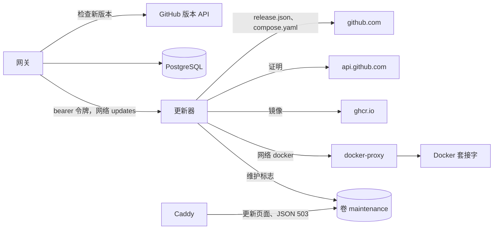

网关发现新版本并请求更新器应用；更新器验证版本并替换容器。[升级](../../self-hosting/upgrades.md)介绍运维人员看到的内容。本页介绍各部分之间的协议及其背后的检查。



## 网关

`services/updates.rs` 和 `update_check` 任务负责查找新版本。该任务每五分钟询问一次下一次检查是否到期（`update_settings.next_check_at`）。

- **列表。** 一次检查带着 `If-None-Match` 获取 `releases_url?per_page=50`，并沿着 GitHub 的下一页链接继续，最多十页，因为 GitHub 不按版本顺序列出版本。列表有变化时，在一个事务中替换 `update_releases`。
- **清单。** 对每个比当前运行版本更新的版本，检查会获取并保存它的 `release.json`，或者保存无法获取的原因。每次检查最多获取十二份，同时获取四份，从最新的开始。清单只从 `https://github.com/logicplanes/kaeso/releases/download/` 获取，使用镜像时则从 `updates.releases_url` 的源获取，而且客户端从不跟随从 HTTPS 到 HTTP 的重定向。
- **时间。** 下一次检查在 12 小时后，再加上一小时内的随机时间。失败后至少隔一小时，如果 GitHub 的 `Retry-After` 或 `x-ratelimit-reset` 要求更晚则更晚。在此之前，`update_settings.blocked_until` 也会阻止 **立即检查** 发起请求。

`kaeso_update::policy::plan` 决定提供哪个版本：所选通道上比当前运行版本更新的最新版本。GitHub 标记为预发布的版本一律算作预发布，无论其版本号如何。遇到新的主版本、任何被跨过的版本清单中有 `manual: true`，或者缺少清单时，该更新需要手动操作。目标版本的 `manual_since` 也会计入，因此即使网关从未见过某个被跨过的版本，更新仍会被标记为需要手动操作。

`update_jobs` 保存每次更新，一个唯一索引保证同一时间只有一行处于 `running`。`apply` 在调用更新器之前先提交这一行：

- 更新器拒绝（除 `202` 外的任何应答）或无法连接时，这一行立即以 `failed` 结束，原因为 `updater_refused` 或 `updater_unreachable`。
- 请求已发出但没有收到明确的应答时，这一行保持 `running`，由更新器自己的记录决定结果。
- 这一行运行期间，每次读取都会向更新器查询状态，并只记录一次结束，通常由替换后的新网关记录。
- 开始两分钟后更新器仍不知道的任务以 `interrupted` 结束。更新器一小时内都没有应答的任务以 `updater_unreachable` 结束。

## 版本附带的内容

Release 工作流构建 `kaeso-gateway`、`kaeso-console` 和 `kaeso-updater`，并为它们的构建来源生成证明。随后它写出 `release.json`（`scripts/release-manifest.mjs`），由一个只能看到这个文件的作业为它生成证明。只有当 `release.json` 和每个镜像都能用 `gh attestation verify` 针对 `refs/heads/prod` 上的这个工作流以及 `release.json` 指明的提交通过验证时，才会创建版本：

```json
{
  "schema": 1,
  "version": "1.4.2",
  "commit": "5388ad0b98aa3d957fea99e200259842bf746680",
  "manual": false,
  "manual_since": "1.3.0",
  "updater_protocol": 1,
  "images": {
    "gateway": { "name": "ghcr.io/logicplanes/kaeso-gateway", "digest": "sha256:…" },
    "console": { "name": "ghcr.io/logicplanes/kaeso-console", "digest": "sha256:…" },
    "updater": { "name": "ghcr.io/logicplanes/kaeso-updater", "digest": "sha256:…" }
  },
  "compose": { "name": "compose.yaml", "sha256": "…" },
  "migrations": { "postgres": "20261017140001_updates", "clickhouse": "0002_usage_rollups" }
}
```

| 字段 | 含义 |
| --- | --- |
| `commit` | Release 工作流运行所在的提交，也是证明中指明的提交，而不是其上的版本提交 |
| `manual` | 工作流的 **manual** 输入为真，或者 `compose.yaml` 与上一个版本相比除镜像版本外还有其他差异时为真 |
| `manual_since` | 截至本版本最新的 `manual: true` 版本，从上一个版本的 `release.json` 继承 |
| `migrations` | 该版本最新的 PostgreSQL 和 ClickHouse 迁移 |

`kaeso_update::manifest` 解析该文件，拒绝其他 schema，并检查每个名称、摘要、迁移、`manual_since` 和提交。

## 更新器

`crates/kaeso-updater` 是一个运行在 8081 端口的小型服务器。`GET /healthz` 不需要令牌；`GET /v1/status`、`POST /v1/updates`（`{ "id", "version" }`）和 `GET /v1/updates/{id}` 需要带共享令牌的 `Authorization: Bearer`。它一次只执行一个更新，并把状态保存在 `/state/job.json` 中，每次变化后以原子方式写入。一次更新依次执行这些步骤（`engine.rs`）：

1. **验证。** 它先下载并验证 `release.json`，然后根据它检查正在运行的实例（[检查项](#更新器检查的内容)）。它还检查本地 `compose.yaml` 换上新镜像版本后与版本中的文件逐字节相同，并在 `/state` 中保存一份副本。
2. **下载。** 它按摘要拉取三个镜像，每个镜像的版本标签都必须与该版本一致。它以同样的方式验证当前运行版本的 `release.json` 并比较迁移。两者不同或无法获取该清单时，本次更新视为会迁移数据库。
3. **切换。** 它写入维护标志。然后先控制台、再网关，停止容器，将其重命名为 `…-previous`，并按旧容器的设置创建新容器（`clone.rs`）。旧镜像带来的一切都会被丢弃，所以新镜像的环境变量、命令和健康检查生效。
4. **迁移。** 它等待每个健康检查：控制台 2 分钟，网关的迁移 10 分钟。崩溃、重启或容器停止会立即失败。
5. **上线。** 如果 `compose.yaml` 仍是它检查过的那份，它就写入新版本号，然后给镜像打标签，删除旧容器并清除维护标志。

切换之前的失败不会改变任何东西（`failed`）。切换之后的失败会重新启动旧容器并等待它们（`rolled_back` 或 `rollback_failed`）。如果新网关可能已经迁移了数据库，则不做任何恢复：新的网关和控制台保留，更新以 `needs_attention` 结束。无法删除维护标志或 `…-previous` 容器时也是如此。如果 `compose.yaml` 无法写入或在更新期间被修改，更新仍以 `succeeded` 结束，原因为 `compose_unwritable` 或 `compose_changed`。

启动时，更新器最多等待 Docker 两分钟。然后它会完成处于 `online` 的更新，完成新网关变为健康的更新，并回滚其他所有更新。

更新器只通过 `http://docker-proxy:2375/v1.44/` 访问 Docker，`compose.yaml` 中的允许列表列出了它用到的每个路径。代理只按方法和路径过滤，`containers/create` 的请求体由更新器决定。因此更新器相当于宿主机的 root 权限，需要主动开启。

### 更新器检查的内容

除非以下各项全部成立，否则 `verify.rs` 会拒绝更新：

- 更新器支持该版本的 `updater_protocol`。
- 它能根据自身容器的标签找到所属 Compose 项目的网关和控制台容器，并且没有以前更新留下的 `…-previous` 容器。
- 当前运行版本（来自网关镜像的 `org.opencontainers.image.version`）比该版本旧，且该版本不是新的主版本。
- `manual` 和 `manual_since` 都没有要求在当前运行版本之后进行手动操作。
- 从 `api.github.com/repos/logicplanes/kaeso/attestations/sha256:…` 获取的每份证明都是 Sigstore bundle，并由 [sigstore-rs](https://github.com/sigstore/sigstore-rs) 根据 `data/trusted_root.json` 中的信任根验证。这涵盖到 Fulcio 的证书链、SCT、DSSE 签名和透明日志条目。
- 证书指明 `https://github.com/logicplanes/kaeso/.github/workflows/release.yml@refs/heads/prod`，由 `https://token.actions.githubusercontent.com` 签发。
- 日志的签名条目时间戳能用 Rekor 密钥验证，这一步由更新器自己完成。没有签名条目时间戳的 bundle（Rekor v2 就是这样写的）会被拒绝，并附上说明这一点的消息。
- 每个 Fulcio 证书颁发机构、CT 日志和 Rekor 密钥只在信任根中的 `validFor` 范围内、以条目的集成时间为准生效。
- in-toto 声明是针对主体名称和摘要的 SLSA provenance v1，来自该工作流和 `release.json` 指明的提交。对镜像而言，主体是按摘要从 `ghcr.io` 获取的镜像索引。

## 边缘

Caddy 从 `maintenance` 卷读取维护标志。标志存在时，每个请求都会立即得到维护应答；否则，网关或控制台返回 `502`、`503` 或 `504` 时才会得到它。`/kaeso-maintenance.json` 提供该标志，例如 `{"state":"updating","step":"migrating"}`，这样页面能说出当前步骤。该页面内联在 `compose.yaml` 中，其内容安全策略按哈希只允许它自己的样式和脚本。`crates/kaeso-server/tests/edge.rs` 检查 JSON 应答与 `ApiError` 和 `kaeso_codecs::dispatch::encode_error` 生成的内容一致，并检查哈希匹配。

## 测试

| 位置 | 内容 |
| --- | --- |
| `crates/kaeso-update` | 版本标签、通道、包含主版本、手动步骤和预发布的计划、清单和协议 |
| `crates/kaeso-server/tests/updates.rs` | 网关对接模拟的 GitHub 和更新器：条件请求、退避、清单、权限、审计日志、单一更新锁以及每种结束方式 |
| `crates/kaeso-updater/tests/verify.rs` | Kaeso 0.1.0 的真实证明能通过验证；换成其他镜像、提交、工作流、签名或日志条目则不能 |
| `crates/kaeso-updater/tests/engine.rs`、`server.rs` | 更新器对接模拟的 Docker API：完整更新、每种拒绝、回滚、每一步的重启、状态文件和 API |
| `scripts/release-manifest.test.mjs` | 清单、`manual_since`、最新的迁移和提交 |
| `e2e/install` | 启用更新器配置的实例、代理，以及 Kaeso 不可用时 Caddy 以各种格式给出的应答 |
| `apps/console` | 各种状态下的更新页面，以及三种语言的更新中页面 |
