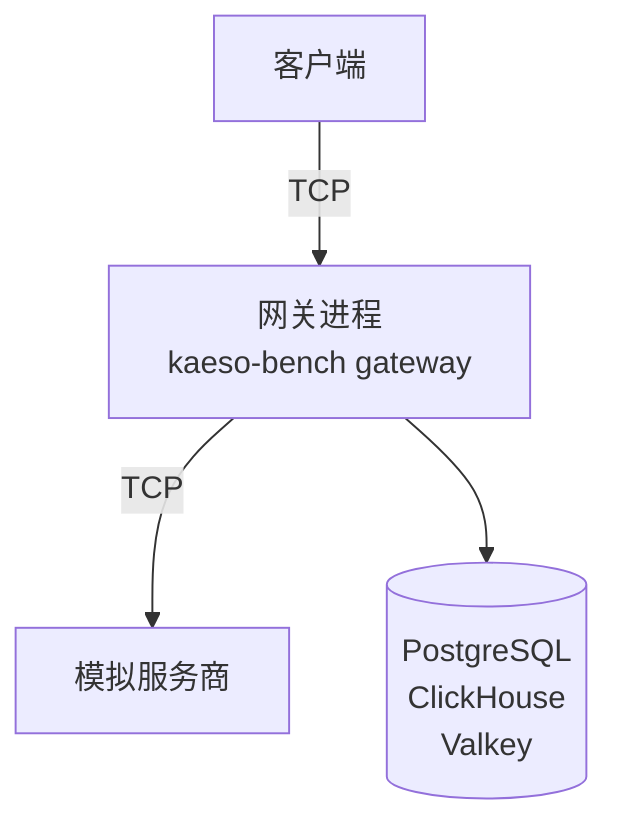

基准测试让完整的网关运行在真实客户端和模拟服务商之间，因此每个数字只反映 Kaeso 自身。先启动[开发栈](stack.md)，然后以完整规模运行所有场景：

```bash
cargo run --release -p kaeso-bench
```

它会打印一张表格，并写出 `target/bench/report.md`、`target/bench/report.json` 以及网关日志 `target/bench/gateway.log`。

## 工作原理

基准测试在开发栈上创建全新的数据库，启动 `kaeso-testkit` 中的模拟服务商，并在独立进程中启动网关。客户端和模拟服务商共用基准测试的进程。每个请求在网关两侧都经过真实的套接字：



- **网关**的运行方式与 `kaeso serve` 相同，使用同样的路由、连接处理、限额、请求日志和指标。每个场景开始前它都会换成一个全新的进程，并用 50 个请求和 8 个流预热。
- **请求路径**是大多数应用走的那条：客户端以 OpenAI Chat Completions 格式为 `gpt-4o` 调用 `POST /v1/chat/completions`。Kaeso 把每个请求转换为 OpenAI Responses 格式发给模拟服务商，再把每个回复转换回来。
- **模拟服务商**立即写出回复的第一个数据块，之后按固定间隔写出其余数据块，默认间隔为 100 ms。每个数据块含四个 token，即每个流每秒 40 个 token。
- **客户端**为每个流打开一个连接，同时最多打开 100 个。它们以重置方式关闭连接，这样运行数千个流也不会耗尽本地端口。

## 运行

以下选项用于选择场景及其规模；不指定时，运行所有场景并使用默认值：

| 选项 | 默认值 | 设置 |
| --- | --- | --- |
| `--scenarios` | 全部五个 | 要运行的场景，以逗号分隔：`baseline`、`streams`、`cancellation`、`slow-clients`、`mixed` |
| `--baseline-requests`、`--baseline-concurrency` | 20,000、64 | 基线中的非流式请求数，以及承载它们的连接数 |
| `--streams` | 100、1,000、5,000 | 并发流的数量，每个数量运行一次 |
| `--gap-ms`、`--chunks` | 100、100 | 模拟服务商两个数据块之间的间隔，以及每个流的数据块数 |
| `--cancel-streams`、`--cancel-share` | 1,000、0.3 | 取消场景中的流数，以及其中断开连接的比例 |
| `--slow-streams`、`--slow-share` | 1,000、0.1 | 慢速客户端场景中的流数，以及其中慢速读取的比例 |
| `--slow-read-every-ms` | 从不 | 慢速客户端在第一个数据块之后多久读取一次 |
| `--idle-timeout-ms` | 5,000 | 网关的 `KAESO_UPSTREAM_STREAM_IDLE_TIMEOUT` |
| `--mixed-streams` | 1,000 | 混合场景中的流数 |
| `--opening` | 100 | 客户端同时打开的流数 |
| `--smoke` | 关闭 | 使用 CI 运行时的小规模 |
| `--out` | `target/bench` | 报告和日志的输出位置 |

例如，测量 2,000 个流、每 10 ms 一个数据块：

```bash
cargo run --release -p kaeso-bench -- \
  --scenarios streams --streams 2000 --gap-ms 10
```

每个流在客户端占用一个套接字，在网关占用两个，在模拟服务商占用一个。运行 5,000 个流之前，先提高打开文件数的上限：

```bash
ulimit -n 65536
```

## 场景

每个场景都从一个全新的网关开始：

| 场景 | 过程 |
| --- | --- |
| 基线 | 客户端以网关能应答的最快速度发送非流式请求 |
| 并发流 | 客户端按每个数量打开流，读取每个数据块后关闭。同样的流也会在没有 Kaeso 的情况下直接对模拟服务商运行一次 |
| 取消 | 一部分流在流的五分之一到五分之四之间的某处断开连接。它们在模拟服务商处的流永远不会自行结束，因此每次断开连接都有一个服务商请求需要关闭。其余的流读到结束 |
| 慢速客户端 | 一部分客户端以很小的接收缓冲区读取第一个数据块后就停止读取，而模拟服务商每毫秒写出一百个文本增量，永不结束。其余客户端正常读取 |
| 混合 | 流、断开连接和慢速客户端同时进行，旁边还有以网关能应答的最快速度发送的非流式请求 |

## 读懂数字

每个时间都以一次运行中所有请求或数据块的百分位数给出：

| 数字 | 含义 |
| --- | --- |
| Requests/s | 网关每秒应答的非流式请求数，包含模拟服务商的时间 |
| Overhead | Kaeso 调用服务商之前自身花费的时间，取自 [`server-timing` 响应头](../api/model-api.md#响应头)中的 `kaeso` 项。从请求到达 Kaeso 的处理程序时开始计时 |
| Latency | 客户端完成一个非流式请求的时间 |
| Added time to first byte | 客户端收到第一个数据块的时间，减去服务商作出应答的时间，即 `server-timing` 中的 `upstream` 项。其中包含开销、Kaeso 处理第一个数据块的工作以及多出的一段连接 |
| Added chunk gap | 经过 Kaeso 时客户端两次读取之间间隔的某个百分位数，减去仅有模拟服务商时的同一百分位数。数值在零附近表示 Kaeso 没有在数据块之间增加延迟 |
| Gateway memory | 用 `ps` 读取的网关进程常驻内存：预热之后、峰值时，以及打开流最多时 |
| Per open stream | 打开流最多时的内存减去预热之后的内存，再除以当时打开的流数 |
| Disconnect to upstream closed | 从客户端重置连接，到模拟服务商看到其流关闭的时间 |
| Ended after the last read | 从慢速客户端最后一次读取，到模拟服务商看到其流关闭的时间。它等于空闲超时，加上模拟服务商填满套接字和 Kaeso 队列所需的片刻 |
| Logged as client_stalled | 停滞的流，由 `kaeso_stream_failures_total{kind="client_stalled"}` 计数 |
| Growth per stream | 峰值内存减去预热之后的内存，再除以该场景的流数 |
| Left open | 场景结束后模拟服务商仍然打开的流 |

如果网关保留停滞应用未读取的所有内容，它会在空闲超时之前随模拟服务商的数据块不断增长。这会表现为每个流的增长远高于没有慢速客户端时每个打开流的内存。

报告还会写明 Kaeso 的版本、提交和构建方式，机器的 CPU、核心数和内存，以及每个参数。请比较同一台机器上用发布构建跑出的结果：客户端和模拟服务商与网关在同一台机器上争用 CPU。

## 检查

只要有一项检查失败，这次运行就失败，命令以错误退出。这些检查只关乎正确性，从不涉及时间：

- 每个请求和每个流都已完成，断开连接或停止读取的除外。
- 每次断开连接都以流关闭的形式到达模拟服务商。
- 每个停滞的流都已结束，Kaeso 把每一个都记录为 `client_stalled`。
- 在部分客户端停止读取期间，网关内存每个流的增长少于 1 MiB。
- 任何场景结束后，模拟服务商都没有仍然打开的流。

`cargo coverage-gateway` 会以 `--smoke` 运行基准测试（`crates/kaeso-bench/tests/smoke.rs`），因此网关的每次变更都会让 CI 以小规模运行每个场景。

## 下一步

- [测试](testing.md)：运行变更必须通过的每一项检查。
- [健康状态和指标](../self-hosting/monitoring.md)：在运行中的实例上观察 Kaeso 的开销。
- [请求流程](../concepts/request-flow.md#失败的流)：了解 Kaeso 如何结束失败或停滞的流。
