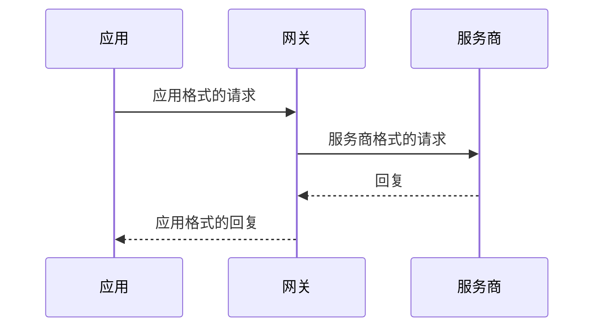

本站的每个页面都是 `apps/docs/content` 中的一个 Markdown 文件，每种语言一个文件夹（`en`、`de`、`zh-CN`），各文件夹中的文件名相同。文档只保存在这里；代码中的 README 保持简短，并链接到这里。如果使用、运行或集成 Kaeso 的人会注意到某个变更，它的拉取请求就要同时更新这些页面。

## 编辑页面

**在 GitHub 上：** 选择任意页面底部的**在 GitHub 上编辑**，或打开 `apps/docs/content` 中的文件，然后针对 `dev` 提出修改。GitHub 渲染页面的效果与本站基本一致，页面之间的链接在那里同样有效。

**在本机上：**

```bash
pnpm build:packages
pnpm --filter kaeso-docs dev
```

站点运行在 http://localhost:4480 ，保存后自动重新加载；终端会指出需要修复的问题。`KAESO_DOCS_PORT` 可以指定其他端口。

| 命令 | 作用 |
| --- | --- |
| `pnpm --filter kaeso-docs check:content` | 不构建站点，检查每个页面的前置元数据、链接、锚点、图片和地址，以及每种语言是否拥有相同的页面和相同的 `order` |
| `pnpm --filter kaeso-docs build` | 把站点构建到 `apps/docs/dist`，然后检查[打包预算](performance.md#文档站点) |
| `pnpm --filter kaeso-docs preview` | 像静态托管那样提供构建结果 |

站点自身的代码像其他包一样经过测试（[测试](testing.md#文档站点)）。

## 页面格式

```markdown
---
title: API keys
description: Create keys for apps and scripts, and keep them under control.
order: 5
---

Every request to the model API carries a **key**.

## Create a key
```

| 字段 | 必填 | 含义 |
| --- | --- | --- |
| `title` | 是 | 页面标题，也是它在侧边栏、搜索和浏览器标签页中的名称 |
| `description` | 是 | 标题下方的一句话，最多 140 个字符；也是搜索引擎和链接预览显示的描述 |
| `order` | 否 | 一个整数，在所在文件夹中越小越靠前。没有该字段或数值相同的页面按文件名排列 |
| `nav` | 否 | 侧边栏中使用的较短标签 |

其他任何字段都会报错。页面标题是页面中唯一的 `#` 标题，因此正文标题从 `##` 开始；为了在 GitHub 上便于阅读，页面仍可以 `# ` 加上完全相同的标题开头，本站只会显示一次。**本页内容**列出 `##` 和 `###` 标题。

## 页面的位置

| 文件 | 地址 | 在侧边栏中 |
| --- | --- | --- |
| `content/en/index.md` | `/` | “Introduction”，排在最前 |
| `content/en/console/index.md` | `/console` | 用它的 `title` 命名分组，用它的 `order` 确定分组位置，并显示为“Overview” |
| `content/en/console/api-keys.md` | `/console/api-keys` | 在该分组中 |
| `content/de/console/api-keys.md` | `/de/console/api-keys` | 同一页面的德语版本 |
| `content/zh-CN/console/api-keys.md` | `/zh-CN/console/api-keys` | 同一页面的简体中文版本 |

文件名就是地址：小写，单词之间用连字符连接（`provider-keys.md`）。重命名或移动文件会改变它在每种语言中的地址，所有指向它的链接都必须随之修改；构建会指出没有更新的链接。分组中的子文件夹需要一个 `index.md`，文件夹最多嵌套三层。名称以 `_` 开头的文件和文件夹不会发布。

## 链接

通过文件链接到其他页面，路径相对于当前页面，与 GitHub 解析链接的方式完全一致：

```markdown
See [rate limits](limits-and-budgets.md#rates) and [the API](../api/index.md).
```

- 锚点就是 GitHub 生成的标题锚点：小写，去掉标点，空格变为连字符。同一页面中的标题写作 `[budgets](#budgets)`。
- 链接到不存在的页面或标题会导致构建失败，并给出文件和链接。
- 不支持引用式链接（`[text][ref]`），它们会显示为文本；请直接写内联链接。
- 其他网站只接受 `http`、`https` 和 `mailto` 地址。仓库中不是页面的文件，请链接到 GitHub（`https://github.com/logicplanes/kaeso/blob/dev/<path>`），或作为代码写出：`crates/kaeso-mail`。

## 图片

把图片放在页面旁边，或旁边的 `images/` 文件夹中，并写上说明图片内容的替代文本：

```markdown

```

支持 PNG、JPEG、GIF、WebP、AVIF 和 SVG。来自其他网站的图片不会显示，没有替代文本的图片会导致构建失败。请选择在浅色和深色背景下都清晰的图片；SVG 可以用 `@media (prefers-color-scheme: dark)` 自行切换颜色。链接 `content/` 中的任何其他文件都会发布该文件。图片从不用来展示图示：图示请写成 [Mermaid 代码块](#图示)。

## README 中的录屏

README 开头是一段控制台的短录屏，分浅色和深色两个版本：`.github/assets/demo-light.gif` 和 `.github/assets/demo-dark.gif`，GitHub 会按读者的主题显示对应的一个。`apps/console/scripts/demo.mjs` 用 Playwright 在开发栈及其种子组织上录制这两个版本，画面里只有模拟服务商、它的占位密钥和种子数据里虚构的人员。脚本在 **服务商** 页面连接一个 Anthropic 密钥，在 **API 密钥** 页面创建一个密钥，从它叠加在页面上的终端面板用这个密钥发送一个请求，然后在开启 **实时** 的 **请求日志** 页面等待这个请求出现。

重新录制时，先准备一个刚填充过种子数据的栈并运行控制台，并事先安装 `ffmpeg`，例如用 `brew install ffmpeg`：

```bash
pnpm stack:down
pnpm stack:up
pnpm seed
pnpm dev
```

然后在第二个终端里运行：

```bash
pnpm demo
```

脚本以 1280 × 800、设备缩放比例 2 录制，把画面转成每秒 20 帧、各用一个调色板的 GIF，写入 `.github/assets` 并输出它们的大小；每个都应小于 4 MB。在已经录制过的栈上也能再次运行：它会先删除 Anthropic 密钥并归档自己的密钥，但之前的请求仍留在日志里。README 链接的是 `dev` 上的 GIF，因此新的录屏在其拉取请求合并后才会显示。

## 提示块

使用 GitHub 的提示语法，第一行只写类型：

```markdown
> [!NOTE]
> A key's secret is shown once.
```

`NOTE`、`TIP`、`IMPORTANT`、`WARNING` 和 `CAUTION` 各有自己的样式和标题。请谨慎使用。

## 图示

系统、架构、请求或数据流、时序、状态和生命周期的每一张图示都写成 Mermaid 代码块。构建时会以 Kaeso 自己的样式把它绘制成浅色和深色两张图片，并跟随网站的主题切换；读者不会收到任何 Mermaid 代码。图示从不在代码块中用制表符或箭头画出，也从不以截图或图片展示：代码块中用 `─`、`│`、`└`、`▶` 或 `→` 等字符画图会导致构建失败。

````markdown

````

- 选择合适的类型：`flowchart` 表示各部分及其连接，`sequenceDiagram` 表示参与方之间的请求和回复，`stateDiagram-v2` 表示生命周期。`flowchart TD`（从上到下）在手机上也易于阅读；比内容栏更宽的图示会在自己的框内滚动。
- `accTitle:` 用几个词为图示命名，必须填写。`accDescr:` 用一两句话说明它展示了什么；屏幕阅读器会朗读两者，搜索也能连同图示的标签找到它们。
- 标签要简短，使用页面的语言；代码中的名称保持原样。`<br>` 可以把标签分成两行。
- 只在图示确实有帮助时才画；简短的列表或表格往往更清楚。
- 不写 `%%` 注释，也不写 `%%{init}`：网站会根据 Kaeso 的设计令牌设置颜色、字体和圆角。

绘制结果提交在 `apps/docs/diagrams/` 中。`pnpm --filter kaeso-docs diagrams` 用 Chromium 绘制新增和修改过的图示，并删除不再被任何页面使用的图示；开发服务器和 `pnpm build` 也会随时补画缺失的图示。图示在绘制后被修改时，`check:content` 会失败；无法解析的图示会连同文件和行号一起报错。

## 其他语法

页面使用 GitHub 风格的 Markdown：**粗体**、_斜体_、~~删除线~~、`代码`、列表、任务列表、表格（`--:` 列右对齐，用于数字）、引用、分隔线和围栏代码块。代码块注明语言，也可以注明文件：

````markdown
```ts title="support-bot/src/client.ts"
export const client = new OpenAI({ baseURL: "https://kaeso.example.com/v1" });
```
````

TypeScript、TSX、JavaScript、JSON、Bash（`sh`、`shell`、`console`）、Python、YAML 和 diff 会高亮；其他语言显示为纯文本。原始 HTML 不会渲染，而是显示为文本。代码块中从不包含注释：请在代码块前面的句子中解释命令。

当前版本写作 `\{{version}}`。构建会在正文、代码和前置元数据中把它替换为该版本的版本号，因此任何页面都不会落后于下一次发布。在前面加一个反斜杠则保留这些字符本身，就像本页这样。

## 写作

- **按代码的实际行为描述 Kaeso。** 设置以网关的配置为准，界面标签以控制台的英文目录为准，行为以网关、KPP 和控制台为准。绝不记录不存在的功能。
- **描述当前状态。** 计划、待解决的问题和待办事项放到 issue 中。
- **先写读者需要的内容**，每段只讲一个意思。参考数据用表格，步骤用编号列表，需要说明理由时用段落。链接到专门讲解某个主题的页面，而不是重复它的内容。
- **标题采用句子式大小写**，用词平实，句子简短，不用感叹号。
- **控制台标签**加粗，并与控制台显示的完全一致：**API 密钥**、**创建密钥**、**设置** › **实例**。
- **示例**使用 Kaeso 自己的占位符（`kaeso.example.com`、`sk-kso-…`、`owner@example.com`），绝不使用真实的密钥或个人数据。

## 翻译

修改英文页面时，要在同一个拉取请求中同时修改 `content/de` 和 `content/zh-CN`。

- **结构相同：** 相同的文件名、相同的 `order`、顺序相同的相同标题，以及逐字节相同的代码块。翻译标题、描述、正文、表格和提示块。
- **链接**保留其文件；锚点改为译文页面自己的标题锚点。
- **保持不变：** 代码、命令、设置（`KAESO_*`）、路径、字段名、权限（`keys.all.view`）、产品名称和模型 ID。
- **控制台标签**使用控制台自己的译文，见 `apps/console/src/i18n/locales/de` 和 `apps/console/src/i18n/locales/zh-CN`。
- **自然地表达**，不要逐字翻译，并保留每个事实和数字。

写作风格和术语表见[翻译](translations.md#写作风格)。有两条规则对页面尤其重要：

| | 德语 | 简体中文 |
| --- | --- | --- |
| 步骤 | 不定式，动词在后：„Schlüssel erstellen“ | 动词在前：“创建密钥” |
| 描述 | 一句话 | 一句话，以“。”结尾 |

站点自身的文字，例如**在 GitHub 上编辑**或搜索，位于 `apps/docs/src/i18n/messages/en.ts`、`de.ts` 和 `zh-CN.ts` 中，并带有类型，缺少翻译会导致类型检查失败。
