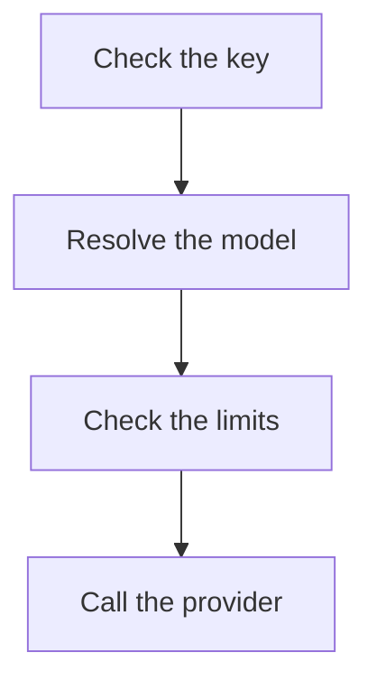
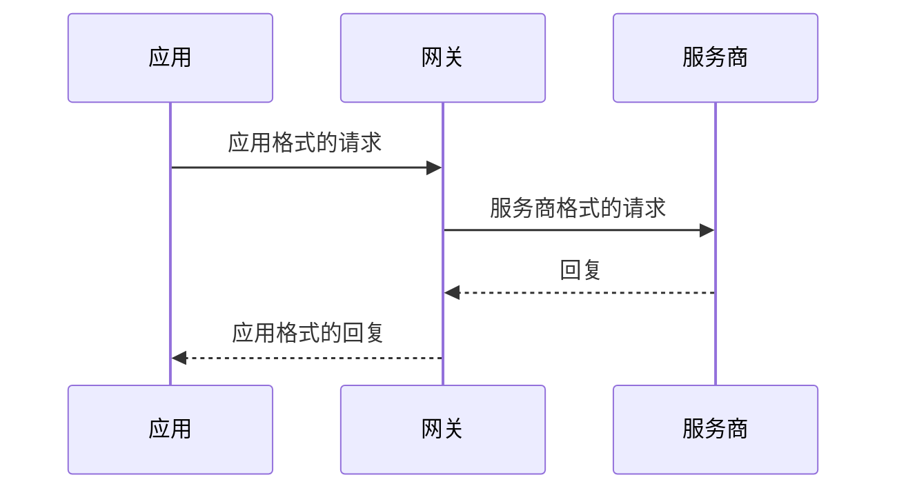

本站的每个页面都是 `apps/docs/content` 中的一个 Markdown 文件，每种语言一个文件夹（`en`、`de`、`zh-CN`），各文件夹中的文件名相同。文档只保存在这里；代码中的 README 保持简短，并链接到这里。如果使用、运行或集成 Kaeso 的人会注意到某个变更，它的拉取请求就要同时更新这些页面。

本页的规则具有约束力。新增或修改页面的拉取请求必须遵守它们，评审时按[检查清单](#合并之前)逐项核对。

## 编辑页面

**在 GitHub 上：** 选择任意页面底部的**在 GitHub 上编辑**，或打开 `apps/docs/content` 中的文件，然后针对 `dev` 提出修改。GitHub 渲染页面的效果与本站基本一致，页面之间的链接在那里同样有效。

**在本机上：**

```bash
pnpm build:packages
pnpm --filter kaeso-docs dev
```

站点运行在 http://localhost:4480 上，保存后自动重新加载；终端会指出需要修复的问题。`KAESO_DOCS_PORT` 可以指定其他端口。

| 命令 | 作用 |
| --- | --- |
| `pnpm --filter kaeso-docs check:content` | 不构建站点，检查每个页面的 frontmatter、链接、锚点、图片和地址，以及每种语言是否拥有相同的页面和相同的 `order` |
| `pnpm --filter kaeso-docs build` | 把站点构建到 `apps/docs/dist`，然后检查 `apps/docs/scripts/budget.ts` 中的打包预算 |
| `pnpm --filter kaeso-docs preview` | 像静态托管那样提供构建结果 |

站点自身的代码像其他包一样经过测试（[测试](testing.md#文档站点)）。

## 页面是否值得存在

页面之所以存在，是因为真实的读者要打开它完成一件事。新增页面之前，以及每次修改页面时，回答四个问题：

1. **谁会读？** 说出读者是谁：在应用中调用模型的人、运行实例的人、使用控制台的人，或修改 Kaeso 代码的人。
2. **它服务于什么任务？** 读者读完后能做成或决定一件具体的事。“了解内部如何运作”只对马上要修改那部分代码的贡献者才算任务。
3. **别处是否已经写过？** 一个主题只有一个页面。两个页面有重叠时，由其中一个讲解，另一个链接过去。
4. **在另一个页面上写一段是否就够了？** 不到约 150 字的页面，或只罗列链接的页面，应并入读者来自的那个页面，成为其中一节。

只要有一个问题回答不了，页面就应删除或合并，而不是精简。只有 CI 才关心的数字和清单，例如打包预算或覆盖率阈值，留在执行它们的代码或配置中；文档只写出检查它们的命令。删除页面时，在三种语言中都删除它，把它的地址连同最相关的页面写进 `apps/docs/redirects.json`（见[页面的位置](#页面的位置)），并修复构建指出的链接。

## 页面类型

每个页面都属于五种类型之一。动笔之前先选定类型：类型决定页面的结构，混合两种类型的页面要拆开。

| 类型 | 读者想要 | 示例 |
| --- | --- | --- |
| 快速开始 | 从头到尾得到第一个可用的结果 | [快速开始](../get-started/quick-start.md) |
| 指南 | 完成一项自己已经知道需要做的任务 | [调用模型](../get-started/calling-models.md) |
| 概念 | 在依赖某个机制之前理解它如何运作 | [请求流程](../concepts/request-flow.md) |
| 参考 | 查找一个确切的事实：端点、设置或错误 | [模型 API](../api/model-api.md) |
| 故障排除 | 修复出了问题的地方 | [故障排除](../self-hosting/troubleshooting.md) |

指南说明如何完成任务，每个选项都链接到参考页面。参考页面列出每个选项，不讲故事。同一张表格绝不同时出现在两类页面上。

文件夹的 `index.md` 是概览页：用一两句话说明本部分涵盖什么，然后是本部分页面的[链接列表](#下一步)，每项配一句话。

### 快速开始

~~~markdown
---
title: Quick start
description: Install Kaeso with Docker Compose, connect a provider and send your first request.
---

Install Kaeso on a server, connect a provider and send your first request through it.

## Before you begin

- A server with Docker Engine and Docker Compose 2.24 or newer.
- An API key from OpenAI or Anthropic.

## Start Kaeso

Start every service and wait until each one is healthy:

```bash
docker compose up -d --wait
```

The command returns once the gateway, the console and the databases are healthy.

## Next steps

- [Calling models](calling-models.md): Call models from your app with the OpenAI and Anthropic SDKs.
~~~

- 一条路走到底，中途没有分支。选项和替代方案放在步骤所链接的指南中。
- 每一步是一个以动词开头的 `##` 标题，加一句话说明这一步做什么，一条命令或一个代码组，再加一句话说明成功后读者会看到什么。
- 最多十步。最后一步证明一切正常，例如第一个请求及其回复。

### 指南

~~~markdown
---
title: Stream replies
description: Show a model's reply as it is written, with the OpenAI and Anthropic SDKs.
---

Ask for a stream and Kaeso sends the reply as server-sent events, in the format of the app's SDK.

```python tab="Python"
…
```

## Handle a stream that fails

…

## Next steps

- [Model API](../api/model-api.md#streaming): Keepalives, failures and disconnects in detail.
~~~

- 第一屏就展示完成的任务：一两句话，然后是一个可运行的示例。
- 各节是读者需要的变体，每节一个以动词开头的 `##` 标题。
- 指南用不到的选项，链接到其参考页面，不在这里解释。

### 概念

~~~markdown
---
title: Request flow
description: The steps a model request takes through the gateway, from the key to the reply.
---

Every model request passes the same checks in the same order. Knowing them tells you which error a request gets and when it is charged.



## Check the key

…
~~~

- 先用一两句话说明读者为什么需要关心，然后是一张图示或一个简短的示例。
- 标题是名词或短语，按事情发生的顺序排列。
- 需要说明理由时用段落；概念页面很少用表格。

### 参考

~~~markdown
---
title: Model API
description: The endpoints apps call, how they authenticate and how they name models.
---

Call the model API with the OpenAI or Anthropic SDK you already use, at your install's address.

```bash tab="curl"
…
```

```python tab="Python"
…
```

```ts tab="TypeScript"
…
```

## Endpoints

| Method and path | Format |
| --- | --- |
| `POST /v1/chat/completions` | OpenAI Chat Completions |
~~~

- API 参考页面先给出一个最小的、可运行的请求[代码组](#代码示例)，然后才是事实。
- 事实写在表格中：每个端点、设置、字段、请求头或错误一行，每个单元格最多两个短句。
- 标题给事物命名（`## 端点`、`### 列出模型`），从不写任务。

### 故障排除

~~~markdown
---
title: Troubleshooting
description: Common problems with an install and how to fix them.
---

Find the message or the symptom you see, then follow its fix.

## Requests fail with 401

The key is wrong, expired or disabled.

1. Open **API keys** in the project and find the key by its last characters.
2. If it shows **Expired** or **Disabled**, create a new key.
~~~

- 每个问题一个 `##` 小节。标题是读者遇到的症状，或确切的报错信息。
- 下面先用一句话说明原因，再用编号步骤给出解决办法。
- 按读者遇到的频率排列问题。

## 语气

像一位乐于助人的同事在白板前讲解那样写：直接、用词平实、没有废话。

- **直接对读者说话。** 指令以动词开头：“创建密钥”，而不是“密钥会被创建”。需要称呼读者时用“您”，但大多数句子不需要称呼。
- **主动语态，现在时。** 写“Kaeso 返回 404”，不写“将会返回 404”。说清楚是谁在做：Kaeso、网关、控制台、应用，或读者。
- **先写读者需要的内容**，再写理由。答案或操作放在段落的开头，也放在句子的开头。
- **一句话一个意思。** 句子尽量短，超过约 50 个字就拆开。不要用分号串联分句；每段最多一个分号。
- **段落要短。** 最多四句。列举四件或更多事情的段落改成列表。
- **用词平实。** 写“使用”，不写“进行使用”；不用“只需”“轻松”“请注意”“基本上”“非常”。
- **不做宣传，不含糊其辞。** 不用“强大”“无缝”“极速”“一流”。“可能”只用于真正的不确定；限制直接作为事实写出。
- **不用感叹号**，不开玩笑，不用“我们”。
- **同一事物始终用同一个词。** 使用[术语表](translations.md#术语表)中的术语和控制台自己的标签。
- **标题**不加结尾标点。表示任务的标题以动词开头（“创建密钥”）；表示事物的标题是名词（“模型名称”）。
- **按代码的实际行为描述 Kaeso。** 设置以网关的配置为准，界面标签以控制台的英文目录为准，行为以网关、KPP 和控制台为准。绝不记录不存在的功能，也不记录计划：计划放到 issue 中。

来自我们自己的页面：

| 不要写 | 而要写 |
| --- | --- |
| 一个 Compose 文件即可运行整个实例：网关、控制台、PostgreSQL、ClickHouse、Valkey，以及 Caddy。本页从一台空服务器开始，一直到发出第一个请求。 | 在服务器上安装 Kaeso，连接服务商，并通过它发送第一个请求。 |
| 只要 Caddy 开始提供服务就算健康，它会在后台为新域名申请证书，所以在拿到证书之前 HTTPS 请求仍可能失败；`docker compose logs caddy` 会显示它何时拿到证书，或为什么拿不到。 | Caddy 获取证书期间，HTTPS 请求可能会失败一分钟左右。运行 `docker compose logs caddy` 查看证书何时就绪。 |
| 它的**模型**和**限额**可以随时在那里修改。 | 在那里随时修改它的**模型**和**限额**。 |
| `/v1/embeddings` 只调用嵌入模型，而嵌入模型只有 OpenAI 提供，嵌入模型也不服务于其他端点；混用两者的请求会以 400 被拒绝。 | `/v1/embeddings` 只服务嵌入模型，嵌入模型也不服务于其他端点。混用两者的请求，Kaeso 返回 400。 |
| 没有会话的人打开控制台页面时，会进入登录页，并把该页面放在 `next` 中，登录后再回到该页面。 | 未登录时打开控制台页面，控制台会先要求登录，然后带您回到该页面。 |

## 突出显示

格式表示某样东西是什么，而不是它有多重要。

| 格式 | 用于 | 示例 |
| --- | --- | --- |
| **粗体** | 控制台标签，与控制台显示的完全一致，用 › 连接 | **设置** › **实例** |
| **粗体**加句号 | 列表项开头的名称，当列表逐一说明几个有名称的事物时 | **保活。** 15 秒后… |
| `代码` | 读者输入的或代码中命名的一切：命令、路径、文件名、设置、字段、请求头、模型 ID、值、带路径的 HTTP 方法 | `KAESO_DOMAIN`、`POST /v1/messages`、`claude-haiku-4-5` |
| 引号 | 控制台显示的消息，原样引用 | “邀请已撤销” |
| 链接 | 另一个页面或标题，用读者在那里能找到的内容命名 | [速率限制](../console/limits-and-budgets.md) |

- 正文中不用粗体表示强调。如果某句话真的那么重要，就把它写成[提示块](#提示块)，或作为所在小节的第一句。
- 不用斜体、下划线或大写来强调。
- 状态码、数字和单位用普通文本：404、15 秒、4 GB。
- 标题中不放链接，也不加格式；只有参考页面上命名字段的标题可以用代码格式。

## 代码示例

读者先复制代码，后读文字，所以代码必须原样可用。

- **以可运行的示例开头。** 每个 API 页面，以及每个讲应用调用 Kaeso 的指南，都要在第一屏展示一个能运行的最小请求：紧跟在引言之后、第一个 `##` 标题之前。
- **粘贴即可运行。** 读者只需修改占位符：地址 `kaeso.example.com`、环境变量 `KAESO_API_KEY` 中的密钥（无法避免字面值时写作 `sk-kso-…`），以及模型 `claude-haiku-4-5` 或 `gpt-5-mini`。同一页面使用同一个提示：“Write a haiku about gateways.”
- **保持最小。** 只包含示例需要的字段。指南中的代码块少于 25 行；更长的代码链接到 GitHub 上的文件。
- **密钥来自环境变量。** 代码读取 `KAESO_API_KEY`：Python 中是 `os.environ["KAESO_API_KEY"]`，TypeScript 中是 `process.env.KAESO_API_KEY`，curl 中是 `$KAESO_API_KEY`。绝不把密钥写进 SDK 代码。
- **使用官方 SDK。** Python 使用 `openai` 和 `anthropic` 的同步客户端；TypeScript 使用 `openai` 和 `@anthropic-ai/sdk`，以 ES 模块和顶层 `await` 编写。OpenAI SDK 的基础 URL 是 `https://kaeso.example.com/v1`，Anthropic SDK 的是 `https://kaeso.example.com`。读者的应用用 `pip install openai anthropic` 和 `npm install openai @anthropic-ai/sdk` 安装它们；在本仓库中工作的命令使用 pnpm。
- **展示回复。** 读者需要了解回复的结构时，在请求之后放一个 `json` 代码块，前面用一句话引出。把较长的回复删减到关键字段。
- **没有注释，没有提示符。** 代码块中从不包含注释；在代码块前面的句子中解释命令。Shell 代码块只写命令，不加 `$` 提示符，以便复制后直接运行。
- **一个代码块，一个用途。** 读者要运行的命令和要阅读的输出放在不同的代码块中。

### 代码组

凡是应用会调用 Kaeso 的地方，都用一个代码组展示同一请求的 curl、Python 和 TypeScript 写法：连续的围栏代码块，每个都带一个命名它的 `tab`。本站把它们显示为标签页，并在每个页面上记住读者的选择；GitHub 则依次显示它们。

~~~markdown
```bash tab="curl"
curl https://kaeso.example.com/v1/responses \
  -H "Authorization: Bearer $KAESO_API_KEY" \
  -H "content-type: application/json" \
  -d '{"model": "claude-haiku-4-5", "input": "Write a haiku about gateways."}'
```

```python tab="Python"
import os
from openai import OpenAI

client = OpenAI(base_url="https://kaeso.example.com/v1", api_key=os.environ["KAESO_API_KEY"])

response = client.responses.create(model="claude-haiku-4-5", input="Write a haiku about gateways.")
print(response.output_text)
```

```ts tab="TypeScript"
import OpenAI from "openai";

const client = new OpenAI({ baseURL: "https://kaeso.example.com/v1", apiKey: process.env.KAESO_API_KEY });

const response = await client.responses.create({ model: "claude-haiku-4-5", input: "Write a haiku about gateways." });
console.log(response.output_text);
```
~~~

- 标签页依次为 `curl`、`Python` 和 `TypeScript`，顺序和拼写都不能变，因为记住的选择以名称为准。只有当某种语言无法完成该调用时才省略它的标签页。
- 每个标签页做同一件事。一个代码组至少有两个代码块，代码块之间只能有空行。
- 页面同时涉及两种格式时，两个 SDK 都要展示：OpenAI SDK 一个代码组，Anthropic SDK 一个代码组，每个前面用一句话点明是哪个 SDK。
- 单条命令、配置文件或回复用不带 `tab` 的普通代码块。

## 提示块

使用 GitHub 的提示语法，第一行只写类型：

```markdown
> [!WARNING]
> Everyone who uses a page can read the key it holds.
```

| 类型 | 用于 |
| --- | --- |
| `NOTE` | 读者可能忽略、但会改变其理解的内容 |
| `TIP` | 读者可以跳过的捷径或更好的做法 |
| `IMPORTANT` | 读者必须做到、否则任务无法成功的事，例如保留主密钥的副本 |
| `WARNING` | 会丢失数据、泄露机密或无法撤销的操作，并说明应当怎么做 |

- 每个 `##` 小节最多一个提示块，每页最多三个。大多数小节一个都不需要。
- 一到三句话，最多约 80 个字。更长的内容自成一节。
- 提示块直接说事。不要以“请注意”开头，也不要重复它的类型。
- 把它放在相关步骤的旁边，绝不放在页面开头。
- 不使用 `CAUTION`：改写为 `WARNING`。

## 列表、表格和段落

- **编号列表**用于读者按顺序执行的步骤。每步一个操作，以动词开头。
- **项目符号列表**用于三个或更多并列的条目。条目要么都是完整句子，要么都是短语，不要混用。
- **表格**用于每个条目有两个或更多属性的参考数据：设置、端点、请求头、错误。第一列是事物的名称；单元格最多两个短句。
- **段落**用于理由、取舍和事物之间的联系。
- 每个列表、表格和代码块前面都用一句话引出，以冒号或句号结尾。

## 链接

通过文件链接到其他页面，路径相对于当前页面，与 GitHub 解析链接的方式完全一致：

```markdown
See [rate limits](limits-and-budgets.md#rates) and [the API](../api/index.md).
```

- **链接文字说明读者在那里能找到什么**：“[API 密钥](../console/api-keys.md)介绍了如何限制密钥”，绝不写“点击[这里](../console/api-keys.md)”。同一小节中不要两次链接同一页面。
- **用链接代替重复。** 另一个页面已经讲解的主题，用一句话加一个链接代替解释。
- 锚点就是 GitHub 生成的标题锚点：小写，去掉标点，空格变为连字符。同一页面中的标题写作 `[budgets](#budgets)`。
- 链接到不存在的页面或标题会导致构建失败，并给出文件和链接。
- 不支持引用式链接（`[text][ref]`），它们会显示为文本；直接写内联链接。
- 其他网站只接受 `http`、`https` 和 `mailto` 地址。仓库中不是页面的文件，链接到 GitHub（`https://github.com/logicplanes/kaeso/blob/dev/<path>`），或作为代码写出：`crates/kaeso-mail`。

## 下一步

快速开始、指南和概览页以 `## 下一步` 结尾：一个列表，每项都是一个页面链接，后跟冒号和一句话。本站把它显示为一组链接卡片。

```markdown
## 下一步

- [调用模型](calling-models.md)：用 OpenAI 和 Anthropic 的 SDK 从应用中调用模型。
- [API 密钥](../console/api-keys.md)：把密钥限制在应用需要的模型和速率之内。
```

- 两到四项，最可能的下一项任务排在最前。
- 链接文字是页面标题；后面的句子说明读者在那里能做什么。
- 这种形式只用于链接列表。以链接开头、接着写成句子的列表项也会变成卡片，因此这类句子要以文字开头。
- 参考页面和故障排除页面没有“下一步”。

## 篇幅

| 部分 | 预算 |
| --- | --- |
| 标题 | 英文最多 6 个词 |
| 描述 | 一句话，最多 140 个字符 |
| 引言 | 第一个示例或标题之前的一到三句话 |
| 段落 | 最多四句 |
| 句子 | 英文尽量少于 20 个词，超过 30 个词就拆开 |
| 快速开始 | 最多 10 步，英文最多 1,200 词 |
| 指南或概念 | 英文最多 1,500 词；超出就拆分 |
| 参考 | 事实有多少就写多少；英文超过 3,000 词的页面按主题拆分 |
| 标题层级 | 只用 `##` 和 `###`；`####` 只用于参考页面上的条目 |

预算以英文页面为准，译文逐句跟随英文。

## 页面格式

```markdown
---
title: API keys
description: Create keys for apps and scripts, and keep them under control.
order: 5
---

Every request to the model API carries an API key.

## Create a key
```

| 字段 | 必填 | 含义 |
| --- | --- | --- |
| `title` | 是 | 页面标题，也是它在侧边栏、搜索和浏览器标签页中的名称 |
| `description` | 是 | 标题下方的一句话，最多 140 个字符；也是搜索引擎和链接预览显示的描述。它说明读者能做什么，而不是页面里有什么 |
| `order` | 否 | 一个整数，在所在文件夹中越小越靠前。没有该字段或数值相同的页面按文件名排列 |
| `nav` | 否 | 侧边栏中使用的较短标签 |

其他任何字段都会报错。页面标题是页面中唯一的 `#` 标题，因此正文标题从 `##` 开始；为了在 GitHub 上便于阅读，页面仍可以 `# ` 加上完全相同的标题开头，本站只会显示一次。**本页内容**列出 `##` 和 `###` 标题。

## 页面的位置

| 文件 | 地址 | 在侧边栏中 |
| --- | --- | --- |
| `content/en/index.md` | `/` | “简介”，排在最前 |
| `content/en/console/index.md` | `/console` | 用它的 `title` 命名分组，用它的 `order` 确定分组位置，并显示为“概览” |
| `content/en/console/api-keys.md` | `/console/api-keys` | 在该分组中 |
| `content/de/console/api-keys.md` | `/de/console/api-keys` | 同一页面的德语版本 |
| `content/zh-CN/console/api-keys.md` | `/zh-CN/console/api-keys` | 同一页面的简体中文版本 |

文件名就是地址：小写，单词之间用连字符连接（`provider-keys.md`）。重命名或移动文件会改变它在每种语言中的地址，所有指向它的链接都必须随之修改；构建会指出没有更新的链接。其他网站的链接和书签仍使用旧地址，因此要把旧地址连同它移到的页面（也可以加上标题）写进 `apps/docs/redirects.json`：`"development/kpp/extras-allowlist": "development/kpp/cross-format.md#extras"`。构建随后会在每种语言的旧地址上生成一个页面，把读者转到译文中的同一标题。分组中的子文件夹需要一个 `index.md`，文件夹最多嵌套三层。名称以 `_` 开头的文件和文件夹不会发布。

## 图片

把图片放在页面旁边，或旁边的 `images/` 文件夹中，并写上说明图片内容的替代文本：

```markdown

```

支持 PNG、JPEG、GIF、WebP、AVIF 和 SVG。来自其他网站的图片不会显示，没有替代文本的图片会导致构建失败。选择在浅色和深色背景下都清晰的图片；SVG 可以用 `@media (prefers-color-scheme: dark)` 自行切换颜色。链接 `content/` 中的任何其他文件都会发布该文件。只有当读者仅凭界面标签找不到方向时，才添加截图。图片从不用来展示图示：图示要写成 [Mermaid 代码块](#图示)。

## 图示

系统、架构、请求或数据流、时序、状态和生命周期的每一张图示都写成 Mermaid 代码块。构建时会以 Kaeso 自己的样式把它绘制成浅色和深色两张图片，并跟随网站的主题切换；读者不会收到任何 Mermaid 代码。图示从不在代码块中用框线字符或箭头画出，也从不以截图或图片展示：代码块中用 `─`、`│`、`└`、`▶` 或 `→` 等字符画图会导致构建失败。

~~~markdown

~~~

- 选择合适的类型：`flowchart` 表示各部分及其连接，`sequenceDiagram` 表示参与方之间的请求和回复，`stateDiagram-v2` 表示生命周期。`flowchart TD`（从上到下）在手机上也易于阅读；比内容栏更宽的图示会在自己的框内滚动。
- `accTitle:` 用几个词为图示命名，必须填写。`accDescr:` 用一两句话说明它展示了什么；屏幕阅读器会朗读两者，搜索也能连同图示的标签找到它们。
- 标签要简短，使用页面的语言；代码中的名称保持原样。`<br>` 可以把标签分成两行。
- 只在图示确实有帮助时才画；简短的列表或表格往往更清楚。
- 不写 `%%` 注释，也不写 `%%{init}`：网站会根据 Kaeso 的设计令牌设置颜色、字体和圆角。

绘制结果提交在 `apps/docs/diagrams/` 中。`pnpm --filter kaeso-docs diagrams` 用 Chromium 绘制新增和修改过的图示，并删除不再被任何页面使用的图示；开发服务器和 `pnpm build` 也会随时补画缺失的图示。图示在绘制后被修改时，`check:content` 会失败；无法解析的图示会连同文件和行号一起报错。

## 其他语法

页面使用 GitHub 风格的 Markdown：**粗体**、_斜体_、~~删除线~~、`代码`、列表、任务列表、表格（`--:` 列右对齐，用于数字）、引用、分隔线和围栏代码块。代码块注明语言，也可以注明文件：

~~~markdown
```ts title="support-bot/src/client.ts"
export const client = new OpenAI({ baseURL: "https://kaeso.example.com/v1" });
```
~~~

TypeScript、TSX、JavaScript、JSON、Bash（`sh`、`shell`、`console`）、Python、YAML 和 diff 会高亮；其他语言显示为纯文本。原始 HTML 不会渲染，而是显示为文本。本身含有代码块的 Markdown 示例用 `~~~markdown` 围起来，这样注释检查才能把两者区分开。

当前版本写作 `\{{version}}`。构建会在正文、代码和 frontmatter 中把它替换为该版本的版本号，因此任何页面都不会落后于下一次发布。在前面加一个反斜杠则保留这些字符本身，就像本页这样。

## 翻译

修改英文页面时，要在同一个拉取请求中同时修改 `content/de` 和 `content/zh-CN`。本页的每条规则都适用于三种语言。

- **结构相同：** 相同的文件名、相同的 `order`、顺序相同的相同标题、相同的提示块，以及逐字节相同的代码块。翻译标题、描述、正文、表格和提示块。
- **链接**保留其文件；锚点改为译文页面自己的标题锚点。
- **保持不变：** 代码、命令、设置（`KAESO_*`）、路径、字段名、权限（`keys.all.view`）、产品名称、模型 ID 和代码组的标签页名称。
- **控制台标签**使用控制台自己的译文，见 `apps/console/src/i18n/locales/de` 和 `apps/console/src/i18n/locales/zh-CN`。
- **自然地表达**，不要逐字翻译，并保留每个事实和数字。译文读起来应当像是先用这种语言写成的。

写作风格和术语表见[翻译](translations.md#写作风格)。在页面上：

| | 德语 | 简体中文 |
| --- | --- | --- |
| 读者 | 英文用“you”的地方用„Sie“，绝不用 „du“。不要为了回避称呼而把句子改成被动语态 | 中性表达；必须称呼读者时用“您” |
| 正文中的指令 | 命令式：„Legen Sie einen Schlüssel an.“ | 动词在前：“创建一个密钥。” |
| 任务标题 | 不定式，动词在后：„Schlüssel erstellen“ | 动词在前：“创建密钥” |
| 描述 | 一句话 | 一句话，以“。”结尾 |
| 下一步 | `[Titel](seite.md): Ein Satz.` | `[标题](page.md)：一句话。` |

站点自身的文字，例如**在 GitHub 上编辑**或搜索，位于 `apps/docs/src/i18n/messages/en.ts`、`de.ts` 和 `zh-CN.ts` 中，并带有类型，缺少翻译会导致类型检查失败。

## README 中的录屏

README 开头是一段控制台的短录屏，分浅色和深色两个版本：`.github/assets/demo-light.gif` 和 `.github/assets/demo-dark.gif`，GitHub 会按读者的主题显示对应的一个。`apps/console/scripts/demo.mjs` 用 Playwright 在开发栈及其种子组织上录制这两个版本，画面里只有模拟服务商、它的占位密钥和种子数据里虚构的人员。脚本在**服务商**页面连接一个 Anthropic 密钥，在 **API 密钥**页面创建一个密钥，从它叠加在页面上的终端面板用这个密钥发送一个请求，然后在开启**实时**的**请求日志**页面等待这个请求出现。

重新录制时，先准备一个刚填充过种子数据的栈并运行控制台，并事先安装 `ffmpeg`，例如用 `brew install ffmpeg`：

```bash
pnpm stack:down
pnpm stack:up
pnpm seed
pnpm dev
```

然后在第二个终端里运行：

```bash
pnpm demo
```

脚本以 1280 × 800、设备缩放比例 2 录制，把画面转成每秒 20 帧、各用一个调色板的 GIF，写入 `.github/assets` 并输出它们的大小；每个都应小于 4 MB。在已经录制过的栈上也能再次运行：它会先删除 Anthropic 密钥并归档自己的密钥，但之前的请求仍留在日志里。README 链接的是 `dev` 上的 GIF，因此新的录屏在其拉取请求合并后才会显示。

## 合并之前

逐一检查拉取请求新增或修改的每个页面：

- [ ] 页面值得存在：有明确的读者和任务，没有别的页面讲同样的内容。
- [ ] 它属于一种页面类型，并具有该类型的结构。
- [ ] 英文标题最多 6 个词，描述是一句说明读者能做什么的话。
- [ ] 第一屏告诉读者能得到什么；API 页面或应用指南在那里给出可运行的请求。
- [ ] 代码组依次带有 `curl`、`Python` 和 `TypeScript` 标签页，每个示例只需修改占位符即可运行。
- [ ] 句子直接面向读者，使用主动语态和现在时，没有过长的句子。
- [ ] 粗体只标记控制台标签和被说明的名称；读者要输入的一切都用代码格式。
- [ ] 每节最多一个提示块，每页最多三个，每个都很简短。
- [ ] 快速开始、指南和概览页以“下一步”结尾：两到四个链接，每个配一句话。
- [ ] 每一句陈述都与 `dev` 上的代码一致，版本号写作 `\{{version}}`。
- [ ] 德语和中文页面表达相同的内容，行文自然，标题、提示块和代码都相同。
- [ ] `pnpm --filter kaeso-docs check:content` 通过，并且您已在站点上以浅色和深色、桌面宽度和 375 px 宽度阅读过该页面。
