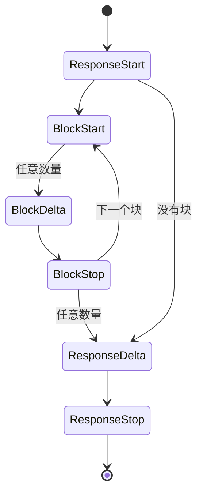

编解码器之所以能保持无损，取决于 KPP 的类型、流和线路结构体的构建方式。本页逐一说明；请求的路径及其背后的设计原则见 [KPP 内部实现](index.md)。

## 类型

这些类型的形态取决于编解码器保持无损所需要的东西：

- **`Extras`** 有三个字段：`origin`、`fields`（逐字节保存的原始 JSON）和 `form`（呈现标记）。同一方言内的往返必须重现被 KPP 规范化抹掉的写法，例如 `content` 是字符串还是数组、`null` 还是缺失、`1` 还是 `1.0`，以及 chunk 边界和 SSE 帧的 `id` 与 `retry` 字段。这些标记不携带含义，因此不会像未知的 `fields` 那样让其他方言拒绝请求。两个空的 `Extras` 无论来源如何都相等。
- **转发的请求头**（`anthropic-beta`、`anthropic-version`、`openai-beta`）保存在 `Extras::fields` 中，键以 `header:` 开头；重复的请求头用 `", "` 连接。请求头也像其他 extra 一样绑定到其方言。以 `header:` 开头的请求体键看起来会像转发的请求头，因此通过 `wire::Ext` 读取请求体的编解码器，即 Anthropic Messages、OpenAI Chat Completions 和 OpenAI Embeddings，会拒绝它（[线路结构体](#线路结构体)）；OpenAI Responses 把这样的键保留在请求体中，只有真正的请求头才会被转发。
- **原始项。** `Box<RawValue>` 包装在 `RawJson` 中，按字节比较。未知的块、工具、工具选择、流事件和 delta 都是 `RawItem { origin, raw }`；引用是 `Citation { origin, raw }`，因为各方言的引用格式几乎没有共同之处。
- **回复。** `Reply` 是 `Generate`、`CountTokens` 或 `Embed`，`RequestKind` 也对应这三种。
- **工具。** `ToolDef` 是函数工具，或完整保留的未知工具；`ToolChoice` 是 `Auto`、`None`、`Required`、指定名称的工具，或未知值。函数工具的 `parameters` 是可选的，与 OpenAI 的规定一致。
- **输出与推理设置。** `OutputSpec::JsonSchema` 有可选的名称（Anthropic 的 schema 没有名称）和描述。`ReasoningConfig` 保存模式、推理强度、预算、摘要以及是否包含加密推理；它的枚举把不认识的值保存在 `Other(String)` 中，因为服务商经常新增推理强度级别。
- **推理块**保存来源、摘要、文本部分和不透明部分。一个 OpenAI 推理 item 同时带有 ID 和加密内容，还可能有多个文本部分。只有摘要的块也需要靠来源来决定可以回放到哪里。
- **用量。** `Usage::input_tokens` 不含缓存读取和写入，它们是单独的字段（[用量](cross-format.md#用量)）；`Usage::raw` 保存服务商的用量对象及其来源，因此编码器只在自己的方言中叠加它。嵌入向量是 `f64`，因此服务商的值输出时保持不变。
- **错误。** `ErrorKind::Billing` 用于 Anthropic 的 `billing_error`（402）和 OpenAI 的 `insufficient_quota`，其他种类都无法如实描述它们。

## 流

KPP 流的结构是 `ResponseStart → (BlockStart → BlockDelta* → BlockStop)* → ResponseDelta* → ResponseStop`，任何位置都可能出现 `Error`，`Extra` 则携带 KPP 没有建模的方言事件。

- **块索引**是 KPP 自己的：按块开始的顺序依次为 0、1、2 等。块可以交错（OpenAI 就是这样流式传输并行工具调用的），因此每个事件都注明它所属的块。
- **每个生命周期事件都携带 `Extras`**，因此同一方言内的回放能精确重现原始事件，包括各事件自己的字段，例如 OpenAI 的 `obfuscation`。
- **失败在带内报告**：先给出到目前为止解码出的事件，最后是一个 `StreamEvent::Error`，因此同一 chunk 中先前解码的内容不会丢失。
- **事件顺序从不改变，但可能暂缓输出。** 兼容 OpenAI 的服务商可能在第一个 chunk 之后才发送回复的 `id` 和 `model`，或工具调用的 `id` 和 `name`。这时 OpenAI Chat Completions 解码器会暂缓 `ResponseStart` 和没有内容的 chunk，直到某个 chunk 带来这些值或内容。工具调用的 `BlockStart` 及其后的每个事件也会被暂缓，直到它的 `id` 和 `name` 都已到达、该块结束，或者流结束或中断（[OpenAI Chat Completions](openai-chat.md#流createchatcompletionstreamresponse)）。服务商在块仍打开时发送的用量会被暂缓到这些块结束，因此 `ResponseDelta` 总是在最后一个 `BlockStop` 之后。

### 流编码器

每个流编码器也都能写出保活帧；何时写出见[保活消息](cross-format.md#保活消息)。

**Anthropic Messages。** Anthropic 一次只流式传输一个内容块，而来自其他方言的 KPP 流可能交错多个块：OpenAI 就是这样流式传输并行工具调用的，并在结尾关闭所有块。编码器是一个显式的状态机：

- 第一个开始的块是活动块，到达时立即写出；
- 在另一个块活动期间开始的块处于等待状态，按开始顺序缓冲；
- 活动块结束时，写出下一个等待中的块，包括它的开始事件、缓冲的 delta，以及已经到达的结束事件；
- 带停止原因的 `ResponseDelta` 或 `ResponseStop` 会先关闭所有打开的块，多个 `ResponseDelta` 会合并为一个 `message_delta`，因为 SDK 每收到一个都会覆盖 `stop_reason`；
- 来自其他方言、不带停止原因的 `ResponseDelta` 只更新最后的 `message_delta` 所报告的用量，块保持打开。

Anthropic 的索引按块写出的顺序分配。不以 `ResponseStart` 开头的流会得到一个 ID 为空的 `message_start`。

**OpenAI Chat Completions。** 从 Chat 解码出的事件会借助 chunk 形式标记重新分组为原来的 chunk，因此同一方言内的回放会重现每一帧；如果某个 chunk 的信封键（`id`、`object`、`created`、`model`、`service_tier`、`system_fingerprint`）与根据 `ResponseStart` 重建的信封不同，差异记录为 `env` 和 `env_absent`。来自其他方言的事件各自成为一个 chunk：

- 响应一开始，流就以一个角色 chunk 开头（`delta: {"role": "assistant", "content": "", "refusal": null}`，即 OpenAI 自己的第一个 chunk），这样在模型思考期间应用也能收到流的消息；
- 工具调用以一个头部 chunk 开始，后面跟参数 chunk；
- 只有在应用请求了用量（`stream_options.include_usage`）时才发送用量，作为最后一个 `choices: []` 的 chunk；
- `ResponseStop` 写出 `data: [DONE]`；`Error` 写出 `data: {"error": …}` 并结束流，不写 `[DONE]`。

**OpenAI Responses。** 流引擎为每个 KPP 事件按 OpenAI 的发送顺序生成 SSE 事件，包括每一个冗余事件（`.done` 事件、part 事件、item 事件，以及带有全部输出 item 的最终 response 对象），并分配 `sequence_number`。解码器把同一个引擎作为影子运行：

- 引擎在该位置会生成的每个 SSE 事件都关联到对应的 KPP 事件，差异记录为带作用范围的覆盖项；
- 关联上了、但原始流中没有的事件记录在形式标记 `skip` 中；
- 出现在引擎不会生成它们的位置上的事件则作为 `Extra` 传递。

同一方言的流会被精确重现，而来自其他方言的流会成为完整、有效的 Responses 流。

## 线路结构体

线路结构体必须保留每个字段，包括结构体没有声明的字段，还必须逐字节保留原始载荷（`RawValue`）。`#[serde(flatten)]` 无法同时做到这两点：flatten 会缓冲输入，而 `RawValue` 无法从缓冲区读取，于是工具参数和 schema 会丢失原始字节。`wire::Ext<T>` 能完成同样的工作，而且不做缓冲：

- JSON 对象中 `T` 没有声明的每个键都原样保存在 `Ext::extra` 中，并成为 KPP 的 `Extras::fields`。键名以 `header:` 开头或含有 `.` 的键会被误认为转发的请求头或嵌套键路径，因此整个对象会被拒绝（`` the field `…` has a name Kaeso cannot carry; remove it ``）：在请求中是 `InvalidRequest`，在服务商的回复中是 `ProviderError`。
- `T` 已声明、但无法重现其收到时写法的每个键，都原样保存在 `Ext::verbatim` 中，并成为 KPP 的 `Extras::form`。例如在 `None` 时跳过的 `Option` 收到了 `"x": null`，在为 false 时跳过的 `bool` 收到了 `"flag": false`，在为空时跳过的 `Vec` 收到了 `"list": []`。

序列化 `Ext<T>` 时，先写 `T`，再写 `T` 没有写出的 verbatim 键，最后写 extra 键。因此解码再编码的往返是精确的；而编解码器修改某个类型化字段时（例如从另一种方言转换时），修改后的值总是优先于过时的 verbatim 写法。在编解码器必须看出区别的地方，`wire::Maybe<T>` 会区分缺失和 `null`。

在 `Ext` 内部使用的线路结构体遵循以下规则：

- 不使用 `#[serde(flatten)]`、`alias`、`deny_unknown_fields`，也不使用 untagged 或 internally tagged 枚举；
- 带标签的联合用 `wire::type_tag` 按 `"type"` 分派；
- 含有重复键的 JSON 对象会被拒绝；
- 只有编解码器会映射到类型化 KPP 字段的字段才会被声明；其他一切都有意不声明，作为 extras 传递。

OpenAI Responses 编解码器用普通的 serde 结构体读取类型化的值，并用一棵有序的 JSON 树（`openai_responses::node::Node`）写出，这棵树可以逐字节嵌入原始 JSON；`serde_json::Value` 则会对对象键排序，并重新格式化原始载荷。[原始写法如何保留](openai-responses.md#原始写法如何保留)介绍了它如何重现原始写法。

## 请求上限

解码请求所需的内存远大于请求正文本身：每条消息、每个内容块和每个工具都会变成带有 extras 的类型化 KPP 值。因此，由大量极小元素组成的正文以前会占用其大小 100 倍以上的内存。每个编解码器的 `decode_request` 都会先运行 `limits::request_shape`，它用 serde 的 `IgnoredAny` 统计正文，不为其分配内存。超出上限的请求会在解码任何内容之前被拒绝，错误为 `InvalidRequest`，状态码 400，`param` 中给出字段：

| 上限 | 值 | 统计对象 | 来源 |
| --- | --- | --- | --- |
| `MAX_MESSAGES` | 100,000 | `messages`（Anthropic Messages、Chat Completions）或 `input` 中的项（Responses） | Anthropic 每个请求最多 100,000 条消息的限制 |
| `MAX_BLOCKS_PER_MESSAGE` | 10,000 | 单条消息、输入项或系统提示词中的内容块，包括其工具结果中的内容块 | 远高于任何服务商对每个请求中图片或文档数量的限制 |
| `MAX_TOOLS` | 10,000 | `tools`，以及 Chat 的 `functions` | Anthropic 工具搜索的目录规模 |
| `MAX_EMBEDDING_INPUTS` | 2,048 | OpenAI Embeddings 中 `input` 数组的输入 | OpenAI 最多 2,048 个输入的限制 |
| `MAX_DEPTH` | 127 | 正文中任意位置对象和数组的嵌套层数，最外层对象也计入 | serde_json 在其 128 层递归上限内能完整解析的最大层数 |

serde 跳过被忽略的值和原始值时不受其递归上限约束，否则编解码器可能以每层一个栈帧的方式遍历任意深度的原始值。`request_shape` 在一次遍历字节时统计字符串之外的深度，并拒绝更深的正文，不给出 `param`。Responses 编解码器与其规范编码的比较同样在 `MAX_DEPTH` 处停止，并把服务商回复的其余部分保留为原始值，因此深层回复也不会让栈溢出。

不是 JSON 的正文，或结构不像该方言请求的正文，会尽可能统计，随后由解码报告问题所在。像 `"messages"` 这样经过转义的键，按其表示的键统计。`request_shape` 还会以 `RequestShape` 返回统计结果、嵌入输入中的 Token ID 数和正文字节数，使网关能在解码之前估算请求的内存。字节数不含请求对象、其消息、输入项和输入、内容块以及工具列表中记号之间的空白，这些空白在解码时会被丢弃，因此在这些位置填充空白不会增加估算。其他值内部的空白会计入，因为原样保留的值（例如工具的 `parameters`）会逐字节保留空白。解码器整体按原始 JSON 保留的消息或内容块，其内部的所有空白同样计入：Chat Completions 的 `function` 消息、不是对象或其消息角色不接受其类型的内容部分，以及不是对象或编解码器不认识其类型或 `source` 的 Messages 内容块。OpenAI Responses 的输入项内部的所有空白都会计入，因为该解码器会原样保留任何无法按其类型解析的输入项或内容部分，而这只有解码才能判断。

## 服务器发送事件

`sse::SseParser` 在行、注释、多行数据、`id`（含 NUL 的值不是 ID）和 `retry`（只接受能放进 `u64` 的 ASCII 数字）上遵循 [WHATWG 事件流算法](https://html.spec.whatwg.org/multipage/server-sent-events.html#event-stream-interpretation)，但为了不丢失任何内容，有意做了以下不同处理：

- 完全没有 `data:` 行的帧（例如单独的 `retry: 3000` 或 `event: ping`）按规范不是事件；解析器仍会返回它，其 `has_data` 为 `false`、`data` 为空，写入器写回时也不带 `data:` 行；
- 注释和未知字段会被报告，而不是被忽略；规范忽略的 `id` 或 `retry` 值作为未知字段保留（`SseEvent::other`）；
- 没有空行结束的最后一帧仍会被报告；
- 在一行中间结束的流会报告为 `SseError::Truncated`，而不是被丢弃。
- 第一行是名称以 U+FEFF 开头的字段的帧，会在一个空行之后写出，因为读取方会把流开头的这些字节当作字节顺序标记并丢弃。

每个流解码器都把没有数据的帧作为 `Extra` 传递，其原始 JSON 中没有 `data` 键；每个编码器写回时也不带 `data:` 行。在 OpenAI Chat Completions 中，没有数据的 `event: error` 帧就是这样的 `Extra`，而不是错误。

被解码为 KPP 事件的帧，其 `id`、`retry` 和未知字段记录为 `{"id", "retry", "other": [[name, value], …]}` 并被写回：在 Anthropic Messages 中是形式标记 `sse`，在 OpenAI Chat Completions 中是 `chunk` 标记里的 `sse`，在 OpenAI Responses 中是带作用范围的形式覆盖项 `~sse`。作为 `Extra` 传递的帧把这些字段保留在 `Extra` 中。

字节可以按任意 chunk 送入：行可以在任何位置被拆开，包括 CRLF 换行符的 `\r` 和 `\n` 之间。超过解析器上限（`sse::DEFAULT_MAX_FRAME_BYTES`，16 MiB）的帧是错误，这限制了每个流能占用的内存。

## 模型列表

模型列表（`GET /v1/models`、`GET /v1/models/{id}`）是 KPP 的一部分，包括 `ModelInfo`、`ModelLifecycle`、`ModelList` 和 `ModelsQuery`，因此网关自己永远不需要了解这些线路结构。

- **入站。** 每种方言都使用相同的路径，因此路径无法说明方言：`dispatch::models_dialect` 根据请求头来选择（有 `anthropic-version` 表示 Anthropic，否则为 OpenAI）。`ModelList::page` 对每种方言都以相同的方式应用 `before_id`、`after_id`、`limit` 和生命周期过滤。
- **出站。** 为了确认服务商是否向某个密钥提供某个模型，网关发送由 `dispatch::encode_model_request` 构建的 `GET /v1/models/{id}`，其中 ID 是一个经过百分号编码的路径段。ID 为 `.` 或 `..`，或在斜杠之间包含其中之一时，结果为 `InvalidRequest`，因为 URL 解析器即使在百分号编码后也会去掉这类路径段。它用 `decode_model` 读取响应，404 解码为 `NotFound`。那里的 404 也可能表示服务商没有这个端点，因此网关接着读取服务商的列表。`dispatch::encode_models_request` 根据 `ModelsQuery` 构建 `GET /v1/models`，只包含该方言会发送的分页和过滤参数，其他参数为 `Unsupported`。`decode_models` 读取每一页。
- **查询字符串**按 `&` 和 `=` 拆分，并按 `application/x-www-form-urlencoded` 进行百分号解码（`+` 表示空格）。未知参数成为 `query.<name>` 下的 extras。
- **日期。** KPP 保存 Unix 秒。RFC 3339 日期时间（Anthropic）和完整日期（OpenAI 的 `shutdown_date`）按前推格里高利历转换，不依赖日期库。亚秒位和时区偏移在转换中无法保留；只要再次编码无法重现收到的原文，就把原文保存在形式标记 `spelling` 中。9999 年之后的日期无法用 RFC 3339 表示：此时 Anthropic 的 `created_at` 取文档规定的未知值（纪元起点），其他日期取 `null`。
- **缺失或为 `null` 的字段。** 对 KPP 中没有值的字段，编码器填入文档规定的默认值；如果收到的请求体对该字段的写法不同，形式标记 `none` 会注明这一点。
