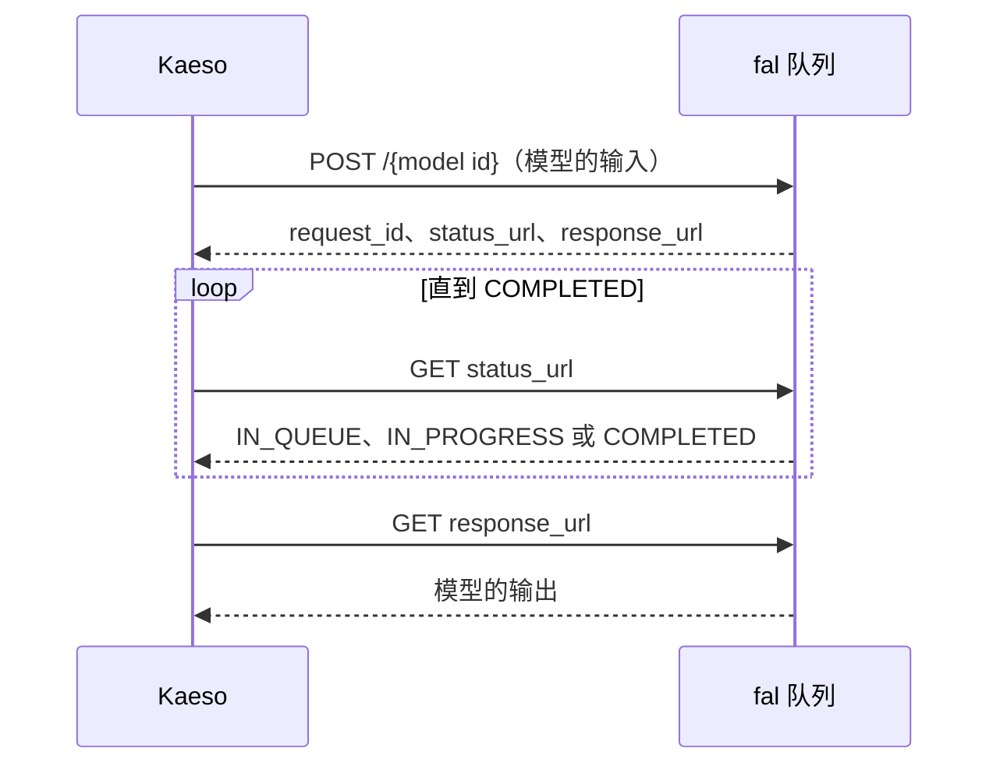

在这里查阅图片请求或视频任务如何到达 fal：每个模型的哪个字段放在哪里、Kaeso 如何跟随队列，以及每项映射的来源。

- **编解码器：**`kaeso_codecs::fal::Fal`（`crates/kaeso-codecs/src/fal/`）
- **路径：**在 fal 的队列上，带 `Authorization: Key …`：`POST /{model id}`，以模型自己的输入作为请求体，之后是 fal 返回的 `status_url` 和 `response_url`
- **Fixture：**`crates/kaeso-codecs/fixtures/fal/`，依据 fal 的文档和每个模型的 OpenAPI 文档构建，被拒绝的密钥和未知模型为实时录制

**来源。**fal 的 [Queue API](https://fal.ai/docs/documentation/model-apis/inference/queue)、[模型错误](https://fal.ai/docs/documentation/model-apis/errors)、[请求错误](https://fal.ai/docs/documentation/model-apis/request-errors)、[文件输入](https://fal.ai/docs/documentation/model-apis/fal-cdn)，以及每个模型的 OpenAPI 文档（`https://fal.ai/api/openapi/queue/openapi.json?endpoint_id=<model>`），2026-11-14 查阅。

## 队列

Kaeso 只跟随 fal 返回的 URL，并且只在 `queue.fal.run` 和 `queue.falrun.com` 上；它保留这些 URL 的路径，并发送到提供商的基础 URL。fal 只给出结果 URL 时，状态 URL 是结果 URL 后接 `/status`。每个请求都带 `X-Fal-Store-IO: 0`，使 fal 不在账号的请求历史中保存输入和输出。

图片请求在请求的时间限制内等待结果。视频任务是 [Videos API](../../api/videos.md) 的任务：它在 fal 的 id 是结果路径，每次查询都询问状态 URL，下载时从结果 URL 取得视频的链接。

## 模型

每个模型有自己的输入，所以 Kaeso 只映射以下模型，其他模型会被拒绝，并附上这份列表：

| 模型 | 类型 | 接收 |
| --- | --- | --- |
| `fal-ai/flux/dev`、`fal-ai/flux/schnell` | 图片 | `n` 1 到 4，`size` 每边最多 14142，`seed`，`output_format` `png` 或 `jpeg` |
| `fal-ai/flux-pro/v1.1` | 图片 | 同上 |
| `bytedance/seedream/v5.5/text-to-image` | 图片 | `n` 1 到 6，`size` 为 921,600 到 4,624,220 像素，`background`，`output_format`；不接收 `seed` |
| `bytedance/seedream/v5.5/edit` | 图片编辑 | 同上，加 1 到 10 张图片 |
| `fal-ai/veo3.1` | 视频 | `seconds` 4、6 或 8；`size` 为 720p、1080p 或 4K，16:9 或 9:16；`audio`、`seed`、`negative_prompt` |
| `kling/v4/text-to-video` | 视频 | `seconds` 3 到 30；`size` 为 720p 或 1080p，16:9、9:16、1:1 或 21:9 |
| `kling/v4/image-to-video` | 视频 | 首帧和尾帧；`seconds` 3 到 30；不接收 `size`：由首帧的形状决定 |
| `alibaba/wan-3.0/text-to-video`、`alibaba/wan-3.0/image-to-video` | 视频 | `seconds` 2 到 30；`size` 为 480p、720p 或 1080p，16:9、4:3、1:1、3:4 或 9:16；`audio`、`seed`；图生视频模型接收首帧和尾帧 |

## 图片请求

| KPP | fal |
| --- | --- |
| `prompt` | `prompt` |
| `n` | `num_images` |
| `size` `WIDTHxHEIGHT` | `image_size` `{width, height}`；`auto` 不发送，使用模型的默认值 |
| `output_format` | `output_format` |
| `background` | `background`，仅 Seedream；`transparent` 需要 `png` |
| `seed` | `seed`，仅 FLUX |
| `response_format: b64_json` | `sync_mode: true`：fal 把每张图片以 data URI 放进结果 |
| 要编辑的图片 | `image_urls`：链接原样发送，上传的文件作为 data URI |

fal 的模型会无声地忽略其 schema 中没有的字段，所以 Kaeso 在发送前拒绝 `auto` 以外的 `quality`、`output_compression`、`negative_prompt`、`user`、`aspect_ratio`、`resolution`、遮罩、流式输出和变体。

## 图片结果

| fal | KPP |
| --- | --- |
| `images[].url` | 图片的链接；是 data URI 时为图片的字节 |
| `images[].width`、`height` | 所有图片尺寸相同时，作为回复的尺寸 |
| `has_nsfw_concepts` 含 `true` | `content_filtered` 错误：FLUX 的安全检查器会改为发送一张黑色图片 |
| `seed`、`timings`、`prompt`、`content_type`、`file_name`、`file_size` | extras |

## 视频任务

| KPP | fal |
| --- | --- |
| `prompt` | `prompt` |
| `seconds` | `duration`：Veo 为 `"8s"`，Kling 和 Wan 为数字 |
| `size` | 由短边得出的 `resolution`（`2160` 即 `4k`）和 `aspect_ratio` |
| `audio` | Veo 为 `generate_audio`，Wan 为 `audio` |
| `seed`、`negative_prompt` | `seed`、`negative_prompt` |
| 首帧和尾帧 | `start_image_url`、`end_image_url`：链接原样发送，上传的文件作为 data URI |

视频任务需要 `seconds`，因为 fal 按秒计费。Kaeso 拒绝大于 1 的 `n`、`user`、参考图片和 remix。

## 状态

| fal | KPP |
| --- | --- |
| `IN_QUEUE` | `queued` |
| `IN_PROGRESS` | `in_progress` |
| `COMPLETED` | `completed`，结果路径作为视频的文件 |
| 带 `error` 和 `error_type` 的 `COMPLETED` | `failed`，以 `error_type` 作为代码；被取消的请求为 `client_cancelled` |
| 结果中的 `video.url` | 视频的链接 |

## 错误

| fal | KPP |
| --- | --- |
| `{"detail": [{loc, msg, type}]}` | `msg` 作为消息，`loc` 中的字段作为 `param`；`content_policy_violation` 为 `content_filtered`，`generation_timeout` 为 `timeout` |
| `{"detail": "…", "error_type": "…"}` 和 `X-Fal-Error-Type` | 消息；`request_timeout` 和 `startup_timeout` 为 `timeout`，运行器故障为 `overloaded` |
| 401、403、404 的 `{"detail": "…"}` | `authentication`、`permission_denied`、`not_found` |
