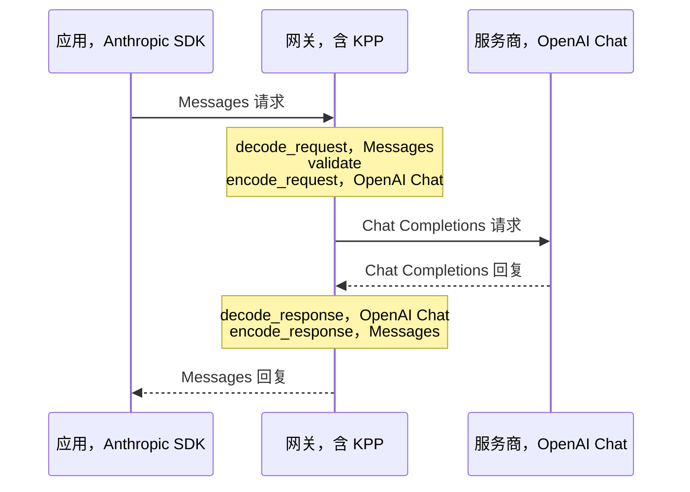

KPP，即 Kaeso Provider Protocol，是每个模型请求都要经过的规范格式。网关把应用发来的内容解码为 KPP，再把 KPP 编码后发给服务商，回复沿同一路径返回。调用方能看到的部分在[格式转换](../../concepts/format-translation.md)中介绍；这些页面面向修改 KPP 的人。

- [编解码器设计](codec-design.md)：了解类型、流和线路结构体如何让每次转换保持无损。
- [跨格式转换](cross-format.md)：查阅数据从一种 API 格式转到另一种格式时会发生什么，以及原因。
- [跨格式的推理](reasoning.md)：查阅推理内容、推理设置及其签名如何在各格式之间转换。
- [Anthropic Messages](anthropic-messages.md)：查找 Anthropic Messages 格式的每个字段在 KPP 中的位置。
- [OpenAI Chat Completions](openai-chat.md)：查找 Chat Completions 格式的每个字段在 KPP 中的位置。
- [Chat Completions 服务商](openai-chat-providers.md)：了解编解码器如何适配使用 Chat Completions 的每个服务商。
- [OpenAI Responses](openai-responses.md)：查找 Responses 格式的每个字段在 KPP 中的位置。
- [OpenAI Embeddings](openai-embeddings.md)：查找 Embeddings 格式的每个字段在 KPP 中的位置。
- [Fixture 与录制](fixtures.md)：添加编解码器测试所用的真实载荷，并录制新的载荷。

## 请求的路径

假设应用发送了一个 Anthropic Messages 请求，而模型通过 OpenAI Chat Completions 提供：

```rust
use kaeso_codecs::{EgressCtx, EncodeCtx, dispatch};
use kaeso_kpp::{DialectId, RequestKind};

let req = dispatch::decode_request(
    DialectId::AnthropicMessages,
    RequestKind::Generate,
    &body,
    &headers,
)?;
req.validate()?;
let mut egress = EgressCtx::new(&req).with_provider("openai");
let outgoing =
    dispatch::encode_request(DialectId::OpenAiChat, &req, &mut egress)?;

let reply = dispatch::decode_response(
    DialectId::OpenAiChat,
    status,
    &reply_headers,
    &reply_body,
    &egress,
)?;
let answer = dispatch::encode_response(
    DialectId::AnthropicMessages,
    &reply,
    &EncodeCtx::for_request(req),
)?;
```



1. **解码。** 应用一侧的编解码器把请求体和请求头读成一个 KPP `Request`。`decode_request` 接受一个 `RequestKind`，因为不知道端点，就无法区分 Anthropic 的 `/v1/messages` 和 `/v1/messages/count_tokens` 请求体。KPP 没有建模的内容保存在 `Extras` 中，并绑定到它所来自的方言。
2. **校验。** `validate()` 检查每种方言都需要满足的条件，例如有模型、消息有内容、工具调用 ID 和工具名称不重复，以及 `tool_choice` 指向已定义的工具。
3. **检查并编码。** `encode_request` 先运行目标的 `check()`，在发送任何内容之前，以 `Unsupported` 拒绝目标无法表达的内容（[跨格式转换](cross-format.md)），然后写出发给服务商的请求。`EgressCtx` 携带网关对目标所知的信息：请求种类和流模式、服务商，以及模型是否推理、是否支持自适应思考。编码器还会在其中记下它不得不改写的工具 ID 和名称。
4. **解码回复。** 服务商一侧的编解码器把回复读成 KPP，并通过 `EgressCtx` 把改写过的工具 ID 和名称映射回原值。
5. **编码回复。** 应用一侧的编解码器以应用的格式写出回复。`EncodeCtx` 携带应用解码后的请求，因为 OpenAI Responses 会在回复中回显请求字段；它还携带一个 `created_at`，因为 sans-IO 编码器需要确定性的时钟。

流使用 `dispatch::stream_decoder` 和 `dispatch::stream_encoder` 走同样的路径，错误则使用 `dispatch::decode_error` 和 `dispatch::encode_error`。网关要到每个请求时才知道两侧的方言，因此 `dispatch` 为每个编解码器函数都提供了接受 `DialectId` 的版本；没有编解码器的方言会得到 `Unsupported`。

`Codec` 本身是一个密封的 trait，由在编译时选定的关联函数组成，覆盖网关两侧的请求、回复、错误、流解码器和编码器，以及模型列表。在入站一侧，应用用该格式与 Kaeso 通信；在出站一侧，Kaeso 用它与服务商通信。

## Crate 与模块

| Crate | 内容 |
| --- | --- |
| `kaeso-kpp` | 只包含 KPP 类型：请求、回复、流事件、错误、Token 计数、嵌入和模型列表，以及 `validate()` 和 `required_capabilities()`。没有编解码逻辑，也没有 I/O。 |
| `kaeso-codecs` | 每种 API 格式一个 sans-IO 编解码器（代码中称为方言，即 `DialectId`），以及它们共用的构件。编解码器把字节转换为 KPP 值，把 KPP 值转换为字节；流按 chunk 逐块送入并产生事件。 |

两个 crate 都发布在 crates.io 上。它们的库代码只能依赖 `serde`、`serde_json`、`bytes`、`thiserror`、`indexmap`、`base64` 和 `mime`，`cargo deny` 禁止它们使用 `tokio`、`reqwest`、`hyper` 和 `axum`（[添加依赖](../contributing.md#添加依赖)）。

| 模块 | 方言 |
| --- | --- |
| `anthropic_messages` | Anthropic Messages（`/v1/messages`、`/v1/messages/count_tokens`） |
| `openai_chat` | OpenAI Chat Completions（`/v1/chat/completions`） |
| `openai_responses` | OpenAI Responses（`/v1/responses`、`/v1/responses/input_tokens`） |
| `openai_embeddings` | OpenAI Embeddings（`/v1/embeddings`） |
| `openai_models` | OpenAI Models API，由三个 OpenAI 编解码器共用 |

| 共享模块 | 职责 |
| --- | --- |
| `codec` | `Codec` trait、`EgressCtx` 和 `EncodeCtx` |
| `dispatch` | 在运行时按 `DialectId` 选择的编解码器函数 |
| `wire` | 用于无损线路结构体的 serde 构件（[线路结构体](codec-design.md#线路结构体)） |
| `sse` | 事件流的解析器和写入器（[服务器发送事件](codec-design.md#服务器发送事件)） |
| `limits` | 请求最多可包含的消息、内容块、工具和 embedding 输入数量（[请求上限](codec-design.md#请求上限)） |
| `cross` | 跨方言数据的规则，以及 extras 允许列表 |
| `continuity` | 随对话传递的推理（[推理的延续](reasoning.md#推理的延续)） |
| `keepalive` | 让进行中的流不至于沉默的帧（[保活消息](cross-format.md#保活消息)） |
| `models` | 模型列表的辅助函数（[模型列表](codec-design.md#模型列表)） |
| `testing` | JSON 和 SSE 的比较工具，也供使用这些编解码器的 crate 使用 |

## 设计原则

- **无状态。** `GenerateRequest` 始终携带完整的对话。
- **消息由有序的内容块组成。** 块的顺序自始至终保持不变。
- **字节要紧的地方保留原始数据。** 工具参数、JSON schema、未知块和引用都是 `RawJson`；不透明的推理按收到时的样子保存，并标记其 `Origin`。
- **语义或提示。** 每个字段要么是语义字段（目标必须遵守，否则以 `Unsupported` 拒绝），要么是提示字段（可以忽略）。[字段类别](#字段类别)列出了所有字段。
- **绑定来源的 Extras。** KPP 没有建模的内容都保存在 `Extras` 中，标记其来源方言，并且只写回该方言。`fields` 是语义字段：其他方言会拒绝它们，除非它们在[允许列表](cross-format.md#extras)中。`form` 只关乎呈现（字符串还是数组、`null` 还是缺失、chunk 如何分组），其他方言会忽略它。嵌套对象的未知键使用带点的键路径，例如 `function.x`，因此本身含有 `.` 的键无法携带（[线路结构体](codec-design.md#线路结构体)）。
- **发送之前拒绝。** `check()` 在发送任何内容之前返回 `Unsupported`，注明目标无法表达的功能。
- **从不静默丢弃。** 传入载荷的每个字段和块都恰好落到一个地方。它会成为类型化的 KPP 字段、绑定方言的 `Extras` 条目、`Unknown` 项，或种类为 `Unsupported` 的 `KppError`。丢弃数据的 match 分支就是 bug。
- **只做增量的公共 API。** 公共枚举和可扩展的结构体都是 `#[non_exhaustive]`。枚举变体包装带有构造函数（`TextBlock::new`、`Block::text` 等）的 `#[non_exhaustive]` 结构体。这样就可以添加字段，而不会破坏构建或匹配这些值的代码。`Codec` trait 是密封的。

KPP 的值和错误都按值返回。`KppError` 和部分枚举变体较大，但一个值每个请求只构建一次，错误又属于冷路径。把它们装箱会让每个签名都更笨拙，因此工作区允许 `clippy::large_enum_variant` 和 `clippy::result_large_err`。

每个 KPP 类型都为日志和快照实现了 `serde`。这种 JSON 形式在补丁版本之间保持稳定，但它不是线路格式。其中的名称采用 snake case，并且与 `DialectId`（`openai_chat`）一样把 OpenAI 写作 `openai`：`OpaqueKind::OpenAiEncryptedReasoning` 对应 `openai_encrypted_reasoning`。

## 字段类别

每个 KPP 字段要么是语义字段，要么是提示字段：

- **语义字段。** 目标必须遵守。如果目标方言或模型无法表达它，编解码器的 `check()` 会返回 `Unsupported` 并注明该字段，什么都不会发送。
- **提示字段。** 目标可以忽略。只有在目标没有对应字段时，编解码器才会丢弃它；能够表达某个提示字段的目标总会收到它。

### `GenerateRequest`

| 字段 | 类别 | 说明 |
| --- | --- | --- |
| `model` | 语义 | 由网关在编码前解析。 |
| `system` | 语义 | |
| `messages` | 语义 | |
| `tools`（`Function`） | 语义 | 其 `cache` 是提示字段，与块相同（[缓存提示](cross-format.md#缓存提示)）。 |
| `tools`（`Unknown`） | 语义 | 只有其来源方言能够表达。 |
| `tool_choice` | 语义 | `Unknown` 只有其来源方言能够表达。 |
| `parallel_tool_calls` | 语义 | |
| `output` | 语义 | `JsonObject` 在 Anthropic 中没有对应项，返回 `Unsupported`，不做模拟（[结构化输出](cross-format.md#结构化输出)）。 |
| `reasoning.mode`、`.effort`、`.budget_tokens` | 语义 | 推理强度与预算按[推理强度与预算](reasoning.md#推理强度与预算)中的表格相互转换。 |
| `reasoning.summary` | 提示 | 只控制是否返回摘要。Anthropic：`thinking.display: "summarized"`（[可读推理与摘要](reasoning.md#可读推理与摘要)）。 |
| `reasoning.include_encrypted` | 提示 | 只控制是否返回加密的推理；仅限 OpenAI Responses（[可读推理与摘要](reasoning.md#可读推理与摘要)）。 |
| `sampling.max_output_tokens` | 语义 | |
| `sampling.temperature`、`.top_p` | 语义 | 它们的写法（`1` 还是 `1.0`）属于形式，只在同一方言内保留（[采样参数](cross-format.md#采样参数)）。 |
| `sampling.top_k` | 语义 | 仅限 Anthropic；其他目标返回 `Unsupported`（[采样参数](cross-format.md#采样参数)）。 |
| `sampling.stop` | 语义 | OpenAI Chat Completions 最多接受四个；OpenAI Responses 没有该参数，返回 `Unsupported`（[采样参数](cross-format.md#采样参数)）。 |
| `sampling.seed` | 语义 | 仅限 OpenAI Chat Completions；其他目标返回 `Unsupported`（[采样参数](cross-format.md#采样参数)）。 |
| `sampling.frequency_penalty`、`.presence_penalty` | 语义 | 仅限 OpenAI Chat Completions；其他目标返回 `Unsupported`（[采样参数](cross-format.md#采样参数)）。 |
| `user` | 提示 | 用于滥用监控的最终用户 ID，从不改变输出。Chat 配置中没有最终用户字段的服务商收不到它，Chat 应用与 `safety_identifier` 一起发送的 `user` 也不会发送（[服务商配置](openai-chat-providers.md#服务商配置)）。 |
| `stream` | 语义 | |
| `extras.fields` | 语义 | 只写回来源方言；发往其他方言时返回 `Unsupported`，除非该字段在 [Extras 允许列表](cross-format.md#extras)中。 |
| `extras.form` | 提示 | 用于呈现的形式标记，其他方言会忽略。 |

### `Message`

| 字段 | 类别 | 说明 |
| --- | --- | --- |
| `role` | 语义 | 对话开始之后的 `System` 消息发往 Anthropic 时返回 `Unsupported`，除非请求来自 Anthropic Messages（[系统消息](cross-format.md#系统消息)）。 |
| `blocks` | 语义 | 块的顺序保持不变。 |
| `extras` | 与请求相同 | |

### `Block`

| 变体 / 字段 | 类别 | 说明 |
| --- | --- | --- |
| `Text.text` | 语义 | |
| `Text.citations` | 语义 | 保持原始数据并绑定来源；发往其他方言时返回 `Unsupported`。 |
| `Text.cache`、`Image.cache`、`Document.cache`、`ToolCall.cache`、`ToolResult.cache` | 提示 | 发往 OpenAI 时丢弃，因为 OpenAI 会自行缓存（[缓存提示](cross-format.md#缓存提示)）。 |
| `Image.source` | 语义 | `FileId` 只能用于签发它的服务商（[文件](cross-format.md#文件)）。OpenAI Chat Completions 只接受 URL 或 base64 形式的图片。 |
| `Document.source` | 语义 | 文本来源仅限 Anthropic。OpenAI Chat Completions 也不接受 URL 来源。 |
| `Document.title`、`.context` | 语义 | 仅限 Anthropic；发往 OpenAI 时返回 `Unsupported`。 |
| `Document.citations` | 语义 | 仅限 Anthropic；OpenAI 无法引用文档，返回 `Unsupported`。 |
| `ToolCall.*` | 语义 | ID 和名称保持不变；目标因字符或长度不接受时，会以固定方式改写，并在返回时还原。 |
| `ToolResult.call_id`、`.content` | 语义 | |
| `ToolResult.is_error` | 对没有错误标志的目标是提示 | 发往 OpenAI Chat 和 Responses 时丢弃，由内容承载错误文本（[工具错误](cross-format.md#工具错误)）。 |
| `Reasoning.summary`、`.text` | 提示 | 在发往其他方言的请求中，可读推理会被丢弃（[推理](reasoning.md)）。在回复中，它会与原始块一起放在[推理数据块](reasoning.md#推理数据块)中展示。 |
| `Reasoning.opaque` | 对其来源是语义 | 逐字节回放给其来源方言和服务商；从不发往其他地方，在那里整个块都会被丢弃（[推理](reasoning.md)）。 |
| `Reasoning.origin` | — | 决定是否回放（[推理](reasoning.md)）。没有签名的 Anthropic `thinking` 块只有在从 Anthropic Messages 读到时才会发回 Anthropic。 |
| `Refusal.text` | 语义 | Anthropic 没有拒绝块：发往它的请求返回 `Unsupported`，给 Anthropic 应用的回复中则变为文本块。 |
| `Unknown` | 语义 | 仅限来源方言。OpenAI Chat 的 `function` 消息作为一个这样的块完整保存（[请求](cross-format.md#请求)）。 |
| 每个块的 `extras` | 与请求相同 | 允许列表按块类型生效（[Extras 允许列表](cross-format.md#extras)）。 |

### `CacheHint`

| 字段 | 类别 | 说明 |
| --- | --- | --- |
| `ttl` | 提示 | |
| `extras` | 提示 | 随提示一起丢弃。 |

### `EmbedRequest`

| 字段 | 类别 | 说明 |
| --- | --- | --- |
| `model`、`input`、`dimensions`、`encoding` | 语义 | |
| `user` | 提示 | |
| `extras` | 与 `GenerateRequest` 相同 | |

### 回复与流事件

回复和流事件从一个服务商流向一个应用。其中没有提示字段。应用的方言无法表达的字段，要么可以推导出来，例如把停止原因映射到最接近的对应值，要么放在 Extras 中，以便在同一方言内回放。每个方言的映射页面都列出了这些映射：[Anthropic Messages](anthropic-messages.md)、[OpenAI Chat Completions](openai-chat.md)、[OpenAI Responses](openai-responses.md) 和 [OpenAI Embeddings](openai-embeddings.md)。

在应用的格式能够承载时，推理会到达其他方言的应用，并经过包装，以便之后能够原样返回（[推理数据块](reasoning.md#推理数据块)，`cross::reasoning_reply_policy`）。未知块只会到达其自身方言的应用。其余内容都不会出现在应用中（[回复](cross-format.md#回复)，`cross::reply_policy`），流中则以[保活消息](cross-format.md#保活消息)帧代替。网关会记录完整的 KPP 回复。

## 修改编解码器

1. 把真实载荷加入 `crates/kaeso-codecs/fixtures/<dialect>/`，并在该目录的 `README.md` 中添加一行来源记录（[Fixture 与录制](fixtures.md)）。
2. 在该方言的映射页面中注明每个映射的来源。来源包括 [OpenAI OpenAPI 规范](https://github.com/openai/openai-openapi)、[Anthropic Messages](anthropic-messages.md) 页面中注明的 Anthropic OpenAPI 规范、官方 SDK 的类型（[openai-python](https://github.com/openai/openai-python)、[anthropic-sdk-python](https://github.com/anthropics/anthropic-sdk-python)），以及服务商文档。来源含糊时，选择 `Unsupported` 并提交一个 issue。
3. 先写失败的测试，再写代码。每个线路字段都映射到类型化的 KPP 字段、绑定来源的 `Extras` 条目、`Unknown` 项或 `Unsupported` 错误。
4. 在同一个拉取请求中，用三种语言更新该方言的映射页面。

错误消息写给调用 Kaeso 的人看：说明目标不支持哪个字段，以及应该怎么做。

## 测试

| 测试套件 | 验证的内容 |
| --- | --- |
| `crates/kaeso-kpp/tests/types.rs` | 单独验证 KPP 类型：错误种类和块的名称保持稳定，以及 `validate()` 和 `required_capabilities()`。 |
| Fixture 往返（每个方言的 `tests` 模块） | `decode → KPP → encode` 把方言的每个 [fixture](fixtures.md) 重现为相等的 JSON 值（流：相等的事件序列），流还要在多种 chunk 切分下验证。必须被拒绝的 fixture 会以指定的 `Unsupported` 功能失败。 |
| `crates/kaeso-codecs/tests/cross_matrix.rs` | 对方言 A 的每个生成类 fixture 和其他每个方言 B：请求经过 `decode_A → check_B → encode_B`，并且必须能被 B 的解码器再次解码，对话内容保持不变；回复和流经过 `decode_A → encode_B → decode_B`，并且必须保留文本、拒绝和工具调用，转回 A 之后也是如此。Token 计数的请求和回复在 Anthropic 与 Responses 之间转换。结果保存为 `insta` 快照。 |
| `crates/kaeso-codecs/tests/dispatch.rs` | `dispatch` 在每种方言中都能解码服务商错误、编码带状态码的错误，嵌入编解码器会拒绝生成类回复，并且在没有请求要求其他编码时把 base64 向量保持为收到时的样子。 |
| `crates/kaeso-codecs/tests/number_spelling.rs` | 在 Anthropic、Chat 和 Responses 请求中，`temperature: 1` 回来时仍是 `1`，`1.0` 仍是 `1.0`；修改过的值按新值写出；另一种方言得到目标自己的写法；Responses 回复中回显的数字保持原来的写法。 |
| `crates/kaeso-codecs/tests/kpp_proptest.rs` | 随机生成的有效 KPP 请求和回复，在每种生成方言上经过编码和解码后保持不变，范围限于所有方言都支持的子集。 |
| `crates/kaeso-codecs/tests/keepalive.rs` | 应用看不到的内容仍会定期在线路上产生保活帧，并且这些帧对应用的解析器不可见。 |
| `crates/kaeso-codecs/tests/reasoning_carry.rs` | 推理发给另一方言的应用后，会在下一轮逐字节地回来，覆盖 Responses、Anthropic 和 Chat 应用。 |
| `crates/kaeso-codecs/tests/responses_on_anthropic.rs` | 使用 Anthropic 模型的 OpenAI Responses 应用，以及使用 OpenAI 模型的 Anthropic 应用：推理请求、按 OpenAI 事件顺序输出的思考流，以及工具循环。 |
| `crates/kaeso-codecs/tests/nesting.rs` | 嵌套层数超过上限的 Anthropic `tool_result` 块在请求、回复和流中都会被拒绝，而不超过上限的嵌套仍能正常解码。 |
| `crates/kaeso-codecs/tests/unknown_frames.rs` | 在每种支持流式传输的方言中，未知的 SSE 帧都能在同一方言内往返而保持原样，包括其 JSON 写法、带引号的字符串、SSE 字段和注释；Anthropic 和 Chat 的流还会保留数据为纯文本的帧。 |
| `e2e/conformance`，由 `crates/kpp-conformance` 提供服务 | 官方的 OpenAI 和 Anthropic Python SDK 能解析编码器产生的所有内容（[测试](../testing.md#sdk-一致性)）。 |
| `fuzz/` | 每个解码器都能接受任意字节而不 panic，SSE 解析器在任何 chunk 切分下都产生相同的项（[模糊测试](../testing.md#模糊测试)）。 |

`kaeso_codecs::testing` 按结构比较 JSON：键的顺序无关紧要，数字按 `serde_json` 读到的结果精确比较，因此 `1` 和 `1.0` 不同，而 `1e0` 和 `1.0` 是同一个数。

KPP 把 `temperature`、`top_p` 和各项惩罚保存为 `f64`，因此由编解码器自己保留写法。OpenAI Chat Completions 和 Anthropic Messages 把写成整数的键列在请求的形式标记 `integers` 中。只要值仍是整数，它们就再写成整数。

OpenAI Responses 把不同的写法记录为形式覆盖项，只在值未改变时生效。修改过的值按新值写出，另一种方言则得到目标自己的写法（`1.0`）。

`testing::sse_diff` 逐项比较流。它先比较事件名，再按 JSON 比较数据（不是 JSON 时按文本比较），然后按顺序比较 `id`、`retry` 和未知字段。没有 `data:` 行的帧，其 `ComparableItem::Event.data` 为 `None`；注释按原文精确比较。

当变更改变了跨方言输出时，要审查快照的差异：运行 `INSTA_UPDATE=always cargo test -p kaeso-codecs --test cross_matrix`，然后在提交之前阅读有变化的 `.snap` 文件。
