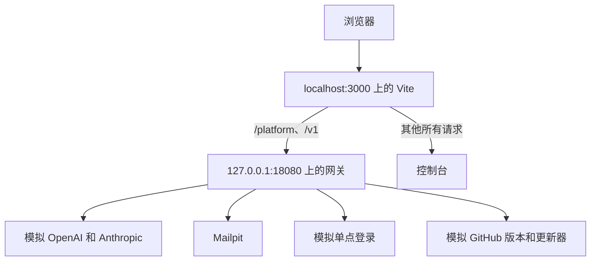

本页带你从全新克隆的代码出发，得到从源代码构建的网关、带有示例数据的控制台，以及全部通过的测试。所有命令都在仓库根目录下运行。

## 所需工具

| 工具 | 版本 | 用途 |
| --- | --- | --- |
| [Git](https://git-scm.com) | 任意较新版本 | 获取代码 |
| [Node.js](https://nodejs.org) | 24，与 `.node-version` 一致 | 控制台、UI 库、文档和脚本 |
| pnpm | 11，固定在 `package.json` 中，由 Corepack 提供 | TypeScript 工作区 |
| 通过 rustup 安装的 [Rust](https://rustup.rs) | 1.99，固定在 `rust-toolchain.toml` 中 | 网关和 KPP |
| 带 Compose 的 [Docker](https://docs.docker.com/get-docker/) | Compose 2.24 或更高版本 | 开发环境栈 |
| [Python](https://www.python.org) | 3.13 | 仅用于[端到端测试](testing.md#端到端测试) |

Corepack 随 Node.js 一起提供。只需启用一次，它就会提供仓库固定的 pnpm 版本：

```bash
corepack enable
```

第一次在仓库中运行 `cargo` 时，rustup 会安装 Rust 1.99 以及 rustfmt、clippy 和 llvm-tools；`rustup show` 可以提前完成安装。

## 1. 获取代码

```bash
git clone https://github.com/logicplanes/kaeso
cd kaeso
```

## 2. 安装依赖

```bash
pnpm install
```

这会安装控制台、文档、展示站点以及 `packages/` 中的库。Cargo 会在第一次构建时获取 Rust 依赖。

## 3. 启动开发环境栈

```bash
pnpm stack:up
```

这会从你的检出代码构建网关镜像（`kaeso-dev-gateway`，来自 `deploy/gateway.Dockerfile`），与下表中的服务一起启动，并等待所有服务都健康。第一次构建要编译网关，需要几分钟；之后的构建会复用 Docker 缓存。只要安装中还没有用户，命令最后会打印一个设置链接 `http://localhost:3000/setup#token=…`，它是在网关容器中通过 `kaeso setup-link` 获取的。

| 服务 | 说明 | 在本机上 |
| --- | --- | --- |
| `gateway` | 从你的检出代码构建的网关 | `127.0.0.1:18080` |
| `postgres`、`clickhouse`、`valkey` | 网关的数据库，Rust 测试也会使用 | `127.0.0.1:55432`、`127.0.0.1:58123`、`127.0.0.1:56379` |
| `mail` | Mailpit，接收网关发送的每封邮件 | `http://127.0.0.1:58025`，SMTP 在 `127.0.0.1:51025` |
| `provider` | 模拟的 OpenAI 和 Anthropic API，因此不需要真实的服务商密钥 | 仅在栈内部 |
| `idp` | 用于单点登录的模拟 OpenID Connect 服务商 | `http://idp.localhost:18091` |
| `releases` | 为 **实例设置 → 更新** 提供模拟的 Kaeso 版本和模拟更新器；向 `POST /__scenario` 发送 `releases`（`patch`、`major`、`manual`、`none`、`error`）、`updater`（`ready`、`down`）和 `outcome`（`succeeded`、`rolled_back`）可以改变它们的响应 | `http://127.0.0.1:18092` |
| `master-key` | 在网关启动前把主密钥写入一个卷 | |

该栈是 Compose 项目 `kaeso-dev`，定义在 `deploy/compose.dev.yaml` 中。Rust 测试只需要数据库和 Mailpit，它们可以不带网关单独启动：

```bash
docker compose -f deploy/compose.dev.yaml up -d --wait
```

## 4. 添加示例数据

```bash
pnpm seed
```

这会像真人操作一样通过 Platform API 完成安装设置并填充数据：组织 Northwind Labs，包含五个项目、六名成员、密钥、模型、别名和限额；通过网关发往模拟服务商的几百个请求；以及过去 70 天的请求历史。

如果想手动设置安装，请跳过这一步，打开 `pnpm stack:up` 打印的设置链接。

## 5. 打开控制台

```bash
pnpm dev
```

这会构建 `packages/` 中的库，启动开发环境栈（网关源代码有变化时会重新构建网关），并在 http://localhost:3000 提供控制台，保存后自动重新加载。

以 `owner@example.com`（实例管理员兼组织所有者）或 `lin@example.com`（开发者）登录。两者的密码都是 `correct horse battery staple`。邮件会出现在 Mailpit 中：http://127.0.0.1:58025 。



网关的公开 URL 就是开发服务器的地址，因此会话 Cookie 是第一方 Cookie，浏览器发送的 `Origin` 也正是网关期望的值。在生产环境中，反向代理以同样的方式在同一个域名下提供控制台和网关。

## 6. 运行测试

```bash
pnpm test
cargo test --workspace --all-features
```

`pnpm test` 运行 TypeScript 测试。Rust 测试使用开发环境栈的数据库，每个测试都会创建自己的数据库，因此可以并行运行，也不会影响示例数据。[测试](testing.md)介绍了每个测试套件，以及变更必须通过的检查。

## 停止开发环境栈

```bash
pnpm stack:down
```

这会删除开发环境栈及其全部数据，包括 Rust 测试的数据库。下一次 `pnpm stack:up` 会从空白状态开始。

## 更改端口和镜像

以下变量可以更改开发环境栈的端口，默认值见 `apps/console/scripts/stack.mjs`：`KAESO_GATEWAY_PORT`、`KAESO_POSTGRES_PORT`、`KAESO_CLICKHOUSE_PORT`、`KAESO_VALKEY_PORT`、`KAESO_MAIL_PORT`、`KAESO_MAIL_SMTP_PORT` 和 `KAESO_IDP_PORT`。`KAESO_PUBLIC_URL` 设置控制台的地址。如果数据库运行在其他地方，用 `KAESO_TEST_POSTGRES_URL`、`KAESO_TEST_CLICKHOUSE_URL` 和 `KAESO_TEST_VALKEY_URL` 告诉 Rust 测试它们的位置。

要使用在别处构建的网关镜像（例如某个发布版本）运行开发环境栈，请指定该镜像；栈会直接使用它，而不再自行构建：

```bash
KAESO_GATEWAY_IMAGE=ghcr.io/logicplanes/kaeso-gateway:{{version}} pnpm stack:up
```

## 运行第二个开发环境栈

第二个克隆可以在第一个旁边运行自己的开发环境栈，只要使用另一个 Compose 项目和其他端口。`KAESO_STACK_PROJECT` 指定项目名称（默认为 `kaeso-dev`），网关镜像也以它命名；之后 `pnpm stack:up`、`pnpm seed` 和 `pnpm stack:down` 只作用于该项目。在第二个克隆中：

```bash
export KAESO_STACK_PROJECT=kaeso-two KAESO_PUBLIC_URL=http://localhost:3001
export KAESO_GATEWAY_PORT=18180 KAESO_IDP_PORT=18191 KAESO_MAIL_PORT=58125 KAESO_MAIL_SMTP_PORT=51125
export KAESO_POSTGRES_PORT=55532 KAESO_CLICKHOUSE_PORT=58223 KAESO_VALKEY_PORT=56479
pnpm dev --port 3001
```

在同一个 shell 中运行 `pnpm seed` 即可填充该栈。

## 从源代码运行网关

如果需要一个几秒钟就能重启、可以挂调试器或增加日志的网关，就用 Cargo 针对开发环境栈的数据库运行它。

1. 在第二个终端中启动模拟服务商，确保没有请求发到真实的服务商：

   ```bash
   cargo run -p kaeso-testkit -- mock-provider 127.0.0.1:18090
   ```

2. 在第一个终端中创建全新的数据库并导出它们的设置，把两个服务商都指向模拟服务商，设置公开 URL、监听地址、主密钥和只记录日志的邮件，然后打印设置链接并启动网关：

   ```bash
   export $(cargo run -q -p kaeso-testkit -- fresh-services)
   export KAESO_PROVIDERS_OPENAI_BASE_URL=http://127.0.0.1:18090
   export KAESO_PROVIDERS_ANTHROPIC_BASE_URL=http://127.0.0.1:18090
   export KAESO_PUBLIC_URL=http://localhost:3000
   export KAESO_LISTEN=127.0.0.1:8080
   export KAESO_MASTER_KEYS="$(cargo run -q -p kaeso -- master-key generate)"
   export KAESO_MAIL_TRANSPORT=log
   cargo run -q -p kaeso -- setup-link
   cargo run -p kaeso -- serve
   ```

3. 在第三个终端中让控制台连接到它，然后打开设置链接：

   ```bash
   KAESO_GATEWAY_URL=http://127.0.0.1:8080 pnpm --filter kaeso-console dev
   ```

如果要调用真实的服务商，去掉两行 `KAESO_PROVIDERS_…` 即可。这些数据库会一直保留，直到你在第一个终端中删除它们：

```bash
cargo run -q -p kaeso-testkit -- drop-services "$KAESO_CLICKHOUSE_DATABASE"
```

所有设置都列在[配置](../self-hosting/configuration.md)中。

## 生成的代码

- **`openapi.json`** 是仓库根目录下的 Platform API 文档，由网关代码生成。修改 Platform API 之后，重新生成它，并与该变更（包括控制台一侧的修改）一起提交：

  ```bash
  cargo run -q -p kaeso -- openapi > openapi.json
  ```

- **控制台的 API 客户端和路由树。** `pnpm --filter kaeso-console generate` 根据 `openapi.json` 生成客户端的类型，根据 `apps/console/src/routes` 生成路由树。控制台的 `dev`、`build`、`typecheck`、`test` 和 `e2e` 脚本都会先运行它；两者的输出都不提交。

## 文档站点

```bash
pnpm build:packages
pnpm --filter kaeso-docs dev
```

站点运行在 http://localhost:4480 ，保存 `apps/docs/content` 中的页面后自动重新加载。其余内容见[编写文档](documentation.md)。

## UI 库

```bash
pnpm build:packages
pnpm --filter kaeso-showcase dev
```

展示站点运行在 http://localhost:4321 ，库的源代码变化后自动重新加载。控制台和文档读取的是库的构建结果：修改 `packages/ui` 或 `packages/tokens` 之后，运行 `pnpm build:packages`，并重启它们的开发服务器。
