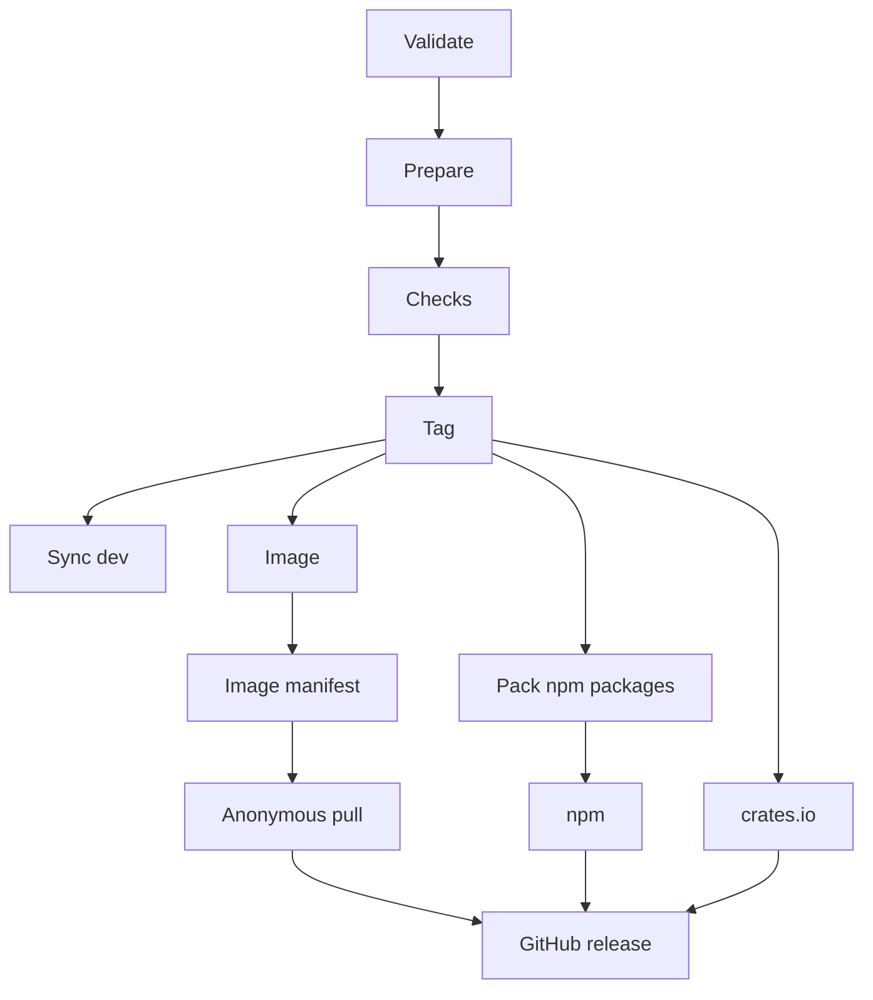

Kaeso 作为一个整体发布：网关、控制台、KPP 的 crate 和 UI 库的包共用同一个版本号，一次发布会发布所有这些内容。每个版本都由维护者从 `prod` 通过 Release 工作流发布，然后从该版本的标签部署文档和展示站点。贡献者从不创建标签或版本。

## 版本号

版本号遵循[语义化版本](https://semver.org)。如果某个版本需要运行 Kaeso 的人手动执行某个步骤，例如一个无法自动运行的迁移，它就是一个主版本。预发布版本会加上后缀，例如 `0.2.0-rc.1`。版本的 Git 标签是 `v` 加上版本号，例如 `v0.2.0`。

同一个版本的网关和控制台是配套的：该版本的 `compose.yaml` 把两个镜像都固定为这个版本，控制台也只适配它自己网关的 Platform API。

## 仓库中的版本号

根目录的 `package.json` 保存仓库的版本号，只有发布才会修改它，方法是运行 `node scripts/version.mjs set <version>`。该命令会把版本号写入每个声明版本号的文件：每个 `package.json`、各 crate 的清单（通过 `cargo set-version`）、`Cargo.lock` 和 `fuzz/Cargo.lock`、`openapi.json`、`deploy/compose.yaml` 中的两个镜像标签，以及各 crate README 中的依赖行，例如 `kaeso-kpp = "0.2"`。`node scripts/version.mjs files` 会列出这些文件。

其他地方都读取版本号，而不是写出它：文档页面写作 `\{{version}}`，由站点构建替换（[其他语法](documentation.md#其他语法)）；网关读取 `env!("CARGO_PKG_VERSION")`；展示站点和 npm 包的生成文件读取各自的 `package.json`。

| 命令 | 失败条件 |
| --- | --- |
| `node scripts/version.mjs check` | 上述文件之间不一致，或者当前版本号出现在任何其他文件中。它会给出文件和行号。`pnpm test` 会运行它，CI 的 **Repository tooling** 作业也会运行它 |
| `node scripts/version.mjs check 0.2.0` | 有其他文件已经手写了 `0.2.0`，例如某个 fixture 恰好用到这个版本号的测试。Release 工作流会首先运行它，在这些文件于 `dev` 上修正之前拒绝发布 |

历史记录和示例可以写出版本号：`CHANGELOG.md`、测试 fixture、演示数据、本页以及关于第一个版本的少数几行都列在脚本的 `ALLOWED` 中，并各自注明原因。

## 分支

| 分支 | 说明 | 谁来修改 |
| --- | --- | --- |
| `dev` | 默认分支，所有工作都合入这里 | 只能通过拉取请求，在 **CI** 检查通过后压缩为一个提交合并（[变更如何进入 dev](contributing.md#合并)） |
| `prod` | 最新的版本，或即将成为版本的提交；Release 工作流只在这里运行 | 维护者，始终以快进方式推送 |
| `hotfix/X.Y.Z` | 针对最新版本的修复，从该版本的标签创建 | 维护者，把它推送到 `prod` |

`dev` 和 `prod` 不能被删除或强制推送，`v*` 标签不能被移动或删除。维护者可以绕过这些规则。每次发布之后，Release 工作流都会尝试把该版本合入 `dev`，使下一次把 `dev` 推送到 `prod` 时再次是快进。

## 一个版本发布什么

| 位置 | 内容 |
| --- | --- |
| GitHub releases | 版本 `vX.Y.Z`，标题为“Kaeso X.Y.Z”，附有来自 `CHANGELOG.md` 的说明和以下文件：[安装](../self-hosting/installation.md)时下载的 `compose.yaml`；`kaeso.example.toml`；`env.example`；两个 npm tarball 和两个 `.crate` 文件 |
| GitHub Container Registry | `ghcr.io/logicplanes/kaeso-gateway` 和 `ghcr.io/logicplanes/kaeso-console`，适用于 `linux/amd64` 和 `linux/arm64`，带有构建来源证明和软件物料清单（SBOM） |
| crates.io | `kaeso-kpp` 和 `kaeso-codecs` |
| npm | `@logicplanes/kaeso-ui` 和 `@logicplanes/kaeso-tokens`，带有来源证明 |

| 镜像标签 | 适用于 |
| --- | --- |
| 版本号，例如 `0.2.0` 或 `0.2.0-rc.1` | 每个版本 |
| `MAJOR.MINOR`（例如 `0.2`）和 `latest` | 每个稳定版本 |
| `MAJOR`，例如 `1` | 从 `1.0.0` 起的每个稳定版本 |

在 npm 上，稳定版本获得 `latest` 标签，预发布版本获得 `next` 标签。在 GitHub 上，预发布版本会被标记为预发布，永远不会成为最新版本，因此 `releases/latest/download/compose.yaml` 始终指向最新的稳定版本。

## 变更日志

仓库根目录的 `CHANGELOG.md` 遵循 [Keep a Changelog](https://keepachangelog.com/en/1.1.0/)。拉取请求不修改它：Release 工作流根据自上一个版本以来合并的拉取请求的标题和标签，写出每个版本的章节。因此，拉取请求的标题就是它在变更日志中的那一行，用一句话向使用、运行 Kaeso 或基于它进行开发的人说明改变了什么，例如“Keep dialogs centered and resize them smoothly when their content changes”。

每一行是去掉末尾句号的标题，加上指向拉取请求的链接：`- Keep dialogs centered and resize them smoothly when their content changes ([#38](https://github.com/logicplanes/kaeso/pull/38))`。标题中的 Markdown 无法向变更日志添加 HTML、链接、标题或列表；代码片段仍保持为代码。这些条目遵循以下规则：

- **章节。** 由类型标签决定；有多个类型标签时，`security` 优先，其余按 Keep a Changelog 的顺序。没有类型标签时，由标题的第一个词决定：Add 或 Introduce 归入 Added，Deprecate 归入 Deprecated，Remove 或 Drop 归入 Removed，Fix 归入 Fixed，其他任何词都归入 Changed。
- **主题。** 恰好有一个领域标签时，该行放在对应主题下，例如 `#### Console`，排在该章节中没有主题的条目之后。没有领域标签或有多个时，该行没有主题。
- **顺序。** 章节按 Keep a Changelog 的顺序排列：Added、Changed、Deprecated、Removed、Fixed、Security。主题按下表的顺序，条目按拉取请求的编号排列。
- **破坏性变更。** 带有 `breaking` 标签的拉取请求还会在该版本章节的顶部列出，写作 **Breaking:** 加上它的标题。这个标签不会改变其他任何东西；版本号仍由维护者选择（[版本号](#版本号)）。
- **依赖项。** Dependabot 的拉取请求以及其他带有 `dependencies` 标签的拉取请求，合并为 Changed 下的一行“Dependencies updated”，并链接到每一个拉取请求。
- **省略。** 带有 `internal` 标签的拉取请求会被省略，例如对 CI、测试或工具的更新，包括 Dependabot 对工作流中 action 的更新。

在 `[Unreleased]` 下手写的条目会构成一个人工整理的版本：只要 `[Unreleased]` 下有内容，发布就只使用这些条目，不使用拉取请求。人工整理的版本适合需要比标题更详细说明的版本，也适合热修复，因为热修复的提交没有拉取请求。

发布时，这些条目会成为该版本的章节 `## [X.Y.Z] - YYYY-MM-DD`，其上方保留一个空的 `## [Unreleased]`，文件末尾的链接也会更新：`[Unreleased]` 改为与新标签比较，并新增一个指向该版本的链接。这个章节就是该版本在 GitHub 上的说明。没有任何内容可列出的发布会被拒绝：`[Unreleased]` 下没有内容，也没有不带 `internal` 的已合并拉取请求，除非 `CHANGELOG.md` 中已经有该版本的章节，或者（对于稳定版本）有它某个预发布版本的章节。

在同一版本的预发布版本之后发布的稳定版本，例如在 `0.2.0-rc.1` 和 `0.2.0-rc.2` 之后发布的 `0.2.0`，会把这些预发布版本的章节和最后一个预发布版本之后合并的拉取请求合并为一个章节 `## [0.2.0] - YYYY-MM-DD`。每个标题（例如 `### Added`）以及其中每个主题（例如 `#### Console`）下的条目会合并在一起，最新的在前，预发布版本的章节和链接则被删除。因此，稳定版本的说明会列出自上一个稳定版本以来的全部变更。这些修改由 `scripts/changelog.mjs` 完成。

两个网站都在 `/changelog` 显示变更日志。文档（[更新日志页面](architecture/docs-site.md#更新日志)）和展示站点都通过 `scripts/changelog.mjs` 中的 `history` 读取 `CHANGELOG.md`，因此发布时无需为它们做额外的步骤。从版本标签构建时，`[Unreleased]` 下没有内容，页面会省略它；从 `dev` 构建时，如果 `[Unreleased]` 下有手写的条目，这些条目排在最前面，并标记为尚未发布。

### 标签

| 标签 | 在版本说明中 |
| --- | --- |
| `added`、`changed`、`deprecated`、`removed`、`fixed`、`security` | 所属章节，例如 Added；`changed` 是默认值 |
| `breaking` | 另外在顶部作为破坏性变更列出 |
| `internal` | 省略 |
| `area: gateway`、`area: kpp`、`area: console`、`area: ui library`、`area: documentation`、`area: self-hosting` | 主题：Gateway、KPP、Console、UI library、Documentation 或 Self-hosting |

**Labels** 工作流（`.github/workflows/labels.yml`）按照 `.github/labeler.yml`，根据拉取请求修改的文件设置领域标签和 `internal`：每次拉取请求被打开或收到推送时都会运行，并移除不再适用的标签。拉取请求修改了 `apps/console` 中的文件时会得到 `area: console`；它修改的每个文件都是测试、fixture、工作流、脚本、贡献者指南或其他工具时，会得到 `internal`。如需手动设置这些标签，请在最后一次推送之后再设置，因为下一次推送会再次根据文件设置它们。该工作流在 `pull_request_target` 上只运行 labeler action，从不检出拉取请求的代码，并且只能读取仓库和写入标签。

如果标题的第一个词选不出正确的章节，维护者会在合并前设置类型标签；如果升级时需要用户做出修改，则设置 `breaking`。`node scripts/changelog.mjs labels` 会列出每个标签及其颜色和说明，用于在仓库中创建它们：

```bash
node scripts/changelog.mjs labels | while IFS=$'\t' read -r name color description; do
  gh label create "$name" --color "$color" --description "$description" --force
done
```

Validate 负责收集拉取请求：`prod` 上每个不包含在任何 `v*` 标签中的提交（合并提交除外），通过压缩提交标题末尾的 `(#123)` 找到它的拉取请求；没有这一部分时，则通过 GitHub 列出的该提交所属的已合并拉取请求找到。Validate 使用只能读取仓库和拉取请求的令牌读取它们，在摘要中列出它们及其标签，并以 JSON 形式交给 Prepare，`scripts/changelog.mjs` 再据此写出章节。`node scripts/changelog.mjs draft pulls.json` 会输出这种格式的拉取请求文件所生成的章节。

### 撰写的版本说明

如果仓库有 secret `LOG_AI_KEY`，Prepare 会通过维护者的 Kaeso 实例提供的 Anthropic Messages API，让 `claude-opus-5-5` 撰写该版本的章节。Release 工作流把实例地址设置为 `RELEASE_NOTES_API_URL`，即 `https://ai.logicplanes.com`，并把模型设置为 `RELEASE_NOTES_MODEL`。`scripts/release-notes.mjs` 会发送 Validate 收集到的已合并拉取请求的信息（这些拉取请求都是公开的）：编号、标题、正文（最多 4,000 个字符）、标签、作者、合并日期、修改文件的路径及新增和删除的行数、它们关闭的 issue，以及人类共同作者；带有 `internal` 标签的拉取请求不会发送。同时发送的还有上一个版本的章节（用于参考风格）、`[Unreleased]` 下的条目，以及该版本各预发布版本的章节。`LOG_AI_KEY` 是仓库 secret，只有这一步会读取它。

回答是固定 schema 的 JSON：摘要、破坏性变更、按章节和主题分组的条目（附上每个条目描述的拉取请求），以及贡献者。只有满足以下条件时脚本才会接受：每个用户可见的拉取请求恰好出现在一个条目中，且没有出现其他编号；贡献者恰好是该版本的参与者；所有文字都是纯文本，不含 HTML、链接、地址、标题、表情符号或对其他人的提及。随后脚本自己生成 Markdown：摘要、破坏性变更、以 `@login` 形式列出的贡献者（并标出首次贡献）、指向自上一个版本以来变更的链接，以及每个条目及其拉取请求链接。无论拉取请求中写了什么，都无法向变更日志添加链接、HTML 或提及。首次贡献是指在上一个版本之前，此人在仓库中没有已合并的拉取请求或提交；机器人、Dependabot 和编程助手永远不算贡献者。

`[Unreleased]` 下的条目会作为维护者自己的措辞交给模型，模型会保留它们。如果没有该 secret，或者请求失败、被拒绝、被截断，或者回答违反了规则，这一步会在运行中留下通知或警告，发布则按上文所述，根据 `[Unreleased]` 下的条目或标题和标签写出章节。这一步永远不会阻止发布：它最多 20 分钟后就会放弃。

`pnpm release:notes --dry-run` 会显示下一个版本的说明，而不修改任何文件。环境中设置了 `LOG_AI_KEY` 时，它输出模型撰写的内容；未设置时，输出发布时会写出的章节。`--since` 选择从哪个标签之后开始，`--head` 选择 `HEAD` 以外的提交，`--version` 选择比较链接中的版本：

```bash
pnpm release:notes --dry-run --since v{{version}} --head origin/dev
```

## 发布一个版本

1. **准备好 `dev`。** `dev` 上的 CI 已通过，[完成变更之前](testing.md#完成变更之前)中的每项检查都通过（包括 `pnpm release:check`），并且自上一个版本以来合并的每个拉取请求都带有其条目所需的标签（[标签](#标签)），或者 `[Unreleased]` 下的条目写明了该版本的全部变更。
2. **刷新模型数据**，让全新安装一开始就有最新的模型和价格，并通过拉取请求把结果合入 `dev`：

   ```bash
   cargo xtask models-dev
   ```

3. **把 `dev` 推送到 `prod`。** 这次推送是快进。如果被拒绝，说明 `dev` 还没有上一个版本；请先把 `prod` 合并到 `dev`，做法见第 5 步。

   ```bash
   git switch dev
   git pull --ff-only
   git push origin dev:prod
   ```

4. **在 `prod` 上运行 Release 工作流**，填入版本号，例如 `0.2.0` 或 `0.2.0-rc.1`；开头的 `v` 会被去掉。在仓库的 **Actions** 中选择 **Release**，然后用分支 `prod` 执行 **Run workflow**，或在终端中运行：

   ```bash
   gh workflow run release.yml --repo logicplanes/kaeso --ref prod -f version=0.2.0
   ```

5. **确认 `dev` 已包含该版本。** 这次运行的 **Sync dev** 作业会尝试把它合入。由于 `dev` 只接受拉取请求，它的推送通常会被拒绝：此时作业以警告结束，摘要中给出需要运行的那条命令，快进时是一次普通推送，否则是下面的合并。如果作业失败，版本本身仍已完整发布，摘要会说明原因。无论哪种情况，都请手动把 `prod` 合并到 `dev` 并推送；维护者对 `dev` 规则的绕过权限允许这次推送。如果合并因冲突停下，请解决冲突，并在推送前用 `git commit --no-edit` 完成合并：

   ```bash
   git fetch origin
   git switch dev
   git pull --ff-only
   git merge --no-ff -m "Merge release 0.2.0 into dev" origin/prod
   git push origin dev
   ```

6. **部署网站**：从该版本的标签部署，做法见[网站](#网站)。预发布之后这一步是可选的，因为那样网站描述的就是预发布版本。

   ```bash
   git fetch origin --tags
   git checkout v0.2.0
   ```

## 预发布版本

预发布版本（例如 `0.2.0-rc.1`）与其他版本一样从 `prod` 发布。它在 npm 上获得 `next` 标签，在 GitHub 上被标记为预发布，镜像标签只有它的版本号，因此 `latest` 仍指向最新的稳定版本。每个预发布版本在变更日志中都有自己的章节，内容来自自前一个版本以来合并的拉取请求，直到稳定版本把它们与最后一个预发布版本之后合并的拉取请求一起合并为一个章节（[变更日志](#变更日志)）。

## 热修复

热修复只修复最新版本，不包含 `dev` 上此后积累的内容。只要 `prod` 仍停留在该版本上，就可以这样做。

1. **从该版本的标签创建分支**，例如为热修复 `0.2.1` 从 `v0.2.0` 创建：

   ```bash
   git fetch origin --tags
   git switch -c hotfix/0.2.1 v0.2.0
   ```

2. **修复问题**：附上能复现缺陷的测试，在 `CHANGELOG.md` 的 `[Unreleased]` 下添加一行，提交，并运行检查。热修复的提交没有拉取请求，因此这一行就是它的变更日志（[变更日志](#变更日志)）。
3. **把该分支推送到 `prod`。** 因为 `prod` 停留在该版本的提交上，这是一次快进：

   ```bash
   git push origin hotfix/0.2.1:prod
   ```

4. **在 `prod` 上运行 Release 工作流**，填入热修复的版本号：

   ```bash
   gh workflow run release.yml --repo logicplanes/kaeso --ref prod -f version=0.2.1
   ```

5. **把热修复合入 `dev`。** 如果 **Sync dev** 失败，请按[发布一个版本](#发布一个版本)中的做法手动合并。如果 `dev` 的 `[Unreleased]` 下有内容，`CHANGELOG.md` 会产生冲突：保留 `dev` 在 `[Unreleased]` 下的条目，并把热修复的章节放在它们下面。

## Release 工作流

`.github/workflows/release.yml` 由人工填入版本号启动，同一时间只运行一次；第二次运行会等待第一次结束。Validate、Prepare、Checks 和 Tag 依次运行。标签推送之后，Sync dev 和各个发布作业开始运行。



写入仓库或发布任何内容的作业都在 `release` 环境中运行，该环境只接受来自 `prod` 的运行。Tag 和 Sync dev 是仅有的会推送到仓库的作业：它们不构建任何东西，只运行 git，并使用本次运行自己的令牌推送，因此它们的推送不会再次触发 CI。

| 作业 | 作用 |
| --- | --- |
| Validate | 拒绝以下情况：在 `prod` 以外的分支上运行；版本号不符合语义化版本；标签已存在；版本号不比最新标签更新；没有任何内容可列出的发布（`[Unreleased]` 下没有内容，没有不带 `internal` 的已合并拉取请求，也没有该版本或对于稳定版本，它某个预发布版本的章节）；以及已有文件手写了该版本号。收集自上一个版本以来合并的拉取请求及其正文、文件、关闭的 issue 和参与者，在摘要中列出它们及其标签，并交给 Prepare（[变更日志](#变更日志)） |
| Prepare | 用该版本号运行 `node scripts/version.mjs set`，把版本号写入每个声明它的文件（[仓库中的版本号](#仓库中的版本号)）；如果其他地方仍手写着该版本号，就会失败。然后撰写版本说明（[撰写的版本说明](#撰写的版本说明)），并把它作为变更日志中该版本的章节；没有版本说明时，根据 `[Unreleased]` 下的条目，或在没有条目时根据已合并的拉取请求写出该章节，并把稳定版本的各预发布版本章节合并进它自己的章节。它只能读取仓库，不持有 Git 凭据，并把这些修改作为补丁交给 Tag |
| Checks | 在 `prod` 的提交上运行完整的 CI 工作流，无论改了什么都运行每个作业 |
| Tag | 应用补丁；如果补丁会创建、删除或重命名文件，修改文件模式，或修改 `CHANGELOG.md` 和 `node scripts/version.mjs files` 列出的文件之外的任何文件，就拒绝。补丁修改了文件时，向 `prod` 提交“Release X.Y.Z”；没有修改任何文件时，直接给 `prod` 的提交打标签。如果自运行开始以来 `prod` 发生了变化，就拒绝。打上标签 `vX.Y.Z`，并把 `prod` 和标签一起推送，要么都成功，要么都不推送 |
| Sync dev | 把该版本合入 `dev`：如果 `dev` 已包含它，则无需操作；如果 `dev` 没有新内容，则快进；否则在能干净合并时创建合并提交“Merge release X.Y.Z into dev”。如果 `dev` 的规则拒绝推送，作业以警告结束，其摘要给出仓库管理员需要运行的命令。如果合并冲突、该版本修改了 `dev` 所没有的 `.github/workflows` 中的文件，或者 `dev` 在运行期间有了新提交，作业就会失败，其摘要会说明如何手动合并 |
| Image | 从标签为每个平台构建每个镜像，带有完整的构建来源证明和 SBOM |
| Image manifest | 把两个平台合并到上述镜像标签下，把镜像的 `org.opencontainers.image` 标签作为注解复制到合并后的索引上，并为构建来源出具证明 |
| Anonymous pull | 像安装时那样，不带任何凭据拉取该版本 `linux/amd64` 和 `linux/arm64` 的两个镜像。如果 ghcr.io 以 401 或 403 拒绝，说明这些包是私有的：作业失败，并提示在包的设置中将其设为公开；之后重新运行该作业即可完成发布 |
| Pack npm packages | 从标签构建这些库，并以该版本号运行包检查进行打包 |
| npm | 发布 `@logicplanes/kaeso-tokens` 和 `@logicplanes/kaeso-ui` |
| crates.io | 发布 `kaeso-kpp` 和 `kaeso-codecs` |
| Release manifest | 为[更新器](../self-hosting/upgrades.md#一键更新)写入 `release.json`：已发布镜像的摘要、`compose.yaml` 的哈希、最新的迁移、该版本或其之前的版本是否要求手动操作，以及本次运行开始时所在、也是其证明中写明的提交。它只能读取仓库 |
| Attest release.json | 为 `release.json` 证明构建来源；它只能看到这个文件，除了证明什么也不能做 |
| GitHub release | 在任何人都能拉取镜像、两个注册表都已有这些包之后，像安装时一样用 `gh attestation verify` 检查 `release.json` 和每个镜像能否依据此工作流在 `prod` 上的运行以及 `release.json` 中的提交通过校验，然后下载已发布的 tarball 和 crate，并创建带有文件和说明的版本 |

npm 和 crates.io 作业通过受信任发布进行身份验证，因此仓库不保存任何注册表令牌。两者都会跳过已经发布的版本，所以发布作业失败时，重新运行这次运行中失败的作业即可完成发布。

## 网站

docs.kaeso.app 上的文档和 ui.kaeso.app 上的展示站点都是静态网站。维护者从某个版本的标签构建它们，并上传到静态托管服务；没有工作流负责部署。

```bash
pnpm install --frozen-lockfile && pnpm build:packages
pnpm --filter kaeso-docs build
pnpm --filter kaeso-showcase build
```

之后，`apps/docs/dist` 中是文档，`apps/showcase/dist` 中是展示站点，每个页面都已用英语、德语和简体中文渲染好。展示站点的**查看源码**链接、它的 `llms.txt` 以及它的变更日志中指向仓库的链接，都指向该版本的标签（`v` 加上根目录 `package.json` 中的版本号）。文档的**在 GitHub 上编辑**链接指向 `dev`，页面修改在那里提出。

每个文件夹都可以原样上传。其中包括：允许一切并注明站点地图的 `robots.txt`；包含每种语言的每个页面及其 `hreflang` 替代链接的 `sitemap.xml`；每种语言一个、标记为 `noindex` 的 `404.html`；`site.webmanifest`、图标，以及用作链接预览图的 `og.png`。托管服务只需用 `guides.html` 响应 `/guides`，并用对应语言的 `404.html` 响应未知地址；移动过的页面在旧地址上有一个转向页面，`_redirects` 也为读取该文件的托管服务列出了同样的迁移。

两次构建最后都运行 `scripts/check-site.mjs`，在以下情况下让构建失败：

- 允许搜索引擎索引的页面不在 `sitemap.xml` 中，或者站点地图列出的地址不是本次构建中的页面；
- 页面缺少规范地址、三种语言和 `x-default` 的替代链接、自己的标题和描述、带有构建中图片的 Open Graph 和 Twitter 标签、图标或 Web 应用清单。

站点地图没有 `lastmod`，因为构建中没有任何信息知道页面最后一次修改的时间。

### 内容安全策略

两次构建最后都用 `scripts/csp.mjs` 写出各自网站的策略。策略以 `<meta http-equiv="content-security-policy">` 的形式放在每个页面中紧跟字符集声明之后，使其在任何托管服务上都生效；同时写入 `csp.txt` 和 `_headers`（供读取该文件的托管服务使用）。还要把它作为 `Content-Security-Policy` 响应头发送：只有响应头才能加上 `frame-ancestors 'none'`，使网站不被嵌入其他页面的框架。遇到内联事件处理程序或 `javascript:` URL（不含 `'unsafe-inline'` 的策略都不允许它们），或策略超过 4 KB（对某些服务器的响应头来说太长）时，构建会失败。

文档没有内联脚本或样式，出现时构建会失败，因此它的响应头始终是：

```text
default-src 'self'; script-src 'self'; style-src 'self'; img-src 'self' data:; font-src 'self'; connect-src 'self'; object-src 'none'; base-uri 'self'; form-action 'self'; frame-ancestors 'none'
```

展示站点的页面包含内联脚本：Astro 和 React 写入的脚本（islands 的加载器和流式 Suspense 边界的结尾），以及展示站点自己的语言和主题脚本，它们必须在首次绘制之前运行。它的策略在 `script-src` 和 `style-src` 中列出每个脚本及少数几个内联 `<style>` 元素的 SHA-256 哈希。它还用 `style-src-attr 'unsafe-inline'` 允许 `style` 属性，因为组件在服务端渲染的 HTML 会设置这些属性，而属性中的 CSS 无法执行代码。这些脚本一变，哈希就会变，因此请从你部署的那次构建的 `csp.txt` 中获取展示站点的响应头。

两个网站的端到端套件都会在 `csp.txt` 中的响应头下，以两种主题和每种语言加载页面，遇到任何 `securitypolicyviolation` 都会失败。
