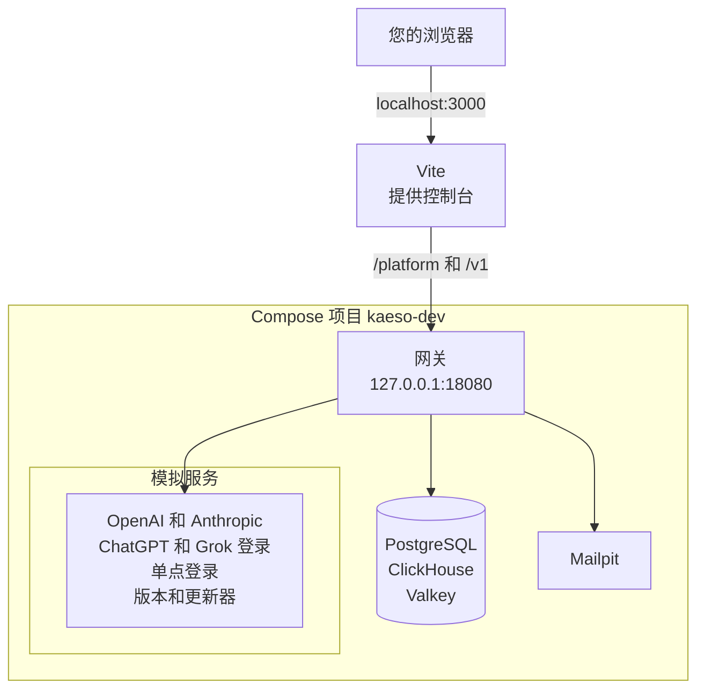

`pnpm stack:up` 会运行从当前检出构建的网关，以及它的数据库和模拟服务，这样无需真实服务商也能开发控制台。开发栈是 Compose 项目 `kaeso-dev`，定义在 `deploy/compose.dev.yaml` 中。



控制台的开发服务器把 `/platform` 和 `/v1` 转发给网关，所以浏览器只看到一个地址。会话 Cookie 因此是第一方 Cookie，与生产环境中位于反向代理之后时一样。

## 查看运行的服务

| 服务 | 说明 | 本机地址 |
| --- | --- | --- |
| `gateway` | 从当前检出构建的网关 | `127.0.0.1:18080` |
| `postgres`、`clickhouse`、`valkey` | 网关的数据库，Rust 测试也会使用 | `127.0.0.1:55432`、`127.0.0.1:58123`、`127.0.0.1:56379` |
| `mail` | Mailpit，接收网关发出的每一封邮件 | `http://127.0.0.1:58025`，SMTP 在 `127.0.0.1:51025` |
| `provider` | 模拟的 OpenAI 和 Anthropic API，因此不需要服务商密钥 | 仅在栈内部 |
| `idp` | 用于单点登录的模拟 OpenID Connect 身份提供商 | `http://idp.localhost:18091` |
| `releases` | 模拟的 Kaeso 版本和更新器，供**设置** › **实例** › **更新**使用 | `http://127.0.0.1:18092` |
| `accounts` | 栈内位于 `auth.openai.com` 的模拟 ChatGPT 登录，以及位于 `auth.x.ai` 和 `api.x.ai` 的模拟 Grok 登录和 xAI API，带有网关信任的测试证书 | `http://127.0.0.1:18093` |
| `master-key` | 在网关启动前把网关的主密钥写入一个卷 | |

只要实例中还没有用户，`pnpm stack:up` 就会输出设置链接。它从网关容器中的 `kaeso setup-link` 读取这个链接。

## 只启动数据库

Rust 测试只需要数据库和 Mailpit。不构建网关、只启动它们：

```bash
docker compose -f deploy/compose.dev.yaml up -d --wait
```

## 选择更新场景

模拟的版本服务默认表现为已有一个补丁版本，并且更新器工作正常。要在**更新**页面看到其他状态，发送一个场景：

```bash
curl -X POST http://127.0.0.1:18092/__scenario -d '{"releases": "major", "outcome": "rolled_back"}'
```

省略的字段会恢复为默认值：

| 字段 | 取值 |
| --- | --- |
| `releases` | `patch`（默认）、`major`、`manual`、`none`、`error` |
| `updater` | `ready`（默认）、`down` |
| `outcome` | `succeeded`（默认）、`rolled_back`、`needs_attention` |

## 停止开发栈

移除开发栈及其所有数据，包括 Rust 测试的数据库：

```bash
pnpm stack:down
```

下一次 `pnpm stack:up` 会从空白状态开始。

## 更改端口和镜像

在 `pnpm stack:up` 之前设置这些变量，可以把服务移到其他端口：`KAESO_GATEWAY_PORT`、`KAESO_POSTGRES_PORT`、`KAESO_CLICKHOUSE_PORT`、`KAESO_VALKEY_PORT`、`KAESO_MAIL_PORT`、`KAESO_MAIL_SMTP_PORT`、`KAESO_IDP_PORT`、`KAESO_RELEASES_PORT` 和 `KAESO_ACCOUNTS_PORT`。`KAESO_PUBLIC_URL` 设置控制台的地址。默认值在 `apps/console/scripts/stack.mjs` 中。

要使用在别处构建的网关镜像，例如某个版本，指定它即可。开发栈随后会跳过构建：

```bash
KAESO_GATEWAY_IMAGE=ghcr.io/logicplanes/kaeso-gateway:{{version}} pnpm stack:up
```

如果数据库运行在别处，用 `KAESO_TEST_POSTGRES_URL`、`KAESO_TEST_CLICKHOUSE_URL` 和 `KAESO_TEST_VALKEY_URL` 让 Rust 测试指向它们。

## 运行第二个栈

第二个克隆可以在第一个旁边运行自己的开发栈。`KAESO_STACK_PROJECT` 指定它的 Compose 项目名（默认为 `kaeso-dev`），也决定其网关镜像的名称。此后 `pnpm stack:up`、`pnpm seed` 和 `pnpm stack:down` 只作用于这个项目。

在第二个克隆中选择项目名和空闲端口，然后启动控制台：

```bash
export KAESO_STACK_PROJECT=kaeso-two KAESO_PUBLIC_URL=http://localhost:3001
export KAESO_GATEWAY_PORT=18180 KAESO_IDP_PORT=18191 KAESO_RELEASES_PORT=18192 KAESO_ACCOUNTS_PORT=18193
export KAESO_MAIL_PORT=58125 KAESO_MAIL_SMTP_PORT=51125
export KAESO_POSTGRES_PORT=55532 KAESO_CLICKHOUSE_PORT=58223 KAESO_VALKEY_PORT=56479
pnpm dev --port 3001
```

在同一个 shell 中运行 `pnpm seed`，即可填充这个栈。

## 从源码运行网关

需要几秒内重启网关、挂接调试器或增加日志时，用 Cargo 运行网关。它使用开发栈的数据库。

1. 在第二个终端中启动模拟服务商，确保没有请求发往真实服务商：

   ```bash
   cargo run -p kaeso-testkit -- mock-provider 127.0.0.1:18090
   ```

2. 在第一个终端中创建全新的数据库，并让网关指向它们和模拟服务商。这些设置还指定了公开 URL、监听地址、主密钥，以及只写入日志的邮件发送方式：

   ```bash
   export $(cargo run -q -p kaeso-testkit -- fresh-services)
   export KAESO_PROVIDERS_OPENAI_BASE_URL=http://127.0.0.1:18090
   export KAESO_PROVIDERS_ANTHROPIC_BASE_URL=http://127.0.0.1:18090
   export KAESO_PUBLIC_URL=http://localhost:3000
   export KAESO_LISTEN=127.0.0.1:8080
   export KAESO_MASTER_KEYS="$(cargo run -q -p kaeso -- master-key generate)"
   export KAESO_MAIL_TRANSPORT=log
   ```

3. 输出设置链接并启动网关：

   ```bash
   cargo run -q -p kaeso -- setup-link
   cargo run -p kaeso -- serve
   ```

4. 在第三个终端中让控制台连接这个网关，然后打开设置链接：

   ```bash
   KAESO_GATEWAY_URL=http://127.0.0.1:8080 pnpm --filter kaeso-console dev
   ```

要调用真实服务商，去掉两行 `KAESO_PROVIDERS_…` 即可。这些数据库会一直保留，直到在第一个终端中删除：

```bash
cargo run -q -p kaeso-testkit -- drop-services "$KAESO_CLICKHOUSE_DATABASE"
```

[配置](../self-hosting/configuration.md)列出了每一项设置。

## 开发 UI 库

运行展示站点，它展示每个组件的每种状态：

```bash
pnpm build:packages
pnpm --filter kaeso-showcase dev
```

展示站点运行在 http://localhost:4321 上，修改库的源码后会自动重新加载。控制台和文档读取的则是库的构建产物。修改 `packages/ui` 或 `packages/tokens` 之后，运行 `pnpm build:packages` 并重启它们的开发服务器。

## 在 macOS 上用 Colima 运行 Docker

[Colima](https://github.com/abiosoft/colima) 无需桌面应用即可在 macOS 上运行 Docker。用 Homebrew 安装，并为开发栈留出足够资源启动它：

```bash
brew install colima docker docker-compose docker-buildx
colima start --cpu 4 --memory 8
```

8 GB 内存足够容纳数据库和网关的首次构建。Homebrew 会把 Compose 和 Buildx 安装为 `docker` 的插件。要让 `docker compose` 找到它们，把 Homebrew 的插件目录加入 `~/.docker/config.json`：

```json
{
  "cliPluginsExtraDirs": ["/opt/homebrew/lib/docker/cli-plugins"]
}
```

在 Intel 芯片的 Mac 上，这个目录位于 `/usr/local` 下。Colima 只与虚拟机共享主目录，所以检出也要放在主目录中。

## 下一步

- [测试](testing.md)：运行变更必须通过的每一项检查。
- [编写文档](documentation.md)：运行文档站点并编写页面。
- [控制台](architecture/console.md)：了解控制台如何读取数据和加载代码。
