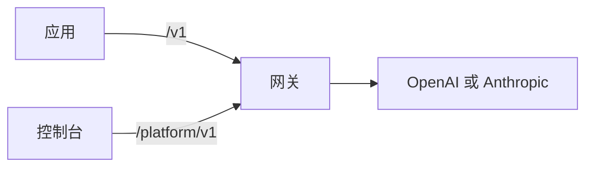

Kaeso 位于应用与模型服务商 OpenAI 和 Anthropic 之间。应用使用已有的官方 SDK 和一个 Kaeso API 密钥调用它；Kaeso 检查密钥、模型和限额，用所配置的服务商密钥调用服务商，再按应用请求时的格式返回回复。每个请求都会被记录并计价，谁用了哪个模型、花了多少，一目了然。

[快速开始](get-started/quick-start.md)从一台装有 Docker 的服务器开始，一直到发出第一个请求。

本文档描述的是 Kaeso {{version}}。

## 功能概览

- **一个 API 对接两家服务商。** Kaeso 提供 OpenAI 的 Chat Completions、Responses 和 Embeddings，以及 Anthropic 的 Messages。三种聊天格式都能调用目录中的任意聊天模型，因此 OpenAI SDK 也能调用 Claude。
- **服务商密钥留在自己手中。** 应用拿到的是 Kaeso API 密钥（`sk-kso-…`），可以为其设置限额、到期时间，也可以停用。服务商密钥用只有本安装持有的主密钥加密。
- **组织和项目**，包括成员、角色和权限、服务账号，以及每个项目各自的模型目录和别名。
- **限额和预算**：请求速率和 Token 速率、Token 预算和支出预算，可针对项目、成员或单个密钥设置。
- **请求日志和用量**：每个请求的状态、Token、费用和耗时；选择保留时还包括请求内容。
- **控制台**：以上一切的 Web 界面，提供英语、德语和简体中文。

## 各部分如何配合

| 部分 | 说明 |
| --- | --- |
| 网关 | 应用调用的服务器。它在 `/v1` 下提供模型 API，在 `/platform/v1` 下提供 Platform API；数据保存在 PostgreSQL，请求日志保存在 ClickHouse，计数器保存在 Valkey。 |
| 控制台 | Web 界面，与网关使用同一域名。它只使用 Platform API，因此控制台能做的，脚本都能做。 |
| KPP | Kaeso Provider Protocol：一种模型请求的规范格式，并为每种 API 格式配有一个双向转换的编解码器。 |

[请求流程](concepts/request-flow.md)跟随一个请求走完网关，[格式转换](concepts/format-translation.md)说明 KPP 在格式之间能传递什么、会拒绝什么。

## 从哪里开始

| 想要 | 阅读 |
| --- | --- |
| 安装 Kaeso 并发送第一个请求 | [快速开始](get-started/quick-start.md) |
| 在代码中调用模型 | [调用模型](get-started/calling-models.md) |
| 在 Claude Code 或 Codex 中使用 Kaeso | [编程工具](get-started/coding-tools.md) |
| 了解 Kaeso 如何处理请求和权限 | [概念](concepts/index.md) |
| 熟悉控制台 | [使用控制台](console/index.md) |
| 查阅 API | [API](api/index.md) |
| 规划和运维一个安装 | [自托管](self-hosting/index.md) |
| 参与 Kaeso 本身的开发 | [开发](development/index.md) |

Kaeso 采用 MIT 许可证。网关、KPP、控制台、UI 组件库和本文档都在同一个仓库中：[logicplanes/kaeso](https://github.com/logicplanes/kaeso)。
