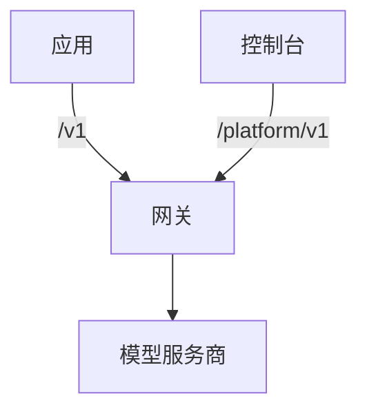

Kaeso 是一个网关，部署在您的应用与 OpenAI、Anthropic 等模型服务商之间。应用继续使用已有的官方 SDK，只需改两项设置：基础 URL 和密钥。Kaeso 按您的密钥、模型和限额检查每个请求，用您的服务商密钥调用服务商，并记录每个请求的费用。

下面是一个用 OpenAI SDK 通过 Kaeso 调用 Claude 的应用：

```bash tab="curl"
curl https://kaeso.example.com/v1/responses \
  -H "Authorization: Bearer $KAESO_API_KEY" \
  -H "content-type: application/json" \
  -d '{"model": "claude-haiku-4-5", "input": "Write a haiku about gateways."}'
```

```python tab="Python"
import os
from openai import OpenAI

client = OpenAI(base_url="https://kaeso.example.com/v1", api_key=os.environ["KAESO_API_KEY"])

response = client.responses.create(model="claude-haiku-4-5", input="Write a haiku about gateways.")
print(response.output_text)
```

```ts tab="TypeScript"
import OpenAI from "openai";

const client = new OpenAI({ baseURL: "https://kaeso.example.com/v1", apiKey: process.env.KAESO_API_KEY });

const response = await client.responses.create({ model: "claude-haiku-4-5", input: "Write a haiku about gateways." });
console.log(response.output_text);
```

本文档描述的是 Kaeso {{version}}。

## Kaeso 提供什么

- **一个 API 对接两家服务商。** Kaeso 提供 OpenAI 的 Chat Completions、Responses 和 Embeddings，以及 Anthropic 的 Messages。每种聊天格式都能调用目录中的任意聊天模型，因此 OpenAI SDK 也能调用 Claude。
- **服务商密钥留在您手中。** 应用拿到的是 Kaeso API 密钥（`sk-kso-…`），您可以为它设置限额和到期时间，也可以停用它。您的服务商密钥用只有本实例持有的主密钥加密。
- **组织和项目。** 成员、角色、权限和服务账号，以及每个项目各自的模型目录和别名。
- **限额和预算。** 请求速率和 Token 速率，以及 Token 预算和支出预算，可针对项目、成员或单个密钥设置。
- **请求日志。** 每个请求的状态、Token、费用和耗时；您选择保留时，还包括请求内容。
- **控制台。** 管理以上一切的 Web 界面，提供英语、德语和简体中文。

## 各部分如何配合



| 部分 | 说明 |
| --- | --- |
| 网关 | 您的应用调用的服务器。它在 `/v1` 下提供模型 API，在 `/platform/v1` 下提供 Platform API。数据保存在 PostgreSQL，请求日志保存在 ClickHouse，计数器保存在 Valkey。 |
| 控制台 | Web 界面，与网关使用同一域名。它只使用 Platform API，因此控制台能做的，脚本都能做。 |
| KPP | Kaeso Provider Protocol：一种模型请求的规范格式，每种 API 格式都有一个与它双向转换的编解码器。 |

[请求流程](concepts/request-flow.md)跟随一个请求走完网关。[格式转换](concepts/format-translation.md)说明 KPP 在格式之间能传递什么、会拒绝什么。

## 从哪里开始

- [快速开始](get-started/quick-start.md)：在服务器上安装 Kaeso，并发送第一个请求。
- [调用模型](get-started/calling-models.md)：用 OpenAI 和 Anthropic 的 SDK 在代码中调用模型。
- [编程工具](get-started/coding-tools.md)：将 Claude Code 或 Codex 指向您的实例。
- [概念](concepts/index.md)：了解 Kaeso 如何处理请求、格式和权限。
- [使用控制台](console/index.md)：熟悉控制台。
- [API](api/index.md)：查阅模型 API 和 Platform API。
- [自托管](self-hosting/index.md)：规划、运行和升级一个实例。
- [开发](development/index.md)：构建、测试和修改 Kaeso 本身。

Kaeso 采用 MIT 许可证。网关、KPP、控制台、UI 组件库和本文档都在同一个仓库中：[logicplanes/kaeso](https://github.com/logicplanes/kaeso)。
