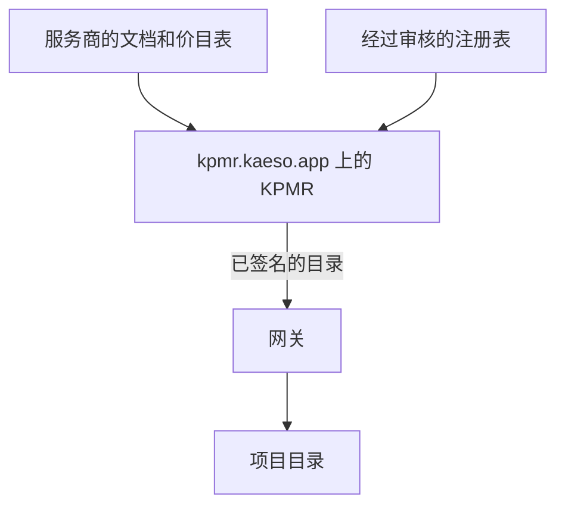

项目目录中的每个模型都以 KPMR（Kaeso Provider & Model Registry）中的值为起点：价格、限制、输入和输出，以及模型接受哪些参数。了解这些值的来源，您就能明白价格为何会自行变化，以及如何在无法访问互联网的环境中运行 Kaeso。

## KPMR 是什么

KPMR 是 Logicplanes 在 [kpmr.kaeso.app](https://kpmr.kaeso.app/zh-CN) 运行的服务。它收集服务商公布的模型信息，在自己的注册表中审核，并把结果作为一个已签名的文档提供，即 **KPMR 目录**。每个 Kaeso 网关都读取它，其他人也可以读取，无需密钥或账户。

## Kaeso 为何有自己的注册表

网关需要的不只是一份模型列表：它按这些价格计算预算，并拒绝模型无法处理的请求。KPMR 补充了 Kaeso 需要的内容：

- **更正和覆盖。**错误的价格、限制或能力会先在 KPMR 中更正，更正会在每个实例下次检查时到达。
- **新模型和停用。**模型或服务商一发布，KPMR 就会加入，并记录服务商停用某个模型的日期。已停用的模型仍会保留，因此其历史和过往价格仍可查阅。
- **网关所需的信息。**Claude 模型是否接受自适应思考或强制工具选择、接受哪些推理强度级别、1 小时缓存写入价格，以及 Kaeso 以哪种 API 格式调用模型。

注册表的每个条目都注明来源，例如服务商的文档或录制的真实请求。kpmr.kaeso.app 上的模型页面会列出这些来源及各自的核实日期。

## 术语

| 术语 | 含义 |
| --- | --- |
| 目录 | KPMR 提供的已签名 JSON 文档：它知道的每个服务商，以及这些服务商的模型和模型系列（[目录格式](catalogue.md)） |
| 注册表 | KPMR 经过审核的条目，每条都注明来源，用于更正和补充服务商公布的信息 |
| 修订版本 | 目录的版本，由构建时间和内容哈希组成。内容一变，它就会变 |
| 模型系列 | 例如 `claude-opus-latest` 这样的名称，KPMR 让它始终指向服务商某个系列中最新的稳定模型（[停用和模型系列](lifecycle-and-lines.md)） |
| 生命周期 | 服务商宣布停用、弃用和停用某个模型的日期，以及它推荐的替代模型 |
| 内置快照 | 每个 Kaeso 版本自带的目录副本，在网关能访问 KPMR 之前使用（[保持模型数据最新](sync.md)） |

## 浏览注册表

[kpmr.kaeso.app](https://kpmr.kaeso.app/zh-CN) 以英文、德文和简体中文展示注册表。其页面只列出 Kaeso 调用的服务商；[KPMR API](api.md) 包含所有服务商。

| 页面 | 显示内容 |
| --- | --- |
| [模型](https://kpmr.kaeso.app/zh-CN/models) | Kaeso 调用的服务商的所有模型。可按名称或 ID 搜索，按服务商、厂商、模态、能力、上下文、价格、状态和发布日期筛选，并按日期、名称、价格或上下文排序。筛选条件保存在地址中，因此可以通过链接分享视图 |
| [服务商](https://kpmr.kaeso.app/zh-CN/providers) | 每个服务商及其模型、模型系列和系列的历史 |
| 某个模型，例如 [Claude Opus 5.5](https://kpmr.kaeso.app/zh-CN/models/anthropic/claude-opus-5-5) | 价格、即将生效的价格、限制、能力、生命周期、指向它的模型系列、注册表条目的来源，以及网关为它收到的内容，也可以 JSON 形式查看 |
| [弃用计划](https://kpmr.kaeso.app/zh-CN/deprecations) | 所有已宣布的停用，最近的排在前面，并附有每个服务商推荐的替代模型 |
| [使用目录](https://kpmr.kaeso.app/zh-CN/catalogue) | 用于您自己代码的示例：获取目录、计算请求价格、查找模型、验证签名 |

侧边栏中的**搜索**可在任何页面查找模型、服务商和页面。

## 下一步

- [保持模型数据最新](sync.md)：设置网关获取目录的频率、立即同步，以及在无法访问互联网时运行。
- [目录格式](catalogue.md)：查阅目录的每个字段。
- [KPMR API](api.md)：在您自己的代码中获取目录和较小的文档，并验证签名。
- [停用和模型系列](lifecycle-and-lines.md)：了解 KPMR 如何记录停用，以及如何移动 `claude-opus-latest` 这样的名称。
