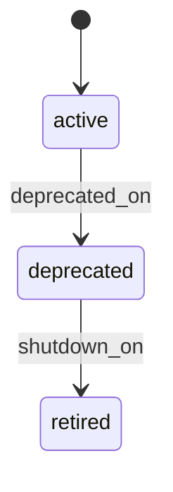

服务商会在固定日期停用模型，并发布同一系列的新模型。KPMR 在目录中记录这两者，因此网关可以提醒仍在调用即将停用模型的项目，而 `claude-opus-latest` 这样的名称无需任何人修改别名就能指向最新模型。

## KPMR 如何记录停用

KPMR 定期读取各服务商的弃用页面，并把每个新日期提交审核；未经审核的内容不会进入目录。审核后的日期写入模型的 `lifecycle`，以服务商的公告作为 `source`，并附上服务商推荐的同一服务商替代模型 `replacement`（[目录格式](catalogue.md#生命周期)）。

这些日期在当天生效：`status` 在 `deprecated_on` 变为 `deprecated`，在 `shutdown_on` 变为 `retired`，无需 Kaeso 发布新版本。网关也会自行检查停用日期，因此即使还未进行下一次获取，模型在停用当天也会被视为已停用。已停用的模型连同其价格保留在目录中，因此其历史和过往请求的费用仍可查阅。

以下三处显示这些日期：

- kpmr.kaeso.app 上的**[弃用计划](https://kpmr.kaeso.app/zh-CN/deprecations)**列出 Kaeso 调用的服务商所有已宣布的停用，最近的排在前面，并可按服务商筛选。
- **模型页面**在其**生命周期**卡片中显示日期及倒计时、替代模型和来源。
- **`/v1/deprecations.json`** 列出所有服务商的同样信息，供您自己的工具使用（[KPMR API](api.md#弃用计划)）。

## 项目如何看到停用

目录一带上这些日期，网关就会在每个目录中有该模型的项目中采取行动（[模型生命周期](../concepts/model-lifecycle.md)）：

- **在控制台中**，**即将停用**选项卡列出项目中即将停用的模型及其调用方，**模型**页面和组织概览上的提示会提醒即将到来的停用。
- **在响应中**，`Deprecation`、`Sunset` 和 `Link` 标头把日期和替代模型传给 SDK、代理和您的日志。
- **通过通知**，成员会收到**模型已弃用**和**模型即将停用**，它们也会作为 Webhook 事件发送。
- **停用之后**，对该模型的请求会以 `410` 失败，并注明停用日期和替代模型。**切换到替代模型**可以提前把项目的别名切换到替代模型，两项项目设置还可以在停用当天切换别名，或用替代模型应答。

## 模型系列

模型系列是 `claude-opus-latest` 这样的名称，它跟随服务商某个家族中最新的稳定模型。KPMR 自行构建这些系列，每个 `family` 一个，命名为 `<family>-latest`。

一个系列指向该家族中 `release_date` 最新、处于 `active` 状态、具有家族中多数模型所具有的输出类型，且是独立版本的模型。预览版、服务商自己的 `-latest` 名称、服务商同时提供无日期版本的带日期快照，以及只做决策的模型，永远不会成为系列的指向对象。新模型发布后，其系列会在下一次构建中移动：`since` 变为其发布日期，`previous` 变为之前指向的模型。

当家族本身无法决定时，注册表会更正系列，并像其他条目一样注明来源：

| 条目 | 作用 |
| --- | --- |
| 保持 | 让系列停留在原处，例如在新模型发布当天出错期间 |
| 模型 | 让系列指向服务商的某个指定模型，或新增没有家族对应的系列，例如 `gpt-mini-latest` |
| 排除 | 让某些模型不进入该系列 |

kpmr.kaeso.app 上的服务商页面显示每个系列指向的模型、其历史、上次移动时价格如何变化，以及它是被保持还是被固定。

## 项目如何跟随系列

项目可以像添加模型一样在**添加模型**中添加系列，应用以 `anthropic/claude-opus-latest` 调用它。项目可以选择如何跟随 KPMR 的移动：立即、先询问、延迟 1 到 30 天，或不跟随。系列永远不会移动到项目无法调用的模型（[模型系列](../console/models-and-aliases.md#模型系列)）。

## 下一步

- [模型生命周期](../concepts/model-lifecycle.md)：了解 Kaeso 如何提醒项目注意即将停用的模型，并把它们切换到替代模型。
- [模型和别名](../console/models-and-aliases.md#模型系列)：为项目添加模型系列，并选择其跟随方式。
- [目录格式](catalogue.md#生命周期)：查阅生命周期和模型系列的字段。
