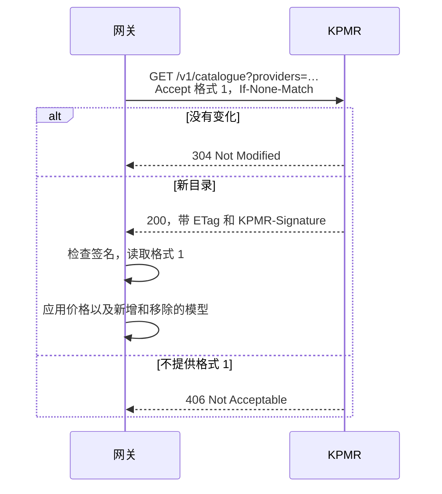

网关会自行保持模型数据最新：它按计划向 KPMR 请求目录，检查签名，并应用发生变化的内容。您可以设置它多久请求一次、立即获取，以及从哪里获取。



## 网关多久请求一次

一个任务每五分钟检查一次网关是否该再次询问 KPMR。何时询问由 `kpmr.interval` 决定（[配置](../self-hosting/configuration.md#kpmr)）：

| `kpmr.interval` | 网关何时请求 |
| --- | --- |
| `auto`，默认值 | 按目录的 `refresh_seconds`，限定在 5 分钟到 24 小时之间。KPMR 目前要求一小时 |
| 至少 `5m` 的时长，例如 `6h` | 按该间隔，不管目录怎么说 |

尝试失败后，即使间隔更长，网关也会在一小时内再次尝试。目录没有变化时，只需一个简短的 `304` 应答。

短于 5 分钟的间隔（例如 `1m` 或 `0`）会让网关在启动时、接触数据库之前就停止。早期版本接受任何时长，最多每 5 分钟获取一次；[升级](../self-hosting/upgrades.md#升级到-070)说明了带有此类设置的更新会如何结束。错误信息会指出该设置及修复方法：

```text wrap
KAESO_KPMR_INTERVAL (kpmr.interval) is 1m, and it must be `auto` or at least 5m: set KAESO_KPMR_INTERVAL=5m or longer, or `interval = "5m"` under `[kpmr]` in the configuration file, or remove it for `auto`
```

`kaeso config check` 会打印同样的错误，而不启动网关（[网关不断重启](../self-hosting/troubleshooting.md#网关不断重启)）。

## 立即同步

要立即获取目录（例如 KPMR 更正了某个价格之后），请在**实例** › **系统**的**模型数据**卡片上选择**立即同步**（[实例管理](../console/instance-administration.md#检查系统)），或在服务器上运行：

```bash
docker compose exec gateway kaeso kpmr sync
```

命令会打印变化的内容，实例中的每个网关都会采用新数据：

```text
Applied new model data: 3 price changes, 0 models no longer listed, 0 listed again. Every gateway reloads it.
```

KPMR 没有新内容时，它会打印 `The model data is current: KPMR has nothing new.`。两种方式都需要开启 `kpmr.sync`。获取失败时，命令会打印原因。

## 网关应用的内容

请求列出此版本 Kaeso 调用的服务商，要求 `application/vnd.kaeso.kpmr+json; version=1`，并发送 `User-Agent: kaeso-gateway/<version>`；不附带实例的任何数据。重定向必须留在同一主机，且不能离开 `https`，最多三次。耗时超过 60 秒的获取或超过 64 MiB 的文档会失败。

网关应用新目录时：

- **价格和其他值会更新**到每个项目的模型，项目[覆盖](../console/models-and-aliases.md#更改模型的参数)的字段除外。
- **价格变更和不再收录的模型**会记入实例的[审计日志](../console/instance-administration.md#查看审计日志)；价格变更还会记入其项目按新价格计费的每个组织的[审计日志](../console/organizations-and-projects.md#查看审计日志)。项目会以最后已知的值保留 KPMR 不再收录的模型。
- **无法读取的模型条目**会被略去，网关会记录一条注明该条目的警告。目录的其余部分仍会应用。

尝试失败时，继续使用当前数据，**实例** › **系统**会在**模型数据**下显示错误。要在同步持续失败时收到通知，请对 `kaeso_kpmr_last_attempt_failed` 设置告警（[监控](../self-hosting/monitoring.md#指标)）。

## 签名和受信任的密钥

KPMR 用 Ed25519 为每个目录签名，并在 `KPMR-Signature` 标头中以 `keyid=<key id>, ed25519=<signature>` 的形式发送针对响应体原始字节的签名。网关信任 KPMR 的内置密钥 `kpmr-2026-10` 以及 `kpmr.public_keys` 中的密钥。未签名、由不受信任的密钥签名或签名不匹配的目录会被拒绝，网关继续使用已有的数据。

签名让镜像变得安全：镜像可以从任何地方提供目录，只要它把 KPMR 的应答连同 `KPMR-Signature` 标头逐字节转发，例如保留标头的缓存反向代理。静态的文件副本没有签名标头，会被拒绝。如果您运行自己的注册表，请以 `<key id>:<base64 Ed25519 public key>` 的形式把它的公钥加入 `kpmr.public_keys`。

## 无法访问互联网时

Kaeso 的每个版本都内置一份目录快照。新实例从它开始，在网关无法访问 KPMR 时它也会继续使用。对于无法访问互联网的实例，请在[配置](../self-hosting/configuration.md#kpmr)中选择以下之一：

- `kpmr.sync = false` 保留内置快照。每次升级都会带来更新的快照。
- 把 `kpmr.url` 指向您网络中的镜像，它要把 KPMR 的应答连同 `KPMR-Signature` 标头逐字节转发，例如缓存反向代理；静态文件会被拒绝。

## 下一步

- [配置](../self-hosting/configuration.md#kpmr)：查阅 `kpmr` 设置。
- [目录格式](catalogue.md)：查看网关读取的每个字段。
- [模型和别名](../console/models-and-aliases.md)：把 KPMR 中的模型添加到项目并覆盖其值。
- [系统要求](../self-hosting/requirements.md)：了解实例会建立哪些连接，其中包括到 KPMR 的连接。
