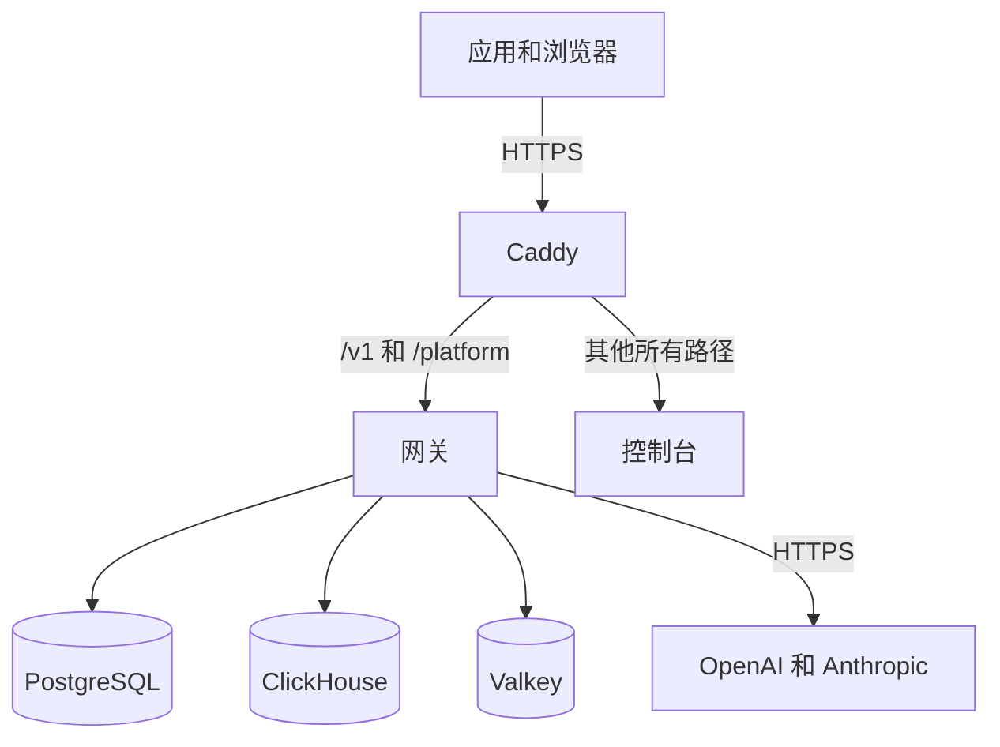

一个 Kaeso 实例就是一个在同一域名下响应的 Docker Compose 项目。了解它的组成，就知道该备份什么、该开放哪些端口，以及出问题时该看哪里。

## 服务

`compose.yaml` 启动六个服务。网关和控制台镜像固定为该版本的版本号，其他镜像固定到版本和摘要。

| 服务 | 职责 | 数据位置 |
| --- | --- | --- |
| `caddy` | 用自行申请和续期的证书终止 TLS，并转发请求 | 卷 `caddy_data` 和 `caddy_config` |
| `gateway` | 在端口 8080 上提供模型 API、Platform API 和健康检查，在端口 9100 上提供指标。调用服务商并发送邮件 | 无 |
| `console` | 提供 Web 界面 | 无 |
| `postgres` | 保存用户、组织、项目、密钥、加密的服务商密钥、目录、限额、用量和审计日志 | 卷 `postgres` |
| `clickhouse` | 保存请求日志和用量汇总 | 卷 `clickhouse` |
| `valkey` | 保存速率和预算计数器以及共享缓存 | 卷 `valkey` |

可选的更新器会再添加两个服务：`updater` 和 `docker-proxy`，用于[一键更新](upgrades.md#一键更新)。

## 文件

一个实例就是一个只有您能读取的文件夹，其中包含以下文件：

| 文件 | 内容 |
| --- | --- |
| `compose.yaml` | 各项服务，来自 Kaeso 版本。升级时会替换它。 |
| `.env` | 您的设置：域名、数据库密码和邮件（[配置](configuration.md#env-中的设置)）。 |
| `master-keys` | 主密钥，网关以 Docker secret `master_keys` 的形式读取。 |
| `compose.override.yaml` | 可选。您对服务的修改，升级时会保留。 |

请把 `.env` 和 `master-keys` 的副本与数据库备份分开保存（[备份和主密钥](backups.md)）。

## 首次启动

`docker compose up -d --wait` 按以下顺序启动服务，等每个服务都报告健康后才返回：

1. PostgreSQL、ClickHouse 和 Valkey 启动。网关等待 PostgreSQL 和 Valkey 变为健康。
2. 网关检查自己的设置。缺少或无效的设置会让它停止，并给出指明该设置的消息，但从不显示其值。
3. 网关在提供任何服务之前先迁移 PostgreSQL。ClickHouse 则在后台迁移，并一直重试到 ClickHouse 响应为止。
4. 在实例还没有用户时，网关会在日志中说明尚未完成设置。它从不把设置链接写入日志，因为任何能读日志的人都能借此接管实例。
5. 网关和控制台健康后，Caddy 启动，并在后台申请证书。

`kaeso setup-link` 会打印设置链接，用它创建第一个用户。该用户成为实例管理员，以及第一个组织的所有者。其他人通过邀请加入，或在实例允许时自行注册（[实例管理](../console/instance-administration.md)）。

## 隔离

各项服务尽可能少地共享资源：

- PostgreSQL、ClickHouse 和 Valkey 位于没有对外路由的内部网络中，只有网关能访问它们。
- 任何容器都无法提升权限。网关和控制台不带 Linux capabilities 运行，网关的文件系统为只读。Caddy 只保留绑定端口 80 和 443 的权限。
- 网关以 `kaeso` 身份登录 PostgreSQL，该用户拥有 Kaeso 数据库，但不是超级用户。ClickHouse 的 `kaeso` 用户无法管理用户和授权，Valkey 要求每个连接都提供密码。
- Caddy 发送 `Strict-Transport-Security`，并且从不转发网关的指标端口 9100。

## 多个网关

网关自身不保存状态。要运行多个网关实例，把它们放在同一个代理后面，并连接同一套 PostgreSQL、ClickHouse 和 Valkey：

- 缓存条目变化时，Valkey 会通知每个网关实例。
- 后台任务在 PostgreSQL 锁的保护下，每次只在一个网关实例上运行。
- 迁移在锁的保护下运行，一个网关实例迁移时，其他网关实例等待。
- 每个网关实例各自缓冲并写入自己的请求日志行和用量。

## 保持不变的名称

每个版本都保留以下名称，因此新的 `compose.yaml` 能找到您的数据：

- Compose 项目 `kaeso` 及其服务 `caddy`、`gateway`、`console`、`postgres`、`clickhouse` 和 `valkey`，以及 `updater` profile（配置集）中的 `updater` 和 `docker-proxy`。
- 存放数据的卷 `kaeso_postgres`、`kaeso_clickhouse` 和 `kaeso_valkey`，存放证书的 `kaeso_caddy_data` 和 `kaeso_caddy_config`，以及供更新器使用的 `kaeso_maintenance` 和 `kaeso_updater`。
- 镜像 `ghcr.io/logicplanes/kaeso-gateway`、`ghcr.io/logicplanes/kaeso-console` 和 `ghcr.io/logicplanes/kaeso-updater`，以版本号作为标签。

> [!WARNING]
> 请在实例文件夹中运行 Compose，不要使用 `-p` 或 `COMPOSE_PROJECT_NAME`。换用其他项目名时，Compose 会使用全新的空卷启动。
