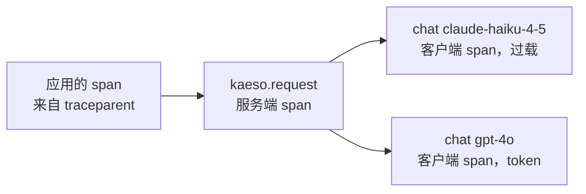

网关通过两个端点报告健康状态，在单独的端口上提供 Prometheus 指标，并输出 JSON 日志。在控制台中，**实例** › **系统**显示同样的健康状态，以及正在运行的版本、请求日志缓冲区和存储占用。

## 健康检查

| 端点 | 响应 |
| --- | --- |
| `GET /healthz` | 进程运行时返回 `{"status": "ok"}` |
| `GET /readyz` | `ready`、`degraded` 或 `not_ready`，并给出 `postgres`、`valkey` 和 `clickhouse` 的状态，每项为 `ok` 或 `down`；请求日志关闭时 `clickhouse` 为 `off` |

PostgreSQL 或 Valkey 无法访问时，`/readyz` 返回 503 和 `not_ready`。ClickHouse 停止或尚未迁移时，返回 200 和 `degraded`，因为请求日志从不阻塞请求。[关闭请求日志](installation.md#选择请求日志的保存方式)后，ClickHouse 为 `off`，实例为 `ready`。

两个端点都在网关的端口 8080 上。Caddy 只把 `/v1/`、`/v1beta/`、`/v2/`、`/platform/`、`/mcp`、`/mcp/`、`/oauth/` 和 `/.well-known/oauth-` 转发到这里，所以在您的域名上，这两个路径会到达控制台。网关容器的健康检查调用 `/healthz`，`docker compose ps` 会显示结果。在服务器上读取 `/readyz`：

```bash
docker compose exec gateway kaeso healthcheck --ready
```

网关镜像中没有 shell，也没有 `curl`，因此通过在容器内运行命令来探测的平台使用 `kaeso healthcheck`：

| 命令 | 请求 | 退出码为 0 的情况 | 适用于 |
| --- | --- | --- | --- |
| `kaeso healthcheck` | `/healthz` | 进程有响应时 | 存活检查（会重启容器）：数据库故障不应导致所有网关重启 |
| `kaeso healthcheck --ready` | `/readyz`，并打印其响应 | `ready` 和 `degraded` 时，`not_ready` 时不是 | 就绪检查：让流量避开无法连接 PostgreSQL 或 Valkey 的网关 |

## 指标

网关在端口 9100 的 `/metrics` 上提供 Prometheus 指标（`KAESO_METRICS_LISTEN`）。切勿公开转发该端口。在 Kubernetes 上，[Helm chart](platforms/kubernetes.md#指标) 会为该端口提供单独的 Service，并可选创建 `ServiceMonitor`。

您自行运行的网关在未设置时监听 `127.0.0.1:9100`。网关镜像在其容器内监听 `0.0.0.0:9100`，而 Compose 不会在任何地方发布该端口。要从服务器上抓取，请在 `compose.override.yaml` 中把它发布到回环地址：

```yaml title="compose.override.yaml"
services:
  gateway:
    ports:
      - "127.0.0.1:9100:9100"
```

在[多个网关](scaling.md)的情况下，请改为发布一个端口范围，每个副本一个端口，并抓取每个端口：

```yaml title="compose.override.yaml"
services:
  gateway:
    ports:
      - "127.0.0.1:9100-9109:9100"
```

| 指标 | 关注点 |
| --- | --- |
| `kaeso_requests_total{surface, route, status, provider, model}` | `surface="model_api"` 上 `status=~"5.."` 的增长。KPMR 未收录的模型，`model` 为 `custom` |
| `kaeso_request_duration_seconds{surface, route}`、`kaeso_time_to_first_byte_seconds{provider}` | 各路由和各服务商的 99 分位数变化 |
| `kaeso_gateway_overhead_seconds{provider}` | Kaeso 调用服务商之前自身花费的时间，不含请求上传，也不含别名中失败步骤等待服务商的时间：校验密钥、转换格式和检查限额。分桶从 0.1 ms 开始。如果 `kaeso_time_to_first_byte_seconds` 没有同样上升，多出的耗时来自 Kaeso，而不是服务商 |
| `kaeso_request_upload_seconds{provider}` | 应用发送请求体所用的时间。它随提示词的大小和应用的网络连接增长；这里的上升来自应用或网络，而不是 Kaeso |
| `kaeso_upstream_errors_total{kind, provider}` | `overloaded`、`timeout` 或 `connect`：服务商故障。`authentication` 或 `billing`：某个服务商密钥需要处理 |
| `kaeso_alias_fallbacks_total{provider, reason}` | [别名路由](../concepts/alias-routes.md)中失败并回退、或因刚刚失败而被跳过的步骤，按步骤的服务商统计。某个服务商的数值上升，说明您的路由正在兜住一次故障 |
| `kaeso_upstream_retries_total{provider, outcome}` | 步骤在连接中断、返回 5xx 或过载后重新发送给模型的请求（[别名路由](../concepts/alias-routes.md#回退)），按某次尝试得到应答（`answered`）或每次尝试都失败（`gave_up`）区分。`gave_up` 很多说明重试只是推迟了失败 |
| `kaeso_stream_failures_total{kind, provider}` | 在响应头发出后失败的流。`kaeso_requests_total` 把它们计为 200，请求日志则计为失败。`client_stalled`：应用不再读取其流 |
| `kaeso_usage_estimates_total{reason, provider}` | Kaeso 不得不估算的用量。`unreported`：服务商结束回复时没有报告用量。`cancelled` 和 `failed`：断开连接的应用和中途中断的流 |
| `kaeso_limit_refusals_total{kind, level}` | 预算即将用完 |
| `kaeso_reasoning_continuity_total{outcome}` | `unavailable`：Valkey 出现问题。大量 `missing`：对话持续时间超过 `KAESO_CONTINUITY_REASONING_TTL` |
| `kaeso_response_cache_lookups_total{result}`, `kaeso_response_cache_writes_total{outcome}` | [响应缓存](../console/response-cache.md)的命中率，`hit` 对比 `miss`。`outcome="full"` 的写入：Valkey 超过了 `KAESO_RESPONSE_CACHE_MEMORY_SHARE`。`failed`：Valkey 出现问题 |
| `kaeso_tokens_total{provider, kind}`、`kaeso_cost_microusd_total{provider}` | 支出趋势 |
| `kaeso_log_buffer_rows`、`kaeso_log_buffer_bytes` | 缓冲区持续增长：ClickHouse 不接受写入 |
| `kaeso_log_rows_dropped_total`、`kaeso_clickhouse_write_failures_total` | 任何增长：日志行已丢失或面临丢失 |
| `kaeso_otel_spans_total{outcome}` | 发给[追踪 collector](#追踪) 的 span：`exported`，导出失败时为 `failed`，因缓冲区已满、collector 拒绝或关闭而丢失的为 `dropped`。`dropped` 增长时：检查 collector 和 `KAESO_OTEL_ENDPOINT` |
| `kaeso_usage_rows_dropped_total` | 任何增长：PostgreSQL 永久拒绝了用量记录，日志行 `a usage row cannot be recorded` 会说明原因 |
| `kaeso_valkey_failures_total{operation}`、`kaeso_limits_fail_open_total{reason}` | Valkey 出现问题。在此期间，硬性预算以 503 拒绝请求，其他限额则不经检查直接放行 |
| `kaeso_job_runs_total{job, outcome}` | 后台任务的 `outcome="failed"`。`job="kpmr_sync"` 是与 [KPMR](../concepts/kpmr.md) 的同步 |
| `kaeso_kpmr_fetched_timestamp_seconds` | KPMR 发布当前所用模型数据的时间，或内置快照的生成时间，与**实例** › **系统**中显示的相同。只有 KPMR 发布新数据时它才会变化，因此主要在关闭 `kpmr.sync` 时需要关注其时长 |
| `kaeso_kpmr_last_attempt_timestamp_seconds`、`kaeso_kpmr_last_attempt_failed` | 网关上次尝试获取 KPMR 数据的时间；该次尝试失败时为 1，成功后为 0。同步未到期的运行不算尝试。如需得知同步失败，可在 `kaeso_kpmr_last_attempt_failed == 1` 持续数小时时告警；有多个网关时请对它们取 `max()` |
| `kaeso_auth_failures_total{method, reason}` | 登录或密钥失败突增。`reason="throttled"` 统计被 [API 密钥限流](configuration.md#api-密钥限流)拒绝的请求 |
| `kaeso_key_failure_blocks_total` | 任何增长：有地址在猜测 API 密钥 |
| `kaeso_emails_total{kind, outcome}` | `outcome="failed"` 或 `dropped`：检查[邮件](email.md)设置 |
| `kaeso_build_info{version}` | 正在运行的版本 |
| `kaeso_connections_open`、`kaeso_connections_max` | 网关当前服务的连接数，以及其同时服务的最大连接数（`server.max_connections`）；达到上限后，新连接需要等待。可对 `kaeso_connections_open / kaeso_connections_max` 设置告警，并在其达到 1 之前增加网关 |
| `kaeso_model_requests_in_flight` | 当前正在服务的模型请求数，包括流和实时会话，直到各自结束 |
| `kaeso_tool_calls_total{source, status, error_type}` | 通过 [MCP 门户](../api/mcp.md)（`source="portal"`）和 Playground 的工具调用，按 `status`（`ok`、`refused`、`error`）和 `error_type` 统计，调用成功时 `error_type` 为空。`upstream_auth`、`upstream_unreachable` 和 `timeout` 指向 MCP 服务器；`denied` 和 `limited` 指向调用方 |
| `kaeso_tool_call_duration_seconds{source, status}` | 工具调用的耗时 |
| `kaeso_update_available{version}` | 实例渠道上提供的最新版本比正在运行的版本新时为 1，`version` 为该最新版本；否则为 0，`version` 为正在运行的版本；关闭更新检查时没有此指标（[新版本](upgrades.md#新版本)） |

## 追踪

设置 `KAESO_OTEL_ENDPOINT` 后，网关会通过 OTLP/HTTP 把每个模型请求和每次经由 [MCP 门户](../api/mcp.md) 的工具调用作为一条追踪发送到 OpenTelemetry collector（[配置](configuration.md#追踪)）。Tempo、Jaeger、Honeycomb、Datadog、Langfuse 和 Arize Phoenix 都能直接或通过 OpenTelemetry Collector 接收。



- **Span。** 一个请求是一个服务端 span `kaeso.request`，从请求到达开始，到回复或流结束为止。其下每个调用了服务商的步骤都是一个客户端 span，名为 `{operation} {model}`，例如 `chat gpt-4o`：先是[别名路由](../concepts/alias-routes.md)中失败的步骤，按尝试顺序排列，然后是作答的步骤。请求日志记录的是失败步骤的耗时而不是开始时间，因此客户端 span 会紧接 Kaeso 自身的时间依次排列。来自[响应缓存](../console/response-cache.md)的回复没有客户端 span。工具调用是一个服务端 span `execute_tool {tool}`。
- **追踪上下文。** 带有 `traceparent` 请求头的请求会延续应用的追踪（W3C Trace Context），在 `_meta` 中带有 `traceparent` 的工具调用也是如此；`tracestate` 会一并保留。没有它时，请求会开始一条新追踪。Kaeso 从不把 `traceparent` 发送给服务商。
- **采样。** 带有 `traceparent` 的请求遵循应用的选择。其他请求按 `KAESO_OTEL_SAMPLE_RATIO` 的比例、依据追踪 ID 进行追踪。
- **约定。** 属性遵循 OpenTelemetry 的 GenAI 语义约定，该约定仍在开发中。Kaeso 遵循的是 `open-telemetry/semantic-conventions-genai` 在提交 `e6658f1`（2026 年 11 月 6 日）时的版本，基于核心约定 1.45.0。
- **发送。** span 在内存中等待，最多 `KAESO_OTEL_BUFFER_SIZE` 个，每隔 `KAESO_OTEL_FLUSH_INTERVAL` 以最多 512 个为一批发送，关闭时再发送一次。collector 无法连接或返回 429、502、503 或 504 时，会在下一个间隔重新发送；其他拒绝会丢弃它们。导出从不延迟请求，也不会导致请求失败。

| 属性 | span | 内容 |
| --- | --- | --- |
| `gen_ai.operation.name` | 所有 span | `chat`，Gemini API 为 `generate_content`，`embeddings`，或请求日志所记的端点，例如 `images/generations`；工具调用为 `execute_tool` |
| `gen_ai.request.model` | 请求、步骤 | 在请求上是应用指定的模型或别名；在步骤上是服务商的模型 |
| `gen_ai.provider.name` | 请求、步骤 | 服务商，有约定名称时使用约定名称，例如 `aws.bedrock`、`gcp.gemini` 或 `x_ai`，否则使用 Kaeso 的 ID |
| `gen_ai.response.model` | 请求、作答步骤 | 服务商所说的作答模型 |
| `gen_ai.usage.input_tokens`、`gen_ai.usage.output_tokens`、`gen_ai.usage.cache_read.input_tokens`、`gen_ai.usage.cache_write.input_tokens`、`gen_ai.usage.reasoning.output_tokens` | 作答步骤；缓存回复时为请求 | token。与约定一致，输入包含缓存读取和写入 |
| `gen_ai.system_instructions`、`gen_ai.input.messages`、`gen_ai.output.messages` | 作答步骤，需开启 `KAESO_OTEL_CONTENT` | 以约定格式的 JSON 表示的提示词和回复，不含媒体。超过 128 KiB 的会被省略，并由 `kaeso.content_omitted` 标明 |
| `gen_ai.request.stream`、`http.response.status_code`、`error.type` | 请求、步骤 | 回复是否为流式、状态码，失败时为 Kaeso 的错误类型，例如 `overloaded` |
| `gen_ai.tool.name`、`kaeso.mcp_server.id`、`kaeso.tool_call.status` | 工具调用 | 门户中的工具名称、其服务器，以及 `ok`、`refused` 或 `error` |
| `kaeso.request_id`、`kaeso.organization.id`、`kaeso.project.id`、`kaeso.key.id`、`kaeso.user.id`、`kaeso.service_account.id` | 请求 | 发送者，使用 Platform API 的 ID |
| `kaeso.alias`、`kaeso.route.path`、`kaeso.skipped`、`kaeso.retried` | 请求、步骤 | 别名、失败步骤在路由中的位置、因刚刚失败而被跳过的步骤，以及该步骤重试的尝试（[重试](../concepts/alias-routes.md#回退)） |
| `kaeso.cost_microusd`、`kaeso.ttfb_ms`、`kaeso.overhead_ms`、`kaeso.upstream_request_id`、`kaeso.response_cache`、`kaeso.cancelled`、`kaeso.usage_estimated`、`kaeso.tags`、`kaeso.endpoint`、`kaeso.source` | 请求 | 与[请求日志](../console/request-logs.md)中的含义相同；`kaeso.usage_estimated` 与 token 放在一起 |

与日志一样，追踪中从不包含 API 密钥的机密、服务商密钥或 authorization 请求头。

## 日志

网关向标准输出写入 JSON，每个事件一行：

```bash
docker compose logs -f gateway
```

请求产生的每一行日志都带有它的 `request_id`，回复也会在 `kaeso-request-id` 响应头中返回该 ID。机密、服务商密钥和 Authorization 请求头从不写入日志。`KAESO_LOG_LEVEL` 设置日志级别或过滤器，例如 `info,kaeso_server=debug`；`KAESO_LOG_FORMAT=text` 为开发输出纯文本行。

## 下一步

- [故障排除](troubleshooting.md)：为健康检查、指标或日志显示的问题找到解决方法。
- [配置](configuration.md)：更改指标地址、日志级别和其他所有设置。
- [备份和主密钥](backups.md)：在出问题之前备份数据库和主密钥。
