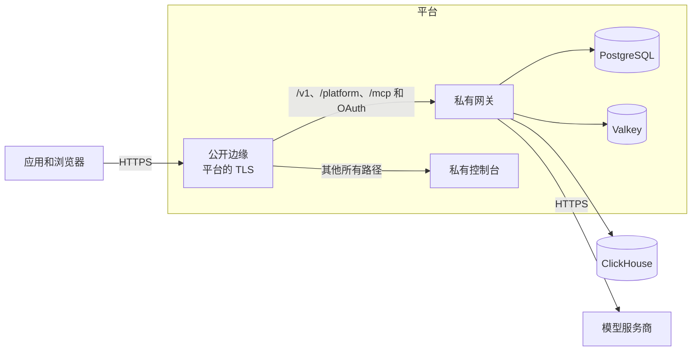

Compose 软件包在您自己管理的一台服务器上运行 Kaeso。仓库中的模板则把同一个版本放到托管平台上运行：由平台终结 TLS、保存数据库并推出新版本。

## 两类路径

| 路径 | 是什么 | 在哪里 |
| --- | --- | --- |
| 平台模板 | 平台读取的一个文件：公开边缘、私有网关和控制台，以及平台的 PostgreSQL 和 Valkey | [Render](render.md)、[Railway](railway.md)、[DigitalOcean](digitalocean.md) |
| 快速服务器 | 一台虚拟机，运行 Compose 软件包、Caddy、内置 ClickHouse 和更新器，与您自己的服务器相同 | [AWS](aws.md)、[Google Cloud](gcp.md) |
| 托管生产环境 | 平台的容器、负载均衡器、PostgreSQL 和 Valkey，机密保存在平台的密钥存储中 | [AWS](aws.md)、[Google Cloud](gcp.md) |

AWS 和 Google Cloud 不是一键部署：您需要选择区域、域名及其证书、数据存储的规格、请求日志的去向、SMTP 服务器，以及主密钥的存放位置。

## 每条路径都保持的内容

- **同一来源。** 控制台和 API 在同一个域名上应答。`/v1/*`、`/platform/*`、`/mcp`、`/mcp/*`、`/oauth/*` 和 `/.well-known/oauth-*` 到达网关，其他所有路径到达控制台。在 Render 和 Railway 上由控制台镜像的第二个命令 `kaeso-edge` 负责，在 DigitalOcean 上由应用的 ingress 规则负责，在 AWS 和 Google Cloud 上由负载均衡器的路径规则负责。
- **流不被缓冲。** 边缘服务立即转发每个数据块，负载均衡器的空闲超时长于网关的保活间隔（[长时间的流](../domains-and-tls.md#长时间的流)）。
- **只相信平台代理给出的客户端地址。** 边缘服务只接受来自平台私有网络的 `X-Forwarded-For`，并只向网关传递一个地址；网关只信任边缘服务（[`KAESO_TRUSTED_PROXIES`](../configuration.md#设置)）。
- **健康检查**用 `/healthz` 检查进程，用 `/readyz` 检查 PostgreSQL、Valkey 和 ClickHouse（[健康状态和指标](../monitoring.md)）。指标端口永不公开。
- **更新器关闭。** 由平台推出和回滚新版本；版本的迁移只向前进行（[升级](../upgrades.md)）。
- **同一版本。** 网关、控制台和边缘服务固定为同一版本；发布新版本时会更新模板。

## 每条路径都需要的内容

| 需要 | 方式 |
| --- | --- |
| 主密钥 | `docker run --rm ghcr.io/logicplanes/kaeso-gateway:{{version}} master-key generate`，保存在平台的密钥存储和密码管理器中（[备份和主密钥](../backups.md)） |
| 电子邮件 | 一个 SMTP 服务器；`KAESO_MAIL_TRANSPORT=log` 只用于试用（[电子邮件](../email.md)） |
| 第一个用户 | `KAESO_SETUP_EMAIL`：在第一个用户创建之前，网关每次启动都会把一次性设置链接发送到该地址，因为网关镜像没有 shell 可运行 `kaeso setup-link`（[配置](../configuration.md#设置)） |
| 请求日志 | 在 `KAESO_CLICKHOUSE_URL` 中填入外部 ClickHouse，例如 ClickHouse Cloud；不填则请求日志关闭，用量、限额和预算照常工作（[选择请求日志的保存方式](../installation.md#选择请求日志的保存方式)） |
| 公开地址 | `KAESO_PUBLIC_URL`，用户和应用使用的 `https` 地址 |

## 已验证的内容

2026-11-06，边缘、网关和控制台已在本地 Docker 中验证：路径路由、分块流、伪造的客户端地址，以及网关不可用时各 API 的错误格式（`e2e/install/test_edge.py`）。CI 会重复模板、lint 和格式检查。

2026-11-07，快速服务器已从空白云账户部署：AWS 模板在 `us-east-1` 创建 CloudFormation 堆栈，Google Cloud 配置在 `europe-west3` 的新项目中应用；两者都安装了 第 8 个候选版本。Google Cloud 部署创建了第一个用户，通过一个 HTTPS 源提供控制台和 API，流式发送了五个 SSE 事件且文本正好为 `Kaeso stream works.`，把请求写入 ClickHouse，并忽略了伪造的 `X-Forwarded-For`。AWS 部署在测试实例上恢复密钥文件的安装器所有权后，才创建第一个用户并通过相同检查。模板现在不再更改该所有权，但修正后的模板尚未从空白账户重新部署。

同一天，Render 蓝图从法兰克福的空白 Render 项目创建。它按固定版本的 `render.yaml` 创建了全部五个资源，发送了一次性设置邮件，通过边缘、网关和就绪检查，流式发送同一回复并记录请求。实际测试还发现 Render 会追加调用方的 `X-Forwarded-For`；现在 Render 上的边缘读取由 Cloudflare 覆盖的 `CF-Connecting-IP` 头。该修复通过了本地边缘集成测试和 Render 配置检查，但尚未在实际 Render 部署上重新测试。

| 平台 | 从空白账户进行的实际测试 |
| --- | --- |
| Render | 蓝图、设置邮件、路由、流和日志记录于 2026-11-07 通过；修正后的客户端地址有本地回归测试，但未重新进行实际测试 |
| AWS 快速服务器 | 2026-11-07 在测试实例上修正主密钥所有权后，堆栈和应用检查通过；修正后的模板尚未重新部署 |
| Google Cloud 快速服务器 | Terraform 配置和设置链接于 2026-11-07 通过 |
| AWS 和 Google Cloud 托管堆栈 | 已通过 CI 的 lint 和格式检查；本轮未部署 |
| Railway | 受阻：登录的测试工作区试用已过期，Railway 要求升级套餐后才能应用新基础设施 |
| DigitalOcean | 本轮未测试 |

## 下一步

- [Render](render.md)：用 Render Postgres 和 Key Value 部署蓝图。
- [Railway](railway.md)：用 Railway Postgres 和 Redis 应用基础设施文件。
- [DigitalOcean](digitalocean.md)：用规范创建应用，使用开发用 PostgreSQL 和托管 Valkey。
- [AWS](aws.md)：启动一台 EC2 服务器，或使用带 Application Load Balancer、RDS 和 ElastiCache 的 ECS Fargate。
- [Google Cloud](gcp.md)：启动一台 Compute Engine 服务器，或使用带负载均衡器、Cloud SQL 和 Memorystore 的 Cloud Run。
