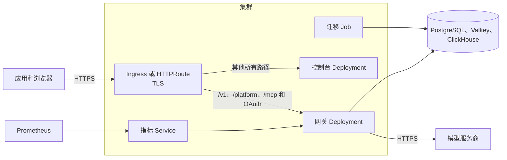

`deploy/helm/kaeso` 中的 Helm chart 在 Kubernetes 集群上运行网关和控制台。每个版本都会把它与镜像一同发布为 `oci://ghcr.io/logicplanes/charts/kaeso`，带有相同的签名来源证明，并固定使用该版本的镜像。



## chart 创建的资源

| 资源 | 说明 |
| --- | --- |
| 网关 Deployment 和 Service | `kaeso-gateway` 镜像，2 个副本，在端口 8080 上通过 `/readyz` 判断就绪、通过 `/healthz` 判断存活。它以非 root 用户运行，根文件系统只读，不带任何 capability，也不允许提权，与 Compose 安装包的运行方式相同 |
| 指标 Service | 只有端口 9100，因此任何 Ingress 或路由都不会触及指标。可选为 Prometheus Operator 创建 `ServiceMonitor` |
| 控制台 Deployment 和 Service | 端口 3000 上的 `kaeso-console` 镜像，只读，并为 Caddy 提供临时目录 |
| 迁移 Job | 作为 Helm hook 运行 `kaeso migrate`，在每次安装和升级到达网关之前执行，使网关永远不会同时迁移 |
| Ingress 或 HTTPRoute | 在同一主机名上，把 API 发往网关，其他所有路径发往控制台 |
| PodDisruptionBudget、HorizontalPodAutoscaler | 同一时间最多有一个网关和一个控制台不可用；可选按 CPU 扩缩网关 |
| Secret `<release>-generated` | chart 生成的主密钥，以及内置数据存储的密码 |
| 内置数据存储 | 可选的 PostgreSQL、ClickHouse 和 Valkey 各一个 StatefulSet，使用 Compose 安装包固定的镜像 |

[更新器](../upgrades.md#更新器)通过 Docker 工作，不属于 chart；Helm 安装通过 `helm upgrade` 更新。

## 开始之前

- Kubernetes 1.30 或更高版本的集群，以及 Helm 3.14 或更高版本。
- 一个 Ingress 控制器或 Gateway API 的实现，以及该域名的证书，例如由 cert-manager 签发。
- PostgreSQL、设置了 `maxmemory-policy noeviction` 的 Valkey 或 Redis，以及在保留[请求日志](../installation.md#选择请求日志的保存方式)时所需的 ClickHouse。生产集群使用托管服务或 operator；内置数据存储仅用于试用。
- 一台 SMTP 服务器（[电子邮件](../email.md)）。

## 安装

1. 把每个数据存储的连接 URL 放入 Secret。网关从那里读取，从不从 chart 的 values 中读取。

   ```bash
   kubectl create namespace kaeso
   kubectl --namespace kaeso create secret generic kaeso-stores \
     --from-literal=postgres='postgres://kaeso:<password>@postgres.example.com:5432/kaeso' \
     --from-literal=clickhouse='https://kaeso:<password>@clickhouse.example.com:8443' \
     --from-literal=valkey='rediss://:<password>@valkey.example.com:6380'
   kubectl --namespace kaeso create secret generic kaeso-smtp --from-literal=password='<password>'
   ```

2. 编写 values：

   ```yaml
   publicUrl: https://kaeso.example.com
   postgres: { existingSecret: kaeso-stores, key: postgres }
   clickhouse: { existingSecret: kaeso-stores, key: clickhouse }
   valkey: { existingSecret: kaeso-stores, key: valkey }
   mail:
     smtp:
       host: smtp.example.com
       user: kaeso@example.com
       from: Kaeso <kaeso@example.com>
       password: { existingSecret: kaeso-smtp, key: password }
   ingress:
     className: nginx
     tls:
       certManager: { issuer: letsencrypt }
   ```

3. 安装 chart：

   ```bash
   helm install kaeso oci://ghcr.io/logicplanes/charts/kaeso --version {{version}} \
     --namespace kaeso --values values.yaml --wait
   ```

4. 输出一次性设置链接并打开它。Helm 也会输出这些命令。

   ```bash
   kubectl --namespace kaeso exec deployment/kaeso-gateway -- kaeso setup-link
   ```

`helm show values oci://ghcr.io/logicplanes/charts/kaeso` 会列出每个值及其作用。chart 会按其 schema 检查 values，因此拼错的值会让安装失败，而不是被忽略。

### 试用 Kaeso

`--set bundled.enabled=true` 会在 release 中各运行一份 PostgreSQL、ClickHouse 和 Valkey，使用 chart 生成的密码。它们没有副本，也没有备份，并以 Compose 安装包赋予的 capability 运行，因此强制执行 restricted Pod 安全标准的命名空间会拒绝它们。使用它们并设置 `mail.transport=log` 时，Kaeso 在集群之外只需要能访问 `publicUrl` 的 Ingress。

## 主密钥

主密钥对静态存储的服务商密钥和其他机密进行加密（[备份和主密钥](../backups.md)）。未设置 `masterKeys.existingSecret` 时，chart 会在首次安装时生成一个，在每次升级时把它保留在 `<release>-generated` 中，并在 `helm uninstall` 时保留该 Secret。请把它复制到密码管理器中：

```bash
kubectl --namespace kaeso get secret kaeso-generated -o jsonpath='{.data.master-keys}' | base64 -d
```

不访问集群就渲染 chart 的工具（例如 Argo CD）看不到上次生成的密钥。请改为提供您自己的 Secret，在 `masterKeys.key` 下放入 `master-key generate` 的输出：

```bash
kubectl --namespace kaeso create secret generic kaeso-master-keys \
  --from-literal=master-keys="$(docker run --rm ghcr.io/logicplanes/kaeso-gateway:{{version}} master-key generate)"
```

网关以 `KAESO_MASTER_KEYS_FILE` 指定的文件读取密钥，从不从环境变量读取。

## 路由和长时间的流

Ingress 把 `/v1`、`/v1beta`、`/v2`、`/platform`、`/mcp`、`/oauth`、`/ingest`、`/.well-known/oauth-authorization-server` 和 `/.well-known/oauth-protected-resource` 发往网关，其他所有路径发往控制台，与 Compose 安装包中的 Caddy 相同。TLS 来自 `ingress.tls.secretName`，或来自 `ingress.tls.certManager.issuer` 中的 cert-manager issuer。

流可能会静默数分钟，图片和音频上传最多 64 MiB。当 `ingress.className` 包含 `nginx` 时，chart 会根据 `ingress.streamTimeoutSeconds` 设置 ingress-nginx 的超时，把请求体上限提高到 64 MiB 并关闭缓冲。其他控制器需在各自的注解中设置相同内容，写在 `ingress.annotations` 下（[长时间的流](../domains-and-tls.md#长时间的流)）。

使用 Gateway API 时，请设置 `httpRoute.enabled`，把 `httpRoute.parentRefs` 指向您的 Gateway，并把 `ingress.enabled` 设为 false。在实现支持的情况下，`httpRoute.timeouts`（例如 `{ request: "0s" }`）会关闭路由的超时。

## 设置

chart 设置由 Kubernetes 决定的部分，其余由您设置：

- `gateway.env` 以变量形式接收[设置](../configuration.md#设置)，例如 `KAESO_CORS_ALLOWED_ORIGINS`；`gateway.extraEnv` 和 `gateway.extraEnvFrom` 以 Kubernetes 自身的形式接收，例如来自 Secret。
- `gateway.config` 以配置文件的形式接收设置，例如 `{ upstream: { request_timeout: 900s } }`。chart 会把它渲染为 TOML 文件，并在其变化时重启网关。
- `gateway.trustedProxies` 指定网关信任其 `X-Forwarded-For` 的网络。默认值涵盖大多数 Pod 网络使用的私有地址段；如需精确，请填写您的 Ingress 控制器所在的 Pod 网络。
- `searchEngines: true` 允许搜索引擎和 AI 爬虫将登录页面编入索引（[搜索引擎](../domains-and-tls.md#搜索引擎)）。chart 会把它传给网关和控制台，并拒绝 `gateway.env` 中的 `KAESO_SEARCH_ENGINES` 和 `gateway.config` 中的 `search_engines`，因为它们只会到达网关。
- `serviceAccount.annotations` 为 Pod 提供云身份，例如 `eks.amazonaws.com/role-arn`。

chart 会把 `KAESO_UPDATES_INSTALLED_WITH` 设为 `helm`，因此控制台的**更新**页面会显示 `helm upgrade`，而不是安装脚本。

## 扩缩

`gateway.replicaCount` 设置网关数量，或由 `gateway.autoscaling.enabled` 按 CPU 在 `minReplicas` 和 `maxReplicas` 之间扩缩。滚动更新会先启动新网关，再停止旧网关。正在停止的网关会在 Service 将其移除期间继续接受连接 `gateway.preStopSeconds` 秒，然后在 `gateway.terminationGracePeriodSeconds`（75 秒）内结束其流（[扩缩](../scaling.md)）。

## 指标

网关在 Service `<release>-gateway-metrics` 的端口 9100 上提供 Prometheus 指标。使用 Prometheus Operator 时，`gateway.metrics.serviceMonitor.enabled` 会创建 `ServiceMonitor`，并带上 `gateway.metrics.serviceMonitor.labels` 中的标签，供应当发现它的 Prometheus 使用（[健康检查和指标](../monitoring.md)）。

## 升级

1. 阅读发布说明，并[备份](../backups.md)数据存储。
2. 升级：

   ```bash
   helm upgrade kaeso oci://ghcr.io/logicplanes/charts/kaeso --version <version> \
     --namespace kaeso --reset-then-reuse-values --wait
   ```

迁移 Job 会先运行一次；它成功后，网关才会滚动更新到新版本，迁移失败的升级不会改变任何内容。如果某个版本的说明要求手动步骤，或者是新的主版本，它还可能要求迁移期间不运行任何旧网关：此时请在升级前用 `kubectl --namespace kaeso scale deployment/kaeso-gateway --replicas 0` 把网关缩到 0。控制台的**更新**页面会说明某个版本是否有此要求（[升级](../upgrades.md)）。

## 卸载

`helm uninstall kaeso --namespace kaeso` 会移除工作负载。它会保留存有主密钥的 Secret `<release>-generated` 以及内置数据存储的卷，因此在该命名空间中再次安装时能找到两者。

## 已验证的内容

CI 会用默认值和内置数据存储的值渲染 chart，并按 Kubernetes 的 schema 检查每个清单。它会在 kind 集群上用内置数据存储和本次变更的镜像安装 chart，打开设置链接，向模拟服务商发送一个请求并在请求日志中找到它，然后在请求持续进行时升级，并检查没有任何请求失败（`e2e/kubernetes`）。chart 尚未在 EKS、GKE 或 AKS 等托管集群上安装过。

## 下一步

- [升级](../upgrades.md)：升级前了解版本带来的变化。
- [扩缩](../scaling.md)：选择网关数量。
- [健康检查和指标](../monitoring.md)：监控网关。
- [备份和主密钥](../backups.md)：妥善保管主密钥和数据存储。
