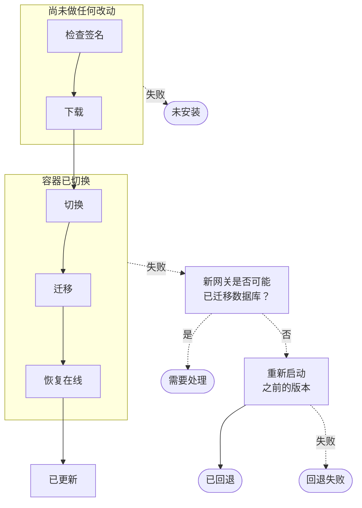

每个版本为 Kaeso 的所有组成部分使用同一个版本号，并遵循语义化版本规范。版本的 `compose.yaml` 把每个镜像固定到版本和摘要。您可以手动更新，这种方式始终可用；也可以通过更新器更新：在控制台中更新，或在您设定的窗口内自动更新。

## 手动更新

1. 阅读发布说明，看是否有需要您处理的事项。发布说明位于[版本页面](https://github.com/logicplanes/kaeso/releases)，以及**实例** › **更新**中。
2. [备份](backups.md) PostgreSQL，以及保存请求日志的 ClickHouse，以便在需要时[回退](#降级)。
3. 在实例文件夹中，把 `version` 设为要更新到的版本，然后下载、检查并启动它。这些命令会把 `compose.yaml` 和 `release.json` 下载到一个临时文件夹，并借助已登录的 [GitHub CLI](https://cli.github.com) 和 `jq` 检查：
   - `release.json` 上 Kaeso Release 工作流的签名；
   - `release.json` 写明的 `compose.yaml` 哈希，进而检查每个 Kaeso 镜像的摘要；
   - `release.json` 写明的版本号。

   只有全部通过后，它们才会把这两个文件移到实例文件夹、拉取镜像并启动。`.env`、`master-keys` 和 `compose.override.yaml` 保持不变。

```bash
version={{version}}
(
  set -euo pipefail
  dir="$(mktemp -d)"
  url="https://github.com/logicplanes/kaeso/releases/download/v$version"
  curl -fsSL -o "$dir/compose.yaml" "$url/compose.yaml"
  curl -fsSL -o "$dir/release.json" "$url/release.json"
  gh attestation verify "$dir/release.json" --repo logicplanes/kaeso \
    --signer-workflow logicplanes/kaeso/.github/workflows/release.yml \
    --source-ref refs/heads/prod
  sum="$(jq -r .compose.sha256 "$dir/release.json")"
  echo "$sum  $dir/compose.yaml" | sha256sum -c -
  jq -e --arg version "$version" '.version == $version' "$dir/release.json"
  mv "$dir/compose.yaml" "$dir/release.json" .
  rmdir "$dir"
  docker compose pull
  docker compose up -d --wait
)
```

这些命令会在第一条失败的命令处停下，实例保持原样。Docker 会按 `compose.yaml` 中的摘要检查拉取的每个镜像。新的网关和控制台都健康后，最后一条命令才会返回；任一不健康时命令失败。

网关启动时会迁移数据库。迁移只会向前、按顺序执行，因此可以跨版本升级。

更新器无法安装某个版本时，控制台会显示带有确切版本号的这些命令。

## 新版本

网关每 5 分钟在 `update.kaeso.app` 上检查一次新版本，失败后 15 分钟再试。如果更新源要求等待更久，网关最多等待一小时。请求中除了网关的版本号，不包含任何关于您实例的信息；版本列表没有变化时，只会得到一个简短的 `304` 应答。

实例管理员在**实例** › **更新**中查看结果。该页面显示正在运行的版本、最新版本及其之后所有版本的说明，以及网关上次检查的时间。

Platform API 的 `instance/updates/check` 会马上检查，即使检查已关闭或更新源要求网关等待。它每分钟最多向更新源请求一次。**更新**旁的**新**标记是唯一的提醒；Kaeso 不会为新版本发送邮件或显示横幅。

| 设置 | 默认值 | 作用 |
| --- | --- | --- |
| **发布渠道** | **稳定版** | **稳定版和预发布版本**还会提供候选版本。运行预发布版本的实例会收到其后的稳定版本。 |
| **更新的安装方式** | **手动** | **自动**会通过更新器在[更新窗口](#自动更新)内安装新版本。 |

在新实例上，这些设置的初始值来自 `KAESO_UPDATES_CHANNEL` 和 `KAESO_UPDATES_MODE`（[配置](configuration.md#更新)）。之后由实例管理员在该页面上修改，实例审计日志会记录每次修改。只有 `KAESO_UPDATES_CHECK` 能让网关停止检查，适用于无法联网的实例。

### 无法联网的实例

在首次启动前，在 `compose.override.yaml` 中关闭网关的出站检查：

```yaml title="compose.override.yaml"
services:
  gateway:
    environment:
      KAESO_UPDATES_CHECK: "false"
      KAESO_KPMR_SYNC: "false"
```

之后网关使用版本内置的模型数据，**更新**页面显示正在运行的版本，您需要手动更新。如果您维护一个与 `update.kaeso.app` 或 GitHub Releases API 响应方式相同的镜像站点，也可以把 `KAESO_UPDATES_RELEASES_URL` 指向它；KPMR 目录的镜像则填入 `KAESO_KPMR_URL`（[KPMR](../concepts/kpmr.md#无法访问互联网时)）。

## 更新器

更新器是 `compose.yaml` 中的可选服务，带有自己的 Docker 套接字代理。它是 Kaeso 中唯一与 Docker 通信的部分，因此在您开启之前一直处于关闭状态。

### 开启更新器

更新器需要 Docker Engine 25 或更高版本。

1. 在实例文件夹中，为网关和更新器设置共享令牌，开启 `updater` profile（配置集），并写明实例文件夹：

```bash
echo "KAESO_UPDATER_TOKEN=$(openssl rand -hex 32)" >> .env
echo "COMPOSE_PROFILES=updater" >> .env
echo "KAESO_DIR=$PWD" >> .env
docker compose up -d --wait
```

2. 在**实例** › **更新**中，现在**更新到 …** 可以更新实例，**自动**则让实例在窗口内自动更新。两者都需要在过去 15 分钟内登录过。

更新器未安装、没有响应或对某个版本来说太旧时，页面会给出提示。Docker 套接字不在 `/var/run/docker.sock` 时（例如 rootless Docker），请在 `.env` 中设置 `DOCKER_SOCKET`。如果 `docker-proxy` 无法启动，且其日志要求设置 `KAESO_DIR`，请按第 1 步添加。

如果不想把令牌放在 `.env` 中，可以把它写进一个文件，作为 [Compose secret](https://docs.docker.com/compose/how-tos/use-secrets/) 交给两个服务。两者都读取 `KAESO_UPDATER_TOKEN_FILE`：

```yaml title="compose.override.yaml"
services:
  gateway:
    environment:
      KAESO_UPDATER_TOKEN_FILE: /run/secrets/updater_token
    secrets: [updater_token]
  updater:
    environment:
      KAESO_UPDATER_TOKEN_FILE: /run/secrets/updater_token
    secrets: [updater_token]
secrets:
  updater_token:
    file: ./updater-token
```

### 更新器会安装哪些版本

版本满足以下所有条件时，更新器会安装它。否则，控制台会显示其发布说明和手动更新的命令。

- 它不是新的主版本。需要手动步骤的迁移总会随新的主版本发布。
- 途经的版本中没有需要手动步骤的版本。当某个版本的 `compose.yaml` 除镜像版本外还有其他变化，或维护者如此标记时，就需要手动步骤。
- 它带有 `release.json`，即更新器读取的已签名清单。

### 从控制台更新

选择**更新到 …**并确认。控制台会逐步跟踪更新，整个过程约需一分钟：

1. **检查版本签名。** 更新器检查该版本和每个镜像是否由 Kaeso 的发布工作流构建。任何一项检查失败，都不会安装任何内容，Kaeso 继续运行。
2. **下载镜像。** 拉取新的网关、控制台和更新器镜像。
3. **切换到新版本。** 先替换控制台，再替换网关，新容器使用新镜像并沿用原有设置。期间由 Caddy 代为响应（[Kaeso 更新期间](#kaeso-更新期间)）。
4. **迁移数据库。** 新网关启动时迁移数据库。更新器最多给它 10 分钟变为健康。
5. **恢复在线。** 更新器把新版本号写入 `compose.yaml`，这样之后运行 `docker compose up -d --wait` 会启动相同的镜像。

更新器运行时不会替换自己，也不会替换 Caddy。下次在实例文件夹中运行 `docker compose up -d --wait` 时会启动它们的新版本。同一时间只运行一个更新，实例审计日志会记录每次更新。

[更新](../development/architecture/updates.md)介绍了更新器如何验证版本和切换容器。

### 自动更新

在**更新的安装方式**下选择**自动**，然后设置更新窗口：**每天**，或**每周**的某一天，再选一个整点。该整点按实例的时区计算（在**常规**中设置），并考虑夏令时。窗口持续一小时，页面会显示下一个窗口何时开始。

在窗口内，如果网关在过去一小时内没有检查过新版本，会先检查一次。然后它更新到更新器会安装的最新版本，与**更新到 …** 完全相同。新的主版本或需要手动步骤的版本会等待您处理。

网关未运行的窗口会直接错过，以下一个窗口为准。历史记录和审计日志会把每次自动更新记录为无人发起。

### 结果

每次更新都会以五种结果之一结束，取决于它停在哪一步：



页面的历史记录显示每次更新的结果：

| 结果 | 含义 |
| --- | --- |
| **已更新** | 新版本正在运行。如果结果说明更新器无法写入 `compose.yaml`，请按[手动更新](#手动更新)中的方法，下载新版本的 `compose.yaml` 覆盖它。 |
| **未安装** | 没有任何变化。 |
| **已回退** | 新版本没有启动，之前的版本重新运行。 |
| **回退失败** | 新版本没有启动，之前的版本也没有。 |
| **需要处理** | 需要有人查看。详情说明了发生了什么以及该怎么做。 |

只要能安全回退，更新器就会自动回退。如果新网关可能已经迁移了数据库后才失败，就无法回退，因为之前的网关无法在迁移后的数据库上运行。此时更新以**需要处理**结束，新网关和新控制台保留，之前的容器以 `kaeso-gateway-1-previous` 和 `kaeso-console-1-previous` 的名称保持停止状态。请选择一种处理方式：

- 用 `docker compose logs gateway` 查明新网关无法启动的原因，修复后按[手动更新](#手动更新)中的方法下载新版本的 `compose.yaml`。
- 或者恢复备份并运行旧版本，见[降级](#降级)。

完成后用 `docker rm` 删除这两个 `…-previous` 容器。只要还有一个存在，更新器就不会开始新的更新。

### 更新器的权限

更新器相当于服务器上的 root。它可以创建容器，而为访问 Docker 套接字以 root 运行的 `docker-proxy` 只检查每个调用的方法和路径，以及绑定挂载的来源。控制了更新器或代理，就控制了服务器。更新器的设计让这种能力尽可能受限：

- 它只在内部网络上响应网关，而且必须带有共享令牌。网关只向它传递一个版本号。
- 它只能通过 `docker-proxy` 访问 Docker，代理只放行更新所需的调用。代理只允许来自 `KAESO_DIR`（即实例文件夹）的绑定挂载，因此移动该文件夹时请修改 `KAESO_DIR`。
- 它只替换自己 Compose 项目中的网关和控制台容器，使用的是它验证过的镜像。
- 如果新容器的特权、capabilities、设备、命名空间、网络、挂载、端口、名称解析、用户组或资源限制与被替换的容器不同，它会拒绝创建。它只按摘要拉取 Kaeso 的镜像。
- 它只修改 `compose.yaml` 中的镜像版本和摘要；如果文件与该版本的原文件有其他差异，它不会改动。

代理无法检查新容器要求什么，例如特权或宿主机设备。它还允许更新器读取任何容器的设置，包括其环境变量中的数据库密码。这些检查只在更新器中进行。没有 `updater` profile（配置集）时，Kaeso 中没有任何部分能访问 Docker。

## Kaeso 更新期间

在更新器切换版本时，或网关、控制台没有响应时，Caddy 会代为响应：

| 请求 | 响应 |
| --- | --- |
| 控制台页面 | 503，并显示一个使用浏览器语言的页面，说明正在发生什么，每 5 秒检查一次，Kaeso 恢复后自动返回 |
| `/platform/v1/*`、`/mcp`、`/oauth/*` 和 `/.well-known/oauth-*` | 503，带有 Platform API 的错误，类型为 `unavailable` |
| `/v1/messages`，以及带 `anthropic-version` 请求头的其他 `/v1/*`，但 `/v1/chat/completions`、`/v1/responses` 和 `/v1/embeddings` 除外 | 529，带有 Anthropic 的 `overloaded_error` |
| 其他 `/v1/*` | 503，带有 OpenAI 的 `service_unavailable_error` |

每个响应都带有 `Retry-After: 30`，OpenAI 和 Anthropic 的 SDK 重试时会遵循它。

## 降级

迁移无法撤销。网关不会在已被较新版本迁移的 PostgreSQL 数据库上启动，并会说明原因。对于已被较新版本迁移的 ClickHouse 数据库，网关能启动，但不写入请求日志，并记录 `ClickHouse migrations failed; request logs are not written`。

要回到较旧的版本：

1. 恢复升级前的 PostgreSQL 备份（[备份](backups.md#恢复-postgresql)）。
2. 如果较新的版本迁移过 ClickHouse，也恢复 ClickHouse。
3. 下载较旧版本的 `compose.yaml`，并用 `docker compose up -d --wait` 启动。

## 下一步

- [备份和主密钥](backups.md)：每次升级前先备份。
- [实例的工作原理](how-it-works.md#保持不变的名称)：了解每个版本都保留的名称，确保升级后能找到数据。
