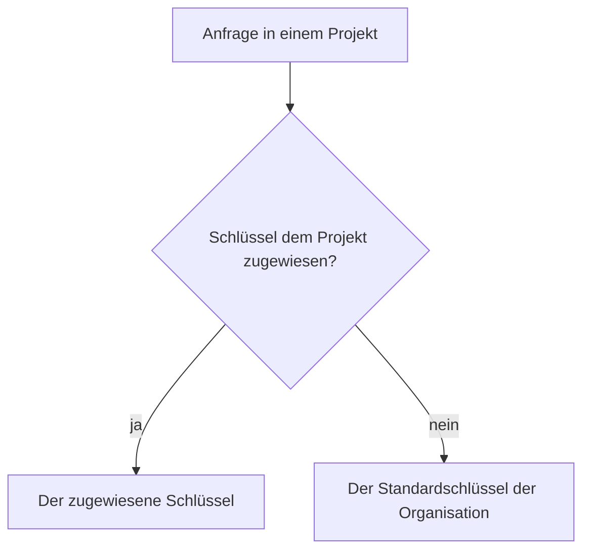

Anbieter-Schlüssel gehören der Organisation. Jedes Projekt nutzt den Standardschlüssel der Organisation für einen Anbieter, sofern ihm kein anderer zugewiesen ist.

## Schlüssel hinzufügen

Auf der Seite **Anbieter** der Organisation **Schlüssel hinzufügen** wählen. Die Anfragen eines Schlüssels zählen gegen die [Ratenlimits](keys-and-limits.md#ratenlimits) des Schlüssels, der sie gesendet hat.

## Schlüssel Projekten zuweisen

Einen Schlüssel den Projekten zuweisen, die ihn nutzen sollen; die anderen behalten den Standard.

