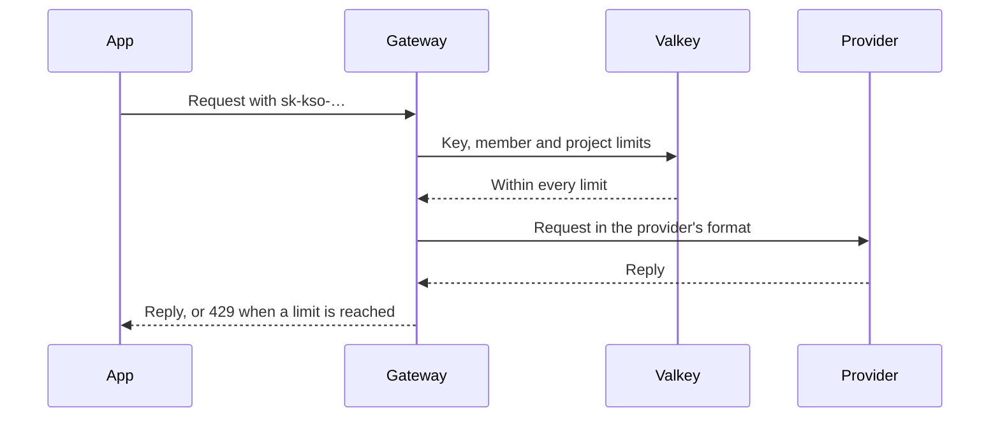

# Keys and limits

Every request to the gateway carries a **key**. A key belongs to a member of a project, acts with that member's rights, and can have _limits_ of its own. Keys that were replaced stay readable as ~~active~~ archived keys.

Use `sk-kso-…` keys only on servers; see [models](../reference/models.md#aliases) for the names a key may call, and [rate limits](#rate-limits) below.

## Create a key

1. Open the project and choose **Keys**.
2. Choose **Create key** and name it after the app that will use it.
   - Pick an expiry: 30, 90 or 365 days.
   - Leave **Models** empty to allow every model of the project.
3. Copy the secret: it is shown once.

```bash
curl https://kaeso.example.com/v1/messages \
  -H "x-api-key: $KAESO_KEY" \
  -H "content-type: application/json" \
  -d '{"model": "claude-haiku-4-5", "max_tokens": 100, "messages": [{"role": "user", "content": "Hello"}]}'
```

> [!NOTE]
> A key's secret is never stored in a readable form. If it is lost, create a new key and archive the old one.

### From an SDK

The official SDKs work unchanged; only the base URL and the key differ.

```python
from anthropic import Anthropic

claude = Anthropic(base_url="https://kaeso.example.com", api_key="sk-kso-…")
claude.messages.create(model="claude-haiku-4-5", max_tokens=100, messages=[{"role": "user", "content": "Hello"}])
```

```ts title="support-bot/src/client.ts"
import OpenAI from "openai";

export const client = new OpenAI({ baseURL: "https://kaeso.example.com/v1", apiKey: process.env.KAESO_KEY });
```

## Limits



Limits apply at three levels, and a request must fit all of them.

| Level   | Requests per minute | Tokens per day | Spend per month | Applies to                                  |
| ------- | ------------------: | -------------: | --------------: | ------------------------------------------- |
| Project |               1,200 |     40,000,000 |       $2,500.00 | Every member and key of the project         |
| Member  |                 300 |     10,000,000 |         $500.00 | Every key the member owns in the project    |
| Key     |                  60 |      1,000,000 |          $50.00 | Requests with this key only                 |

> [!TIP]
> Give each app its own key: its usage and its limits are then its own.

### Rate limits

A request over a rate limit is refused before it reaches the provider, with `429` and a `retry-after` header.

```json
{
  "type": "error",
  "error": { "type": "rate_limit_error", "message": "The key's limit of 60 requests per minute is reached; try again in 12 seconds." }
}
```

> [!IMPORTANT]
> Limits count requests the gateway accepted, streamed ones included.

### Budgets

Budgets are checked before sending, with the price of the model at request time.

> [!WARNING]
> A budget reached mid-month refuses every request of the key until the month ends or the budget grows.

> [!CAUTION]
> Archiving a key can't be undone: apps using it stop at once.

## Checklist

- [x] Create a key for each app
- [x] Set an expiry
- [ ] Add a monthly budget
- [ ] Review the request logs after a week

## Notes

> Keys are cheap; shared keys are expensive to untangle.
>
> — from the operations guide

The request flow, from app to provider:


A long address stays inside the column: https://kaeso.example.com/platform/v1/orgs/org_01jb2xk7e9r3q5w8v4n6m2p0zt/projects/prj_01jb2xk7e9r3q5w8v4n6m2p0zt/keys.

A language without highlighting shows as plain text:

```toml
[gateway]
public_url = "https://kaeso.example.com"
```

---

Next, connect a provider: [Provider keys](provider-keys.md).
