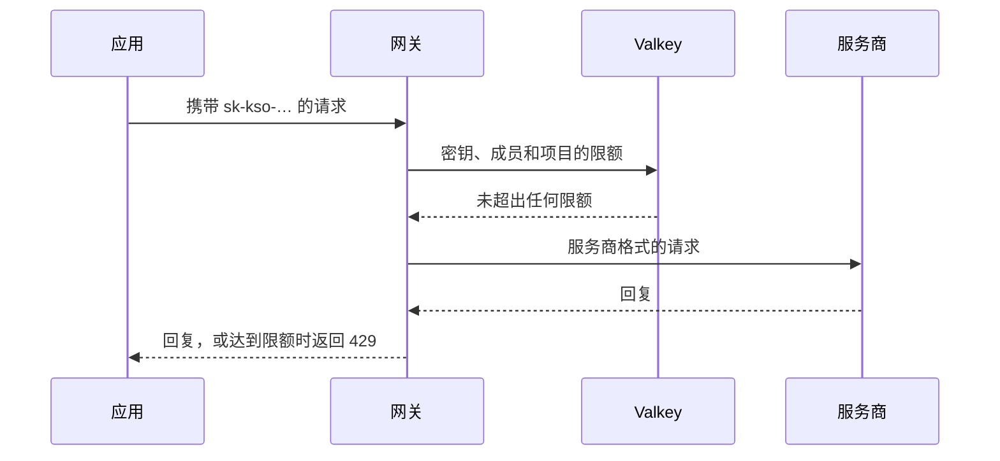
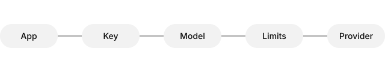

# 密钥和限额

发往网关的每个请求都带有一个**密钥**。密钥属于项目的某个成员，以该成员的权限行事，并可以有自己的_限额_。被替换的密钥会作为~~活跃~~已归档的密钥保留，仍可查看。

`sk-kso-…` 密钥只应在服务器上使用；密钥可以调用哪些名称，请参阅[模型](../reference/models.md#别名)，下文还介绍了[速率限制](#速率限制)。

## 创建密钥

1. 打开项目并选择 **API 密钥**。
2. 选择**创建密钥**，并以使用它的应用命名。
   - 选择有效期：30、90 或 365 天。
   - **模型**留空即允许项目中的所有模型。
3. 复制密钥：它只显示一次。

```bash
curl https://kaeso.example.com/v1/messages \
  -H "x-api-key: $KAESO_KEY" \
  -H "content-type: application/json" \
  -d '{"model": "claude-haiku-4-5", "max_tokens": 100, "messages": [{"role": "user", "content": "你好"}]}'
```

> [!NOTE]
> 密钥从不以可读形式保存。如果丢失，请创建新密钥并归档旧密钥。

### 通过 SDK

官方 SDK 无需修改即可使用，只需更换基础 URL 和密钥。

```python
from anthropic import Anthropic

claude = Anthropic(base_url="https://kaeso.example.com", api_key="sk-kso-…")
claude.messages.create(model="claude-haiku-4-5", max_tokens=100, messages=[{"role": "user", "content": "你好"}])
```

```ts title="support-bot/src/client.ts"
import OpenAI from "openai";

export const client = new OpenAI({ baseURL: "https://kaeso.example.com/v1", apiKey: process.env.KAESO_KEY });
```

## 限额



限额分三个层级，请求必须同时满足所有层级。

| 层级 | 每分钟请求数 | 每天 Token 数 | 每月支出 | 适用于 |
| ---- | ---------: | ----------: | ------: | ------ |
| 项目 | 1,200 | 40,000,000 | $2,500.00 | 项目的每个成员和密钥 |
| 成员 | 300 | 10,000,000 | $500.00 | 该成员在项目中的每个密钥 |
| 密钥 | 60 | 1,000,000 | $50.00 | 仅使用此密钥的请求 |

> [!TIP]
> 为每个应用分配单独的密钥，这样它的用量和限额都只属于它自己。

### 速率限制

超过速率限制的请求会在到达服务商之前被拒绝，返回 `429` 和 `retry-after` 标头。

```json
{
  "type": "error",
  "error": { "type": "rate_limit_error", "message": "The key's limit of 60 requests per minute is reached; try again in 12 seconds." }
}
```

> [!IMPORTANT]
> 限额统计网关接受的请求，包括流式请求。

### 预算

预算在发送前按请求时的模型价格检查。

> [!WARNING]
> 预算在月中用尽后，该密钥的所有请求都会被拒绝，直到月底或预算提高。

> [!CAUTION]
> 归档密钥无法撤销：使用它的应用会立即停止工作。

## 检查清单

- [x] 为每个应用创建密钥
- [x] 设置有效期
- [ ] 添加每月预算
- [ ] 一周后查看请求日志

## 备注

> 密钥很便宜；共享的密钥却很难理清。
>
> ——摘自运维指南

请求从应用到服务商的流程：



长地址不会超出栏宽：https://kaeso.example.com/platform/v1/orgs/org_01jb2xk7e9r3q5w8v4n6m2p0zt/projects/prj_01jb2xk7e9r3q5w8v4n6m2p0zt/keys。

没有语法高亮的语言以纯文本显示：

```toml
[gateway]
public_url = "https://kaeso.example.com"
```

---

下一步，连接服务商：[服务商密钥](provider-keys.md)。
